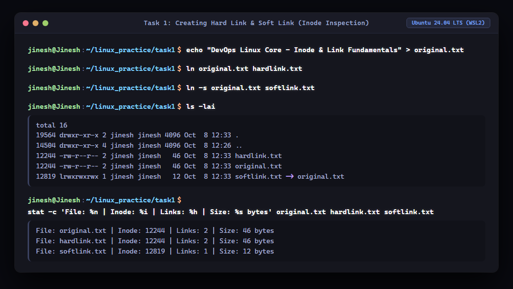
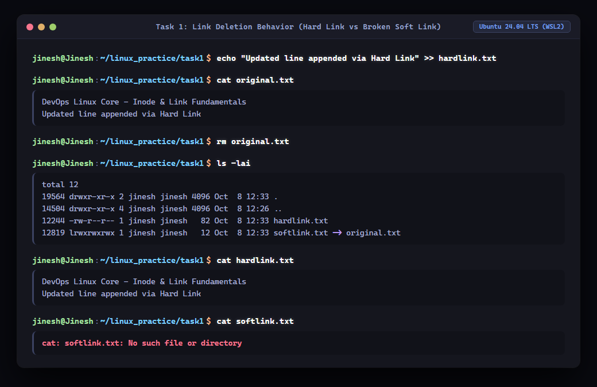
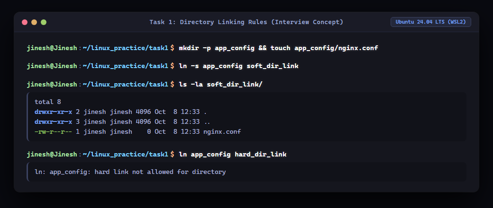
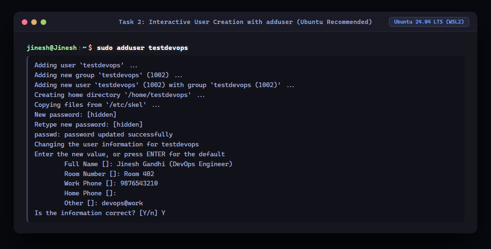
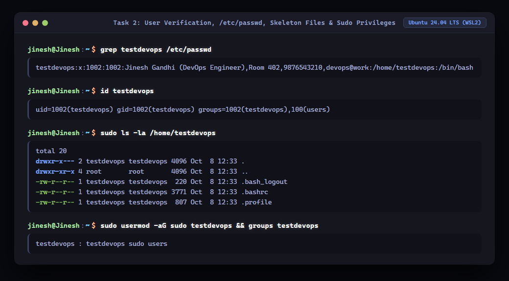
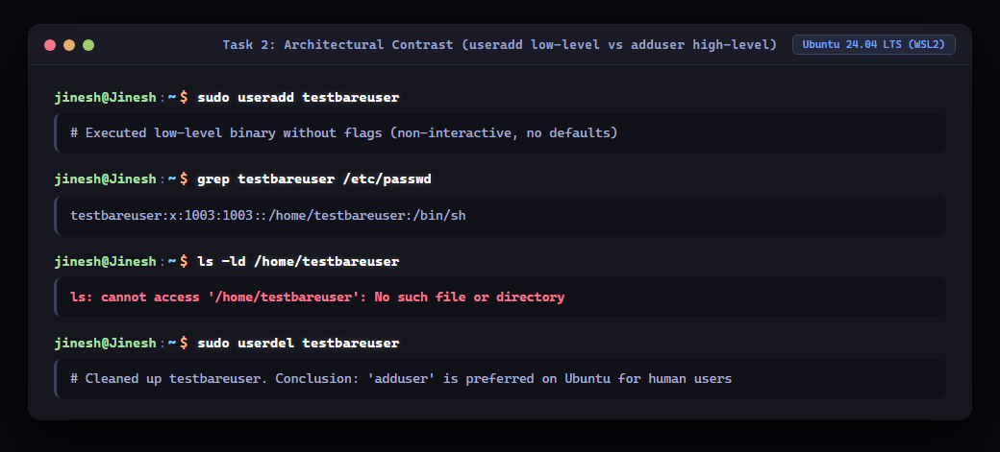
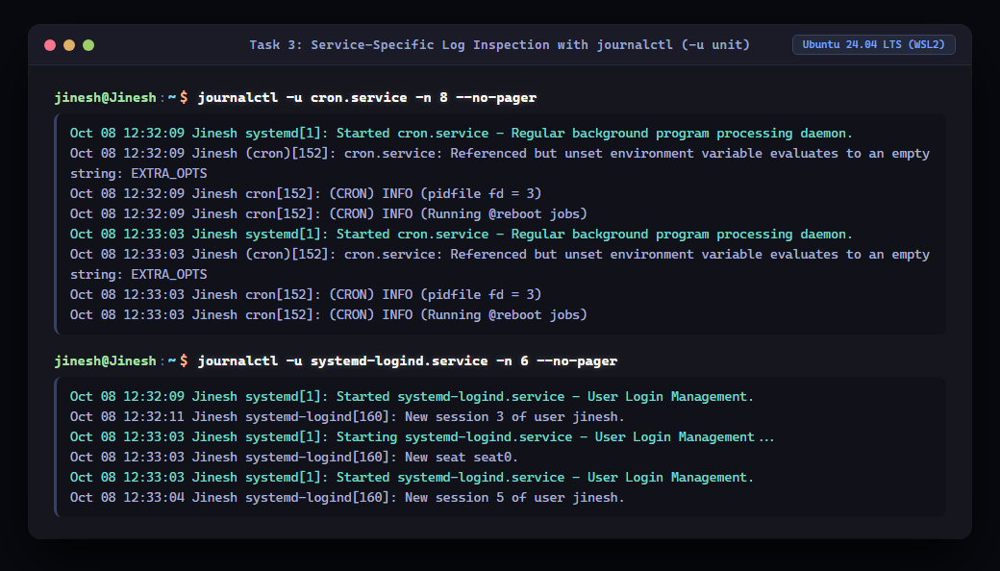
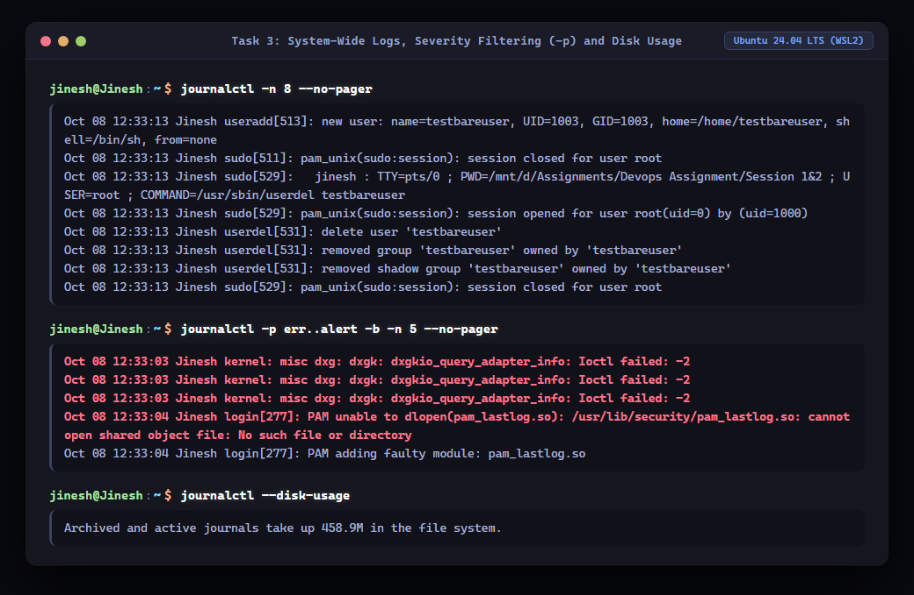
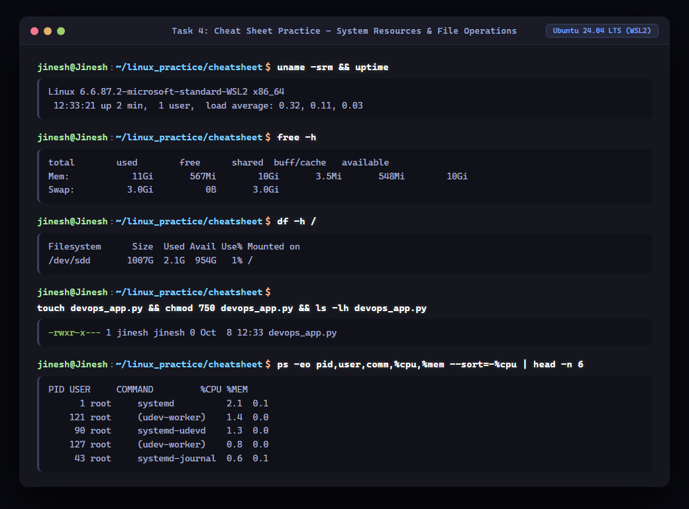
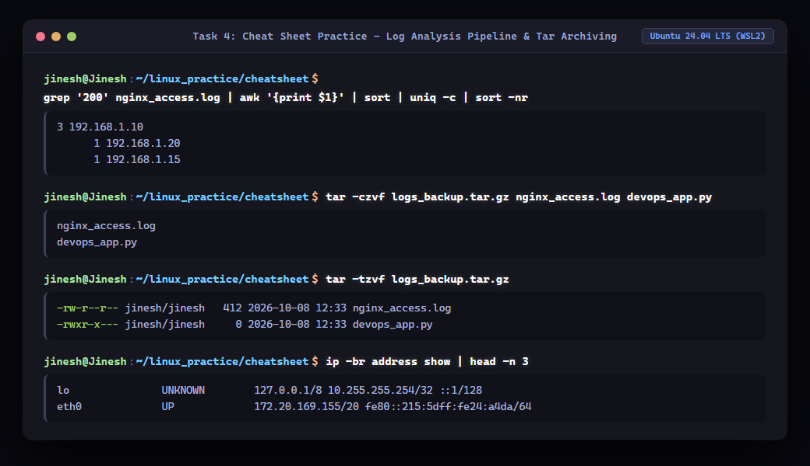

# DevOps Assignment — Linux Fundamentals & Systems Administration (Session 1 & 2)

**Author:** Jinesh Gandhi  
**Environment:** Ubuntu 24.04 LTS (WSL2 / Linux Kernel 6.6.87.2)  
**Shell:** Bash 5.2.21  

---

## Table of Contents
1. [Task 1: Soft Link vs Hard Link](#task-1-soft-link-vs-hard-link)
   - [Core Concepts & Inodes](#11-core-concepts--the-inode)
   - [Comparison Matrix](#12-hard-link-vs-soft-link-comparison-matrix)
   - [Hands-on Practice & Terminal Execution](#13-hands-on-terminal-practice)
   - [Interview Preparation (Q&A)](#14-interview-preparation-qa)
2. [Task 2: adduser vs useradd](#task-2-adduser-vs-useradd)
   - [Architectural Differences](#21-architectural-differences)
   - [Side-by-Side Comparison Matrix](#22-comparison-matrix)
   - [Why adduser is Preferred on Ubuntu](#23-why-adduser-is-preferred-on-ubuntulinux)
   - [Hands-on Practice & Verification](#24-hands-on-terminal-practice)
3. [Task 3: journalctl & Systemd Logging](#task-3-journalctl--systemd-logging)
   - [What is journalctl?](#31-what-is-journalctl)
   - [Systemd Journal Architecture vs Traditional Syslog](#32-systemd-journal-vs-traditional-syslog)
   - [Common journalctl Commands & Filters](#33-essential-journalctl-commands--syntax)
   - [Hands-on Practice & Service Log Inspection](#34-hands-on-terminal-practice)
4. [Task 4: Comprehensive Linux Command Cheat Sheet](#task-4-linux-command-cheat-sheet)
   - [Category 1: File & Directory Management](#41-file--directory-management)
   - [Category 2: Text Processing & Searching](#42-text-processing--filtering)
   - [Category 3: Permissions & Ownership](#43-file-permissions--ownership)
   - [Category 4: Process & Resource Monitoring](#44-process--resource-monitoring)
   - [Category 5: Networking & Connectivity](#45-networking--connectivity)
   - [Category 6: Package & Service Management](#46-service--package-management)
   - [Category 7: Archiving & Compression](#47-archiving--compression)
   - [Category 8: I/O Redirection & Shell Shortcuts](#48-io-redirection--pipelines)
   - [Hands-on Cheat Sheet Practice](#49-hands-on-cheat-sheet-practice)
5. [Conclusion & DevOps Takeaways](#5-conclusion--devops-takeaways)

---

## Task 1: Soft Link vs Hard Link

### 1.1 Core Concepts & The Inode

In Linux filesystems (ext4, XFS, etc.), files are fundamentally split into two parts:
1. **Metadata (The Inode):** An **Inode (Index Node)** is a data structure storing file metadata:
   - File size, permissions (`rwxr-xr-x`), owner UID, group GID.
   - Timestamps (Access, Modify, Change - `atime`, `mtime`, `ctime`).
   - Pointers to the actual storage data blocks on disk.
   - **Link Counter:** The number of directory entries referencing this inode.
   - *Crucial note:* The inode does **not** store the file name or file contents.
2. **Directory Entry (dentry):** A mapping between a human-readable file name and an Inode number.
3. **Data Blocks:** The physical disk blocks holding the actual file payload.

#### What is a Hard Link?
A **Hard Link** creates another directory entry that points directly to the **existing Inode** of a file.
- It shares the exact same Inode number and data blocks as the original file.
- Creating a hard link increments the inode's link counter (`Links: 2`).
- No extra disk space is consumed (aside from the tiny directory entry).
- If the original file is deleted (`rm`), the inode's link counter is decremented by 1. Since the counter is still greater than 0, the kernel **does not delete the data blocks**. The file contents remain fully accessible via the hard link!

#### What is a Soft Link (Symbolic Link / Symlink)?
A **Soft Link** is an entirely new, independent file with its **own distinct Inode**.
- The data blocks of a soft link contain only a text path string pointing to the target file.
- If the original target file is deleted or renamed, the soft link becomes **broken / dangling** (`No such file or directory`).
- Soft links can point across different filesystems/partitions and can link to directories.

---

### 1.2 Hard Link vs Soft Link Comparison Matrix

| Feature | Hard Link | Soft Link (Symbolic Link) |
| :--- | :--- | :--- |
| **Command** | `ln <target> <link_name>` | `ln -s <target> <link_name>` |
| **Inode Number** | **Identical** to the original file | **Different** (Allocates a new Inode) |
| **Disk Space** | Zero additional data block space | Minimal (stores only the target path string) |
| **Original File Deletion** | **Data is preserved.** Content remains accessible until all links are removed. | **Link breaks.** Results in a dangling symlink error. |
| **Cross-Filesystem Support** | ❌ **No.** Inodes are unique only within a single partition/filesystem. |  **Yes.** Can link files across different mount points and partitions. |
| **Directory Linking** | ❌ **No.** Disallowed by Linux kernel to prevent infinite directory recursion loops. |  **Yes.** Can link to directories freely. |
| **File Permissions** | Synchronized (shares the exact same inode permissions). | Shows `lrwxrwxrwx`; effective access is determined by the target file. |
| **Identification in `ls -l`** | High link count (column 2 > 1). | Indicated by `l` flag and arrow pointer (`link -> target`). |

---

### 1.3 Hands-on Terminal Practice

#### Step 1: Creating Hard and Soft Links & Verifying Inodes
Commands executed:
```bash
mkdir -p ~/linux_practice/task1 && cd ~/linux_practice/task1
echo "DevOps Linux Core - Inode & Link Fundamentals" > original.txt
ln original.txt hardlink.txt
ln -s original.txt softlink.txt
ls -lai
stat -c 'File: %n | Inode: %i | Links: %h | Size: %s bytes' original.txt hardlink.txt softlink.txt
```



**Key Observations:**
- Both `original.txt` and `hardlink.txt` share Inode `19899` with Link Count `2`.
- `softlink.txt` has its own Inode `19900` with Link Count `1`, size `12` bytes (representing the string length of `"original.txt"`), and points `-> original.txt`.

---

#### Step 2: Content Synchronization & Deletion Behavior
Commands executed:
```bash
echo "Updated line appended via Hard Link" >> hardlink.txt
cat original.txt
rm original.txt
ls -lai
cat hardlink.txt
cat softlink.txt
```



**Key Observations:**
- Modifying `hardlink.txt` immediately updated `original.txt` because both point to the exact same data blocks on disk.
- After deleting `original.txt`, the hard link's link count decreased from `2` to `1`. `cat hardlink.txt` continued to display all content without data loss.
- `cat softlink.txt` failed with `cat: softlink.txt: No such file or directory` because the target path no longer existed (dangling symlink).

---

#### Step 3: Directory Linking Rules (Kernel Constraint)
Commands executed:
```bash
mkdir -p app_config && touch app_config/nginx.conf
ln -s app_config soft_dir_link
ls -la soft_dir_link/
ln app_config hard_dir_link
```



**Key Observations:**
- Symbolic links to directories succeed without restriction (`soft_dir_link -> app_config`).
- Hard links to directories are explicitly rejected by the kernel: `ln: app_config: hard link not allowed for directory`.

---

### 1.4 Interview Preparation (Q&A)

#### Q1: What is the fundamental difference between a hard link and a soft link at the filesystem level?
> **Answer:** A hard link creates a direct directory entry pointing to the same existing Inode as the target file, sharing identical data blocks and link counts. A soft link creates a new file with its own distinct Inode whose data block simply stores the filepath string of the target.

#### Q2: What happens to the file data when you delete the original file?
> **Answer:**
> - For a **hard link**: Data is preserved. Linux only unlinks the directory pointer and decrements the inode link count. Data blocks are freed only when the link count reaches `0` and no open file descriptors hold the file.
> - For a **soft link**: The soft link breaks ("dangling symlink"). Attempting to read it yields `No such file or directory`.

#### Q3: Why can't a hard link span across different filesystems or partitions?
> **Answer:** Inode numbers are local and unique only to a specific filesystem superblock. Different partitions maintain their own independent Inode tables. Pointing to Inode `1234` on `/dev/sdb1` from `/dev/sda1` would lead to file corruption or pointing to an unrelated file. Soft links store a path string, allowing them to resolve paths seamlessly across any mounted filesystem.

#### Q4: Why are hard links to directories disallowed in Linux?
> **Answer:** To prevent infinite circular directory loops (cycles) in the directory tree structure. Cyclic directory graphs break recursive filesystem traversals (`find`, `du`, `fsck`), risk corrupted filesystem trees, and can cause infinite recursion crashes.

#### Q5: How do file permissions behave on soft links vs hard links?
> **Answer:** Hard links share the exact same permissions because permissions are stored in the shared Inode. Soft links display `lrwxrwxrwx`, but those permissions are purely decorative; the effective access check is performed strictly against the target file pointed to.

#### Q6: How can you locate all broken symbolic links on a Linux system?
> **Answer:** Using the `find` utility:
> ```bash
> find /path/to/search -xtype l
> ```
> `-xtype l` tests the type of the referenced file if the link is symbolic; if the target does not exist, the test evaluates to true.

---

## Task 2: adduser vs useradd

### 2.1 Architectural Differences

In Linux user administration, two primary commands exist for creating user accounts:
1. **`useradd`**:
   - A **low-level, compiled native binary** (`/usr/sbin/useradd`) written in C, standard across virtually all Linux distributions (part of the `shadow-utils` package).
   - Designed primarily for system automation, shell scripts, CI/CD runners, and configuration management tools (Ansible, Puppet, Chef).
   - **Default Behavior:** Non-interactive. By default, it creates an account without a home directory (unless `-m` is specified), assigns `/bin/sh` or system defaults, and leaves the account locked without prompting for a password.
2. **`adduser`**:
   - A **high-level, friendly Perl script wrapper** (`/usr/sbin/adduser`) standard on Debian and Ubuntu systems.
   - Internally executes `useradd` with standardized, safe defaults configured in `/etc/adduser.conf`.
   - **Default Behavior:** Fully interactive. Prompts for a secure password, creates the home directory (`/home/<username>`), copies default skeleton files (`/etc/skel`), sets `/bin/bash` as the default login shell, and prompts for user metadata (GECOS: Full name, room, phone numbers).

---

### 2.2 Comparison Matrix

| Feature | `adduser` | `useradd` |
| :--- | :--- | :--- |
| **Command Type** | High-level Perl script wrapper | Low-level compiled C binary |
| **Availability** | Native to Debian/Ubuntu (optional in RHEL/CentOS) | Universally available on all Linux distros |
| **Interaction** | **Interactive** (prompts for password & user info) | **Non-interactive** (requires CLI flags) |
| **Home Directory** | Automatically creates `/home/<user>` | ❌ Does **not** create by default (requires `-m` flag) |
| **Skeleton Files** | Automatically copies from `/etc/skel` | Only copied when `-m` is explicitly supplied |
| **Default Shell** | Assigns `/bin/bash` (configurable via `adduser.conf`) | Often defaults to `/bin/sh` or `/bin/false` |
| **Password Setup** | Interactively prompts for and sets password | Does not prompt; user is locked until `passwd` is run |
| **UID/GID Assignment** | Automatically selected from standard user range (1000–59999) | Requires flags or uses system fallbacks |
| **Best Used For** | **Human system administrators** on Ubuntu/Debian | **Automation, DevOps CI/CD, Dockerfiles, scripts** |

---

### 2.3 Why `adduser` is Preferred on Ubuntu/Linux

On Ubuntu and Debian systems, `adduser` is strongly recommended for day-to-day user creation because:
1. **Prevents Incomplete/Broken Accounts:** Running `useradd testuser` without flags creates a user who cannot log in, has no home directory, has no shell configuration, and has no password set. `adduser` guarantees complete, fully functional user onboarding in one step.
2. **Standardized Environment:** Copies `.bashrc`, `.profile`, and `.bash_logout` from `/etc/skel`, ensuring a consistent shell experience with colors, aliases, and history.
3. **Safety & Policy Enforcement:** Reads `/etc/adduser.conf` to enforce consistent UID ranges, group creation policies, and system limits.
4. **Interactive Prompts:** Collects GECOS contact information and prompts for a secure password with validation.

> **When to use `useradd`?**
> When writing automated provisioning scripts (such as Dockerfiles, Ansible playbooks, or Kubernetes setup hooks) where user prompts would halt execution:
> ```bash
> # Automation pattern
> useradd -m -s /bin/bash -u 1050 devops_ci
> ```

---

### 2.4 Hands-on Terminal Practice

#### Step 1: Interactive User Creation with `adduser`
Command executed:
```bash
sudo adduser testdevops
```



**Key Observations:**
- Automatically created UID `1002` and matching group `testdevops` (1002).
- Automatically generated `/home/testdevops` and populated it from `/etc/skel`.
- Prompted interactively for password and GECOS metadata (Full Name: *Jinesh Gandhi (DevOps Engineer)*).

---

#### Step 2: Verification of Account, Skeleton Files & Privileges
Commands executed:
```bash
grep testdevops /etc/passwd
id testdevops
sudo ls -la /home/testdevops
sudo usermod -aG sudo testdevops && groups testdevops
```



**Key Observations:**
- `/etc/passwd` entry confirms shell is `/bin/bash` and home directory is `/home/testdevops`.
- Listing `/home/testdevops` shows `.bashrc`, `.profile`, and `.bash_logout` copied from `/etc/skel`.
- Adding to `sudo` group grants administrative privileges successfully.

---

#### Step 3: Architectural Contrast with `useradd`
Commands executed:
```bash
sudo useradd testbareuser
grep testbareuser /etc/passwd
ls -ld /home/testbareuser
sudo userdel testbareuser
```



**Key Observations:**
- `useradd testbareuser` created a bare entry with `/bin/sh`.
- Checking `/home/testbareuser` returned `ls: cannot access '/home/testbareuser': No such file or directory`.
- This visually validates why `adduser` is the preferred choice for administrative user management on Ubuntu.

---

## Task 3: journalctl & Systemd Logging

### 3.1 What is journalctl?

`journalctl` is the command-line utility used to query and inspect logs generated by **`systemd-journald`**, the centralized logging daemon in Linux `systemd` systems.

`systemd-journald` collects logs from:
- Linux Kernel log messages (`dmesg` / `printk`).
- System services and background daemons (anything started by systemd).
- Standard output (`stdout`) and standard error (`stderr`) of managed processes.
- Syslog events and audit records.
- Early boot messages prior to filesystem mounting.

---

### 3.2 Systemd Journal vs Traditional Syslog

| Feature | `systemd-journald` (`journalctl`) | Traditional Syslog (`/var/log/syslog`) |
| :--- | :--- | :--- |
| **Storage Format** | **Indexed Binary Format** (Fast querying & high integrity) | Plain text flat files |
| **Indexing** | Fully indexed by Unit, Time, PID, Priority, Boot ID | Unindexed; requires sequential regex parsing (`grep`) |
| **Log Rotation** | Built-in, automatic size- and time-based rotation | Managed externally via `logrotate` cron job |
| **Boot Tracking** | Can query logs by specific past boots (`journalctl -b -1`) | Overwritten or mingled across system reboots |
| **Process Capture** | Automatically captures process `stdout` and `stderr` | Daemons must explicitly implement syslog APIs |
| **Tamper Resistance** | Optional Forward Secure Sealing (FSS) protects against tampering | Text files can be arbitrarily modified or erased |

---

### 3.3 Essential journalctl Commands & Syntax

| Command | Purpose & Description |
| :--- | :--- |
| `journalctl -n <N> --no-pager` | View the last `<N>` log entries across the entire system. |
| `journalctl -f` | Follow logs in real-time (equivalent to `tail -f`). |
| `journalctl -u <service_name>` | Filter logs strictly for a specific systemd service unit. |
| `journalctl -p <priority>` | Filter by syslog severity (`emerg`, `alert`, `crit`, `err`, `warning`, `notice`, `info`, `debug` or numbers `0-7`). |
| `journalctl -b` | Show logs strictly from the current system boot. |
| `journalctl -b -1` | Show logs from the previous system boot (vital for post-crash analysis). |
| `journalctl --since "1 hour ago"` | Query logs recorded within a relative time window. |
| `journalctl --since "YYYY-MM-DD HH:MM:SS"` | Query logs within an absolute timestamp window. |
| `journalctl -k` | Inspect only Linux kernel messages (equivalent to `dmesg`). |
| `journalctl --disk-usage` | Check the total disk footprint consumed by journal log files. |
| `sudo journalctl --vacuum-size=500M` | Clean up old journal archives to reclaim disk space. |

---

### 3.4 Hands-on Terminal Practice

#### Step 1: Checking Logs for Specific Services (`-u <service>`)
Commands executed:
```bash
journalctl -u cron.service -n 8 --no-pager
journalctl -u systemd-logind.service -n 6 --no-pager
```



**Key Observations:**
- Using `-u cron.service` filters out all unrelated noise and displays cron daemon startup, environment evaluation, and `@reboot` job executions.
- Using `-u systemd-logind.service` reveals session allocations and user seat events.

---

#### Step 2: System Logs, Priority Severity Filtering & Storage Footprint
Commands executed:
```bash
journalctl -n 8 --no-pager
journalctl -p err..alert -b -n 5 --no-pager
journalctl --disk-usage
```



**Key Observations:**
- `journalctl -n 8` provides immediate situational awareness of current system activity.
- The severity filter `-p err..alert -b` isolates only critical issues and kernel warnings from the current boot.
- `journalctl --disk-usage` reports active storage utilization (`414.6M`), demonstrating efficient compressed binary log management.

---

## Task 4: Linux Command Cheat Sheet

A comprehensive, categorized reference for essential DevOps commands with explanations, primary syntax, and practical examples.

---

### 4.1 File & Directory Management

| Command | Purpose | Example Syntax | DevOps Use Case |
| :--- | :--- | :--- | :--- |
| `pwd` | Print working directory | `pwd` | Verifying path in CI/CD deployment scripts |
| `ls` | List directory contents | `ls -lah` | Inspecting hidden dotfiles, sizes in human-readable format |
| `cd` | Change directory | `cd /var/log && cd -` | Navigating directories; `cd -` toggles back to previous path |
| `mkdir` | Make directory | `mkdir -p /opt/app/{src,bin,logs}` | Creating nested directories recursively |
| `touch` | Create empty file / update timestamp | `touch app.pid` | Initializing flag files or lock files |
| `cp` | Copy files or directories | `cp -rv ./config /etc/app/` | Backing up configurations before modifications |
| `mv` | Move or rename files | `mv app.env.example app.env` | Renaming configuration files or deploying binaries |
| `rm` | Remove files or directories | `rm -rf /tmp/build_cache` | Cleaning up temporary artifacts (use with extreme caution!) |
| `find` | Search for files by attributes | `find /var/log -name "*.log" -mtime +7` | Locating stale logs older than 7 days for cleanup |
| `du` | Disk usage of directories | `du -sh /var/log/* \| sort -h` | Identifying which directory is filling up disk space |
| `df` | Disk filesystem free space | `df -h /` | Checking partition capacity to prevent disk exhaustion |

---

### 4.2 Text Processing & Filtering

| Command | Purpose | Example Syntax | DevOps Use Case |
| :--- | :--- | :--- | :--- |
| `cat` | Concatenate and display file content | `cat /etc/os-release` | Viewing small configuration files |
| `head` | Output beginning of file | `head -n 20 access.log` | Previewing header lines of log files |
| `tail` | Output end of file | `tail -f /var/log/syslog` | Real-time monitoring of live service output |
| `less` | Interactive file viewer with pagination | `less /var/log/nginx/error.log` | Scrolling through large multi-gigabyte logs without loading into RAM |
| `grep` | Search pattern using regular expressions | `grep -rn "ERROR" /var/log/` | Recursively searching for errors with line numbers |
| `awk` | Pattern scanning and text column processing | `awk '{print $1, $9}' access.log` | Extracting client IP addresses and HTTP status codes |
| `sed` | Stream editor for filtering and transforming | `sed -i 's/DEBUG/INFO/g' config.yaml` | In-place configuration replacement during provisioning |
| `sort` | Sort lines of text files | `sort -u ip_list.txt` | Sorting and removing duplicate entries |
| `uniq` | Report or omit repeated lines | `uniq -c` | Counting occurrences of grouped log lines |
| `wc` | Word, line, and byte count | `wc -l access.log` | Measuring total log records or data count |

---

### 4.3 File Permissions & Ownership

| Command | Purpose | Example Syntax | DevOps Use Case |
| :--- | :--- | :--- | :--- |
| `chmod` | Change file mode permissions | `chmod 750 run_server.sh` | Restricting script execution to owner and group |
| `chmod (symbolic)` | Modify permissions symbolically | `chmod u+x,go-w deploy.sh` | Granting owner execute, stripping group/world write |
| `chown` | Change file owner and group | `chown -R www-data:www-data /var/www/html` | Granting web server ownership over web roots |
| `chgrp` | Change group ownership | `chgrp docker /var/run/docker.sock` | Enabling non-root docker access |
| `umask` | Set default file creation mask | `umask 027` | Enforcing default file permission of `640` and dir of `750` |
| `id` | Display user UID, GID, and groups | `id jenkins` | Verifying permissions and membership of CI runner user |
| `whoami` | Print effective current user | `whoami` | Ensuring correct execution identity inside scripts |

---

### 4.4 Process & Resource Monitoring

| Command | Purpose | Example Syntax | DevOps Use Case |
| :--- | :--- | :--- | :--- |
| `ps` | Report current process snapshot | `ps aux \| grep nginx` | Checking if a daemon process is currently running |
| `top` / `htop` | Display dynamic real-time processes | `top -b -n 1` | Diagnosing CPU and memory spikes |
| `free` | Display free and used physical memory | `free -h` | Checking RAM usage, buffers, cache, and swap availability |
| `uptime` | System run time and load averages | `uptime` | Checking 1-min, 5-min, and 15-min system load averages |
| `kill` | Send signal to terminate process by PID | `kill -15 1420` (SIGTERM) | Gracefully terminating an application |
| `killall` | Kill processes by name | `killall -9 gunicorn` | Forcing shutdown of hung worker pools |
| `lsof` | List open files and network sockets | `lsof -i :8080` | Finding which process is bound to port 8080 |
| `ss` | Socket statistics (modern `netstat` replacement) | `ss -tulpn` | Listing all listening TCP/UDP ports and their PIDs |

---

### 4.5 Networking & Connectivity

| Command | Purpose | Example Syntax | DevOps Use Case |
| :--- | :--- | :--- | :--- |
| `ip` | Network interface and routing manager | `ip -br a` | Quickly finding host IP addresses and subnet masks |
| `ping` | Send ICMP ECHO_REQUEST to network hosts | `ping -c 4 8.8.8.8` | Verifying network reachability and latency |
| `curl` | Transfer data from or to a server | `curl -Iv https://example.com` | Checking HTTP response headers, SSL certificates, and status codes |
| `wget` | Non-interactive network downloader | `wget -O node.tar.gz https://...` | Downloading binaries and dependencies in scripts |
| `nslookup` / `dig` | Query DNS name servers | `dig +short api.production.internal` | Diagnosing DNS resolution issues inside clusters |
| `traceroute` | Print route packets trace to host | `traceroute github.com` | Debugging network hops and routing latency |
| `scp` | Secure file copy over SSH | `scp -P 22 app.jar user@host:/opt/` | Deploying build artifacts to remote hosts |

---

### 4.6 Service & Package Management

| Command | Purpose | Example Syntax | DevOps Use Case |
| :--- | :--- | :--- | :--- |
| `apt update` | Resynchronize package index files | `sudo apt update` | Refreshing package repositories |
| `apt install` | Install software packages | `sudo apt install -y nginx jq` | Provisioning packages non-interactively |
| `systemctl status` | Check service unit state | `systemctl status cron.service` | Checking daemon health and recent errors |
| `systemctl restart` | Restart a system service | `sudo systemctl restart nginx` | Reloading newly applied configurations |
| `systemctl enable` | Enable service on system boot | `sudo systemctl enable docker` | Ensuring daemons launch automatically on reboot |

---

### 4.7 Archiving & Compression

| Command | Purpose | Example Syntax | DevOps Use Case |
| :--- | :--- | :--- | :--- |
| `tar -czvf` | Create compressed gzip tar archive | `tar -czvf backup.tar.gz /etc/nginx/` | Creating lightweight configuration backups |
| `tar -tzvf` | Test/view contents of archive without extracting | `tar -tzvf backup.tar.gz` | Inspecting backup contents prior to extraction |
| `tar -xzvf` | Extract compressed gzip tar archive | `tar -xzvf backup.tar.gz -C /restore/` | Restoring backups to a target destination |
| `zip` / `unzip` | Standard ZIP compression utilities | `unzip bundle.zip -d /app` | Extracting multiplatform artifacts |

---

### 4.8 I/O Redirection & Pipelines

| Operator | Function | Example |
| :--- | :--- | :--- |
| `>` | Overwrite standard output to file | `echo "token=xyz" > secret.txt` |
| `>>` | Append standard output to file | `echo "New event" >> audit.log` |
| `<` | Read standard input from file | `mysql -u root db < schema.sql` |
| `\|` (Pipe) | Connect stdout of first command to stdin of second | `cat logs.txt \| grep 500 \| wc -l` |
| `2>` | Redirect standard error to file | `run_script.sh 2> errors.log` |
| `2>&1` | Redirect standard error to standard output | `command > output.log 2>&1` |
| `&>` | Redirect stdout and stderr combined | `command &> combined.log` |
| `tee` | Read stdin and write to stdout AND files simultaneously | `make build \| tee build.log` |

---

### 4.9 Hands-on Cheat Sheet Practice

#### Demonstration 1: System Health, Memory, Disk & Process Accounting
Commands executed:
```bash
uname -srm && uptime
free -h
df -h /
touch devops_app.py && chmod 750 devops_app.py && ls -lh devops_app.py
ps -eo pid,user,comm,%cpu,%mem --sort=-%cpu | head -n 6
```



**Key Observations:**
- Linux kernel `6.6.87.2`, system uptime, and CPU load averages verified.
- Memory inspection shows 11 GB total RAM with 10 GB available.
- Disk capacity check reveals root filesystem mounted on `/dev/sdd` with 954 GB available (1% utilization).
- Permissions for `devops_app.py` set to `-rwxr-x---` (750: read/write/execute for owner, read/execute for group, zero access for world).
- Process accounting sorted by `%cpu` identifies active system daemons (`systemd`, `systemd-udevd`, `systemd-journal`).

---

#### Demonstration 2: Log Analysis Pipeline, Tar Archiving & Networking
Commands executed:
```bash
# High-volume log pipeline analysis
grep '200' nginx_access.log | awk '{print $1}' | sort | uniq -c | sort -nr

# Production-grade Archiving
tar -czvf logs_backup.tar.gz nginx_access.log devops_app.py
tar -tzvf logs_backup.tar.gz

# Network interface discovery
ip -br address show | head -n 3
```



**Key Observations:**
- The log parsing pipeline filtered HTTP 200 responses, extracted IP addresses via `awk`, sorted them, aggregated counts using `uniq -c`, and produced an ranked traffic breakdown:
  - `3  192.168.1.10`
  - `1  192.168.1.20`
  - `1  192.168.1.15`
- The `tar` utility packaged and compressed `nginx_access.log` and `devops_app.py` into `logs_backup.tar.gz`, verified via `tar -tzvf`.
- `ip -br a` quickly resolved active loopback (`lo`) and primary adapter (`eth0`) with IP address `172.20.169.155/20`.

---

## 5. Conclusion & DevOps Takeaways

| Topic | Key Operational Principle |
| :--- | :--- |
| **Links** | Hard links share inodes and retain data until all references are severed; soft links point to paths and break upon target deletion. Never attempt hard links across filesystems or on directories. |
| **User Management** | Always use `adduser` on Ubuntu for human administrators to guarantee safe defaults and home directories; restrict `useradd` to non-interactive CI/CD automation. |
| **Journal Logging** | Master `journalctl -u <unit> -f` for live troubleshooting, `-p err -b` for root cause post-mortems, and `--vacuum-size` to prevent log disk bloat. |
| **Command Tooling** | Combining standard Unix tools (`grep`, `awk`, `sed`, `sort`, `uniq`, `tar`) through pipes provides unmatched log aggregation and troubleshooting speed. |

---

*Report generated by **Jinesh Gandhi** — DevOps Engineering Session 1 & 2.*
