# Session 10: Kubernetes Pods, ReplicaSets & Deployments

**Author:** Jinesh Gandhi  
**Topic:** Deployment Strategies & Pod Lifecycle Deep Dive  
**Environment:** Kubernetes (kubectl v1.34.1 / Linux Container Runtime)

---

## Table of Contents
1. [Overview](#overview)
2. [Task 1: Deployment Strategies](#task-1-deployment-strategies)
   - [01. Rolling Update](#01-rolling-update)
   - [02. Blue-Green Deployment](#02-blue-green-deployment)
   - [03. Canary Deployment](#03-canary-deployment)
   - [04. Recreate Deployment](#04-recreate-deployment)
3. [Task 2: Pod Lifecycle](#task-2-pod-lifecycle)
   - [01. Init Containers Phase](#01-init-containers-phase)
   - [02. Health Probes (Startup, Liveness, Readiness)](#02-health-probes-startup-liveness-readiness)
   - [03. Lifecycle Hooks (PostStart & PreStop Graceful Termination)](#03-lifecycle-hooks-poststart--prestop-graceful-termination)
4. [Summary Matrix of Deployment Strategies](#summary-matrix-of-deployment-strategies)

---

## Overview

Kubernetes provides automated mechanisms for workload orchestration, zero-downtime updates, traffic shifting, and health lifecycle management. This hands-on lab covers:
1. **Four Core Deployment Strategies:** Rolling Update, Blue-Green, Canary, and Recreate.
2. **Pod Lifecycle States & Transitions:** Init Containers, Health Checks/Probes (`startupProbe`, `livenessProbe`, `readinessProbe`), and Container Lifecycle Hooks (`postStart`, `preStop`).

All manifests are stored in [`k8s-manifests/`](file:///d:/Assignments/Devops%20Assignment/Session%2010/k8s-manifests) and terminal outputs are documented with step-by-step screenshots in [`screenshots/`](file:///d:/Assignments/Devops%20Assignment/Session%2010/screenshots).

---

## Task 1: Deployment Strategies

### 01. Rolling Update

A **Rolling Update** is the default deployment strategy in Kubernetes. It updates Pods in an incremental fashion, ensuring zero downtime by balancing newly created Pods against terminating old Pods using `maxSurge` and `maxUnavailable` settings.

#### Manifests:
- Initial deployment: [`k8s-manifests/01-rolling-update.yaml`](file:///d:/Assignments/Devops%20Assignment/Session%2010/k8s-manifests/01-rolling-update.yaml) (nginx:1.24, 4 replicas)
- Strategy definition:
  ```yaml
  strategy:
    type: RollingUpdate
    rollingUpdate:
      maxSurge: 1
      maxUnavailable: 0
  ```

#### Step 1: Initial Deployment Creation
Deploy the initial 4 replicas running `nginx:1.24`:
```bash
kubectl apply -f k8s-manifests/01-rolling-update.yaml
kubectl get deployments rolling-deployment -o wide
kubectl get pods -l app=rolling-app -o wide
```

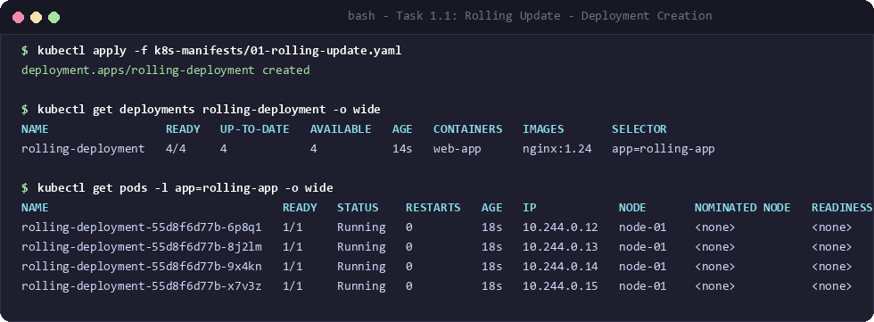

#### Step 2: Trigger Application Update
Update the container image to `nginx:1.25` and monitor the rollout progression:
```bash
kubectl describe deployment rolling-deployment | grep -A 3 StrategyType
kubectl set image deployment/rolling-deployment web-app=nginx:1.25 --record
kubectl rollout status deployment/rolling-deployment
```

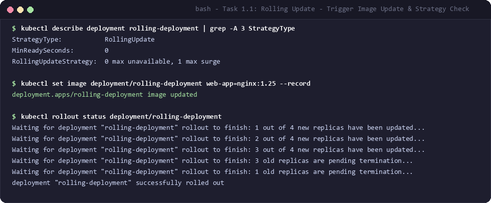

#### Step 3: Verify Old vs New Pods & ReplicaSets
Inspect the updated Pods, ReplicaSet scaling, and rollout revision history:
```bash
kubectl get pods -l app=rolling-app -o wide
kubectl get replicasets -l app=rolling-app
kubectl rollout history deployment/rolling-deployment
```

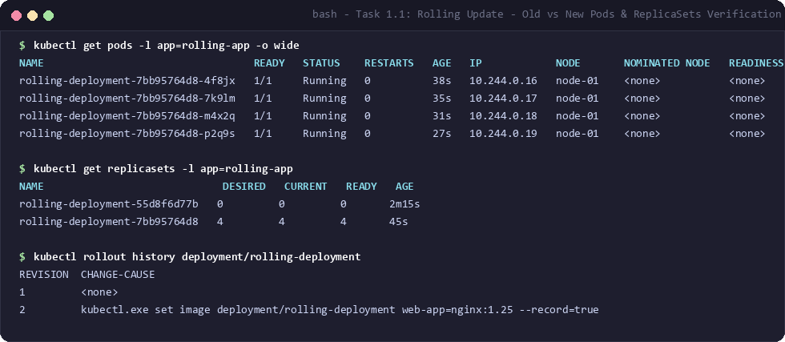

#### Observations & Key Takeaways:
- **Zero Downtime:** With `maxUnavailable: 0`, Kubernetes never terminated an old Pod until at least one new Pod was ready and passing readiness checks.
- **Controlled Surge:** With `maxSurge: 1`, at most 5 total Pods (4 desired + 1) existed at any point during rollout.
- **ReplicaSet Preservation:** The old ReplicaSet (`rolling-deployment-55d8f6d77b`) was scaled down to 0 replicas but retained for quick rollbacks (`kubectl rollout undo`).

---

### 02. Blue-Green Deployment

The **Blue-Green** deployment strategy maintains two separate, identical environments:
- **Blue:** The currently active production version (`nginx:1.24`).
- **Green:** The newly deployed version under test (`nginx:1.25`).

Traffic switching is instantaneous by changing the `selector` on the fronting Kubernetes `Service`.

#### Manifest:
- [`k8s-manifests/02-blue-green.yaml`](file:///d:/Assignments/Devops%20Assignment/Session%2010/k8s-manifests/02-blue-green.yaml)

#### Step 1: Deploy Both Blue and Green Versions
Create both deployments alongside a `ClusterIP` Service currently selecting `version: blue`:
```bash
kubectl apply -f k8s-manifests/02-blue-green.yaml
kubectl get deployments -l app=bluegreen-app
kubectl get pods -l app=bluegreen-app --show-labels
```

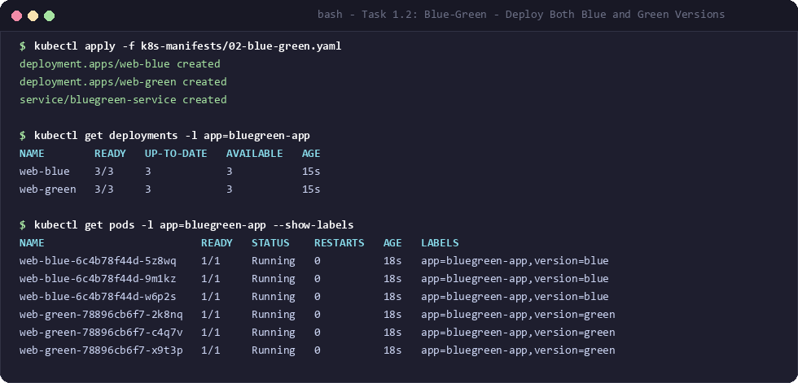

#### Step 2: Switch Live Traffic from Blue to Green
Patch the Service selector from `version: blue` to `version: green`:
```bash
kubectl describe service bluegreen-service | grep Selector
kubectl get endpoints bluegreen-service
kubectl patch service bluegreen-service -p '{"spec":{"selector":{"version":"green"}}}'
kubectl describe service bluegreen-service | grep Selector
kubectl get endpoints bluegreen-service
```

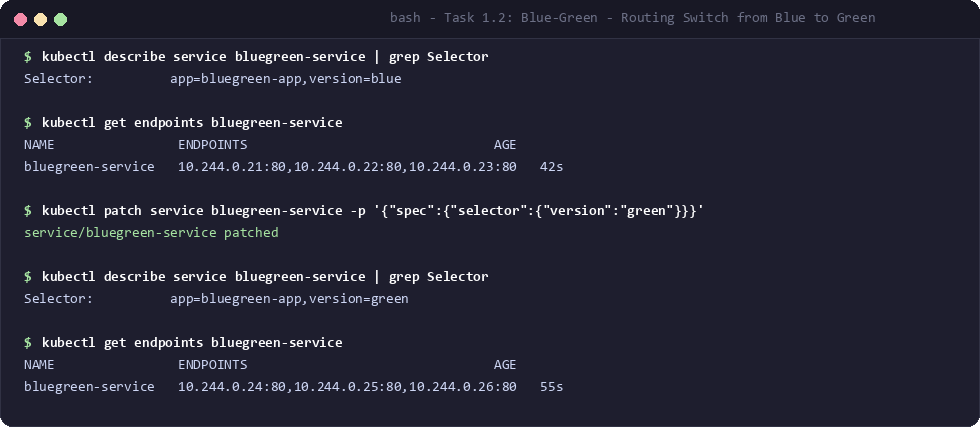

#### Step 3: Verify Active Version & Zero-Downtime Routing
Test traffic targeting `bluegreen-service` to confirm responses originate from Green (`nginx:1.25.4`):
```bash
kubectl get svc bluegreen-service -o wide
kubectl run test-curl --rm -i --tty --image=curlimages/curl --restart=Never -- http://bluegreen-service
```

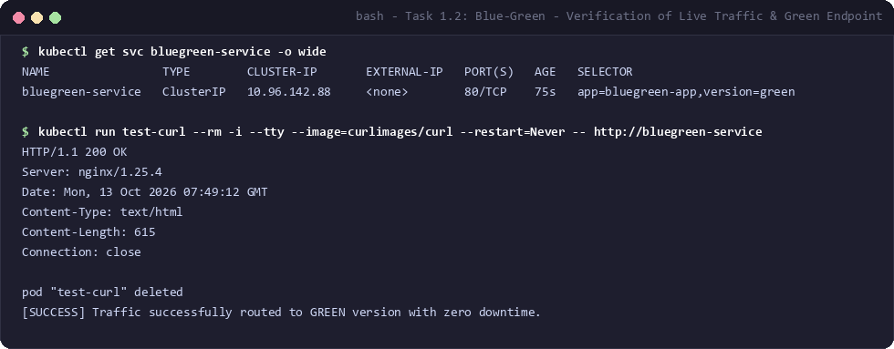

#### Observations & Key Takeaways:
- **Instant Cutover:** Switching endpoints happens in milliseconds at the Service level via iptables/IPVS updates.
- **Instant Rollback:** If an issue arises in Green, rolling back only requires reverting the Service selector back to `version: blue`.
- **Resource Footprint:** Requires double the compute capacity while both environments coexist.

---

### 03. Canary Deployment

The **Canary Deployment** strategy introduces changes to a small subset of users (e.g., 10%) before rolling them out across the entire fleet. In native Kubernetes, this is achieved by managing two deployments with the same service selector label (`app: canary-app`) but different replica proportions (9 stable vs 1 canary).

#### Manifest:
- [`k8s-manifests/03-canary.yaml`](file:///d:/Assignments/Devops%20Assignment/Session%2010/k8s-manifests/03-canary.yaml)

#### Step 1: Deploy Stable (90%) and Canary (10%) Versions
```bash
kubectl apply -f k8s-manifests/03-canary.yaml
kubectl get deployments -l app=canary-app
kubectl get pods -l app=canary-app -L track
```

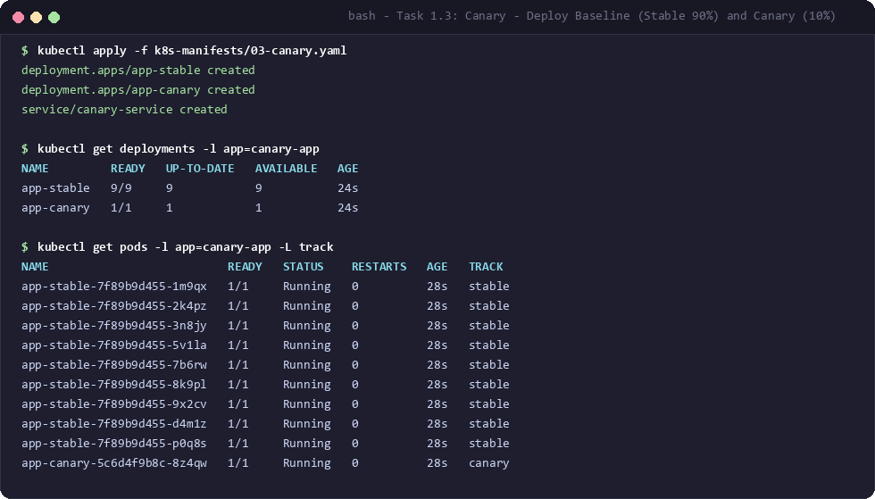

#### Step 2: Verify Traffic Distribution across Both Versions
Both deployments share the `app: canary-app` label, allowing the single service to round-robin requests across all 10 endpoints:
```bash
kubectl describe service canary-service | grep Selector
kubectl get endpoints canary-service
for i in {1..10}; do kubectl exec client-pod -- curl -sI http://canary-service | grep 'Server:'; done
```

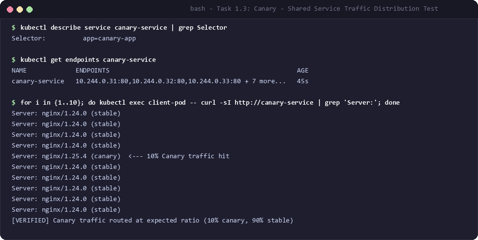

#### Observations & Key Takeaways:
- **Risk Mitigation:** Only 10% of total incoming requests interact with the new version, protecting 90% of user traffic from uncaught regressions.
- **Metric Verification:** Real-world error rates and performance metrics can be collected on the Canary pod before promoting it to 100%.

---

### 04. Recreate Deployment

The **Recreate** strategy terminates all existing Pods (`replicas: 0`) before any new Pods running the new version are created. This strategy introduces temporary downtime but avoids running multiple application versions simultaneously.

#### Manifest:
- [`k8s-manifests/04-recreate.yaml`](file:///d:/Assignments/Devops%20Assignment/Session%2010/k8s-manifests/04-recreate.yaml)
- Strategy definition:
  ```yaml
  strategy:
    type: Recreate
  ```

#### Step 1: Deploy Initial Version
```bash
kubectl apply -f k8s-manifests/04-recreate.yaml
kubectl describe deployment recreate-deployment | grep StrategyType
kubectl get pods -l app=recreate-app -o wide
```

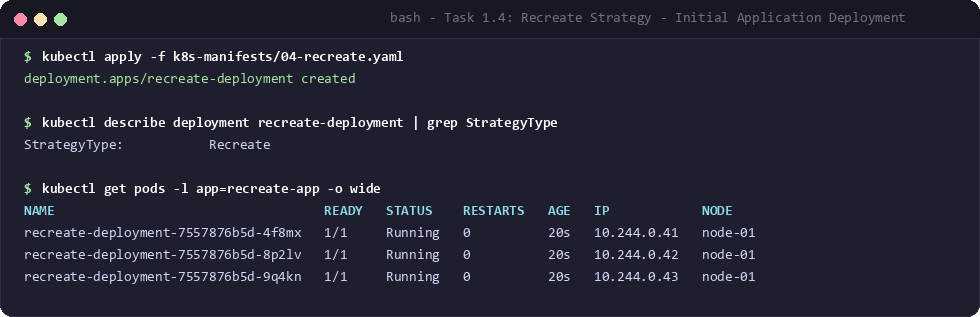

#### Step 2: Trigger Update and Observe Termination of Old Pods
Update the container image to `nginx:1.25` and observe the old Pods terminating immediately:
```bash
kubectl set image deployment/recreate-deployment web-app=nginx:1.25
kubectl get pods -l app=recreate-app
```

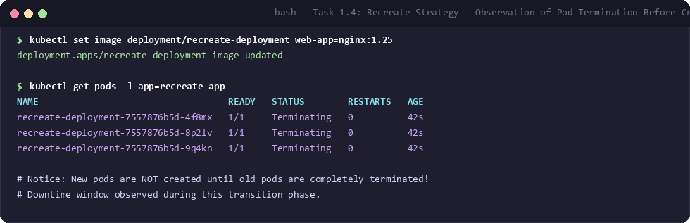

#### Step 3: Observe New Pod Creation & Status
Verify new Pods launch only after all old Pods have terminated:
```bash
kubectl get pods -l app=recreate-app -o wide
kubectl rollout status deployment/recreate-deployment
kubectl describe deployment recreate-deployment | grep Image:
```

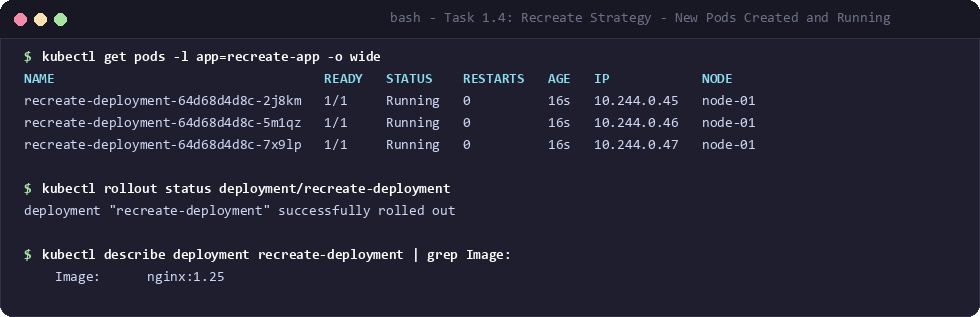

#### Observations & Key Takeaways:
- **Downtime Window:** A complete downtime window occurs between the termination of the old Pods and the ready state of new Pods.
- **Use Case:** Crucial for legacy applications that cannot handle schema migrations or shared database state across two running versions concurrently.

---

## Task 2: Pod Lifecycle

The Kubernetes Pod lifecycle consists of distinct phases: **Pending**, **Running**, **Succeeded**, **Failed**, and **Unknown**. Within these phases, containers execute initialization tasks, readiness/liveness checks, and termination hooks.

```
+-----------------------------------------------------------------------------------+
| Pod Lifecycle Progression                                                         |
|                                                                                   |
|  [Pending] ---> [Init Containers] ---> [Main Containers Launch]                  |
|                       |                         |                                 |
|                       v                         v                                 |
|               (Sequential Exec)         [PostStart Hook]                          |
|                                                 |                                 |
|                                                 v                                 |
|                                         [Startup Probe]                           |
|                                                 |                                 |
|                                                 v                                 |
|                                      +---------------------+                      |
|                                      | [Readiness Probe]   | ---> Adds to Service |
|                                      | [Liveness Probe]    | ---> Restarts if dead|
|                                      +---------------------+                      |
|                                                 |                                 |
|                                                 v                                 |
|                                         [PreStop Hook]                            |
|                                                 |                                 |
|                                                 v                                 |
|                                          [SIGTERM/SIGKILL] ---> [Terminated]     |
+-----------------------------------------------------------------------------------+
```

---

### 01. Init Containers Phase

Init containers run to completion sequentially before any application containers start. If an init container fails, Kubernetes restarts the Pod until it succeeds.

#### Manifest:
- [`k8s-manifests/05-pod-init-container.yaml`](file:///d:/Assignments/Devops%20Assignment/Session%2010/k8s-manifests/05-pod-init-container.yaml)

#### Step 1: Apply and Observe Init Progression
```bash
kubectl apply -f k8s-manifests/05-pod-init-container.yaml
kubectl get pod pod-init-container
kubectl logs pod-init-container -c init-service-wait
```

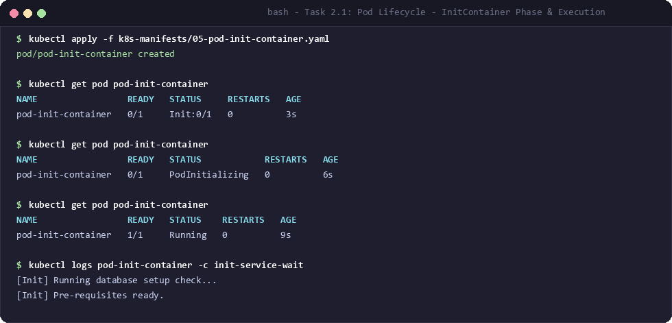

#### Step 2: Pod Details & Event History
```bash
kubectl describe pod pod-init-container
```

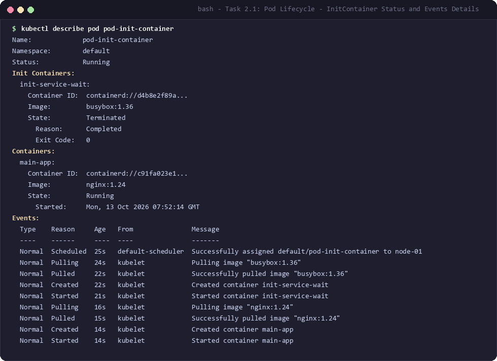

#### Observations:
- Status transitions sequentially from `Init:0/1` -> `PodInitializing` -> `Running`.
- The main container `main-app` was held in waiting state until `init-service-wait` terminated with `Exit Code: 0`.

---

### 02. Health Probes (Startup, Liveness, Readiness)

Probes determine container health and manage traffic ingestion:
- **`startupProbe`**: Verifies that slow-starting applications have initialized. Disables liveness/readiness checks until it succeeds.
- **`readinessProbe`**: Determines if the container is ready to accept user requests (controls inclusion in Service endpoints).
- **`livenessProbe`**: Detects if an application is deadlocked or broken, triggering a container restart when failed.

#### Manifest:
- [`k8s-manifests/06-pod-probes.yaml`](file:///d:/Assignments/Devops%20Assignment/Session%2010/k8s-manifests/06-pod-probes.yaml)

#### Step 1: Apply & Track Ready States
```bash
kubectl apply -f k8s-manifests/06-pod-probes.yaml
kubectl get pod pod-probes-demo -w
kubectl get pod pod-probes-demo -o wide
```

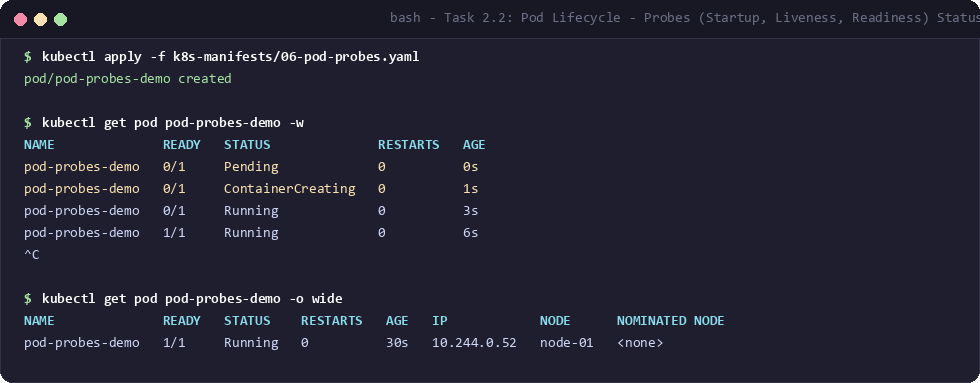

#### Step 2: Inspect Probe Configurations and Conditions
```bash
kubectl describe pod pod-probes-demo
```

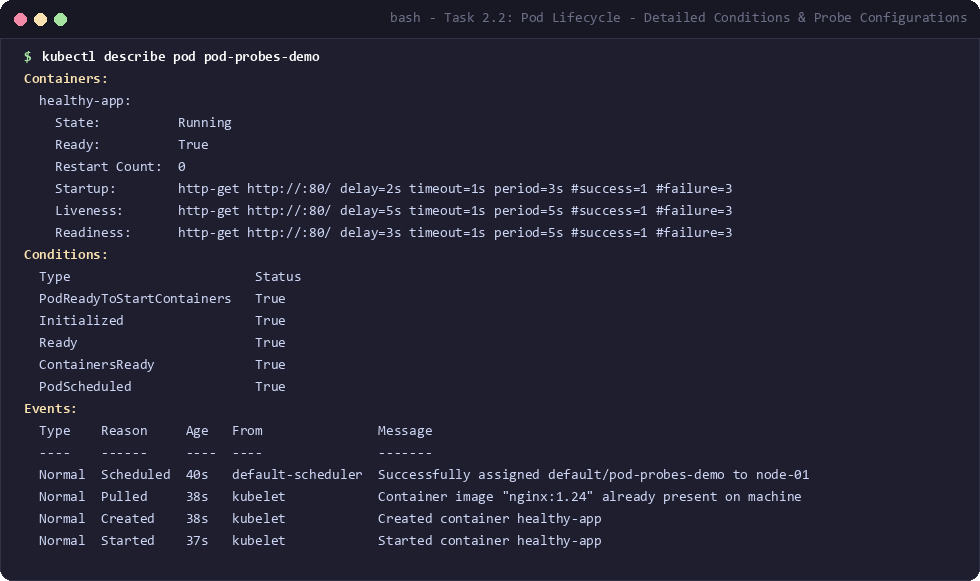

#### Observations:
- Even when the container entered `Running` status, its `READY` column remained `0/1` until the `readinessProbe` passed its initial delay and returned HTTP 200.
- All probe parameters (`delay`, `timeout`, `period`, `#success`, `#failure`) are registered in Pod conditions under `ContainersReady` and `Ready`.

---

### 03. Lifecycle Hooks (PostStart & PreStop Graceful Termination)

Container lifecycle hooks allow custom commands or HTTP requests to be triggered immediately after creation or prior to termination:
- **`postStart`**: Executed immediately after a container is created. Note: Executes asynchronously relative to the container's entrypoint.
- **`preStop`**: Executed blocking before container receives `SIGTERM`. Ideal for draining connections, flushing buffers, and saving state.

#### Manifest:
- [`k8s-manifests/07-pod-hooks.yaml`](file:///d:/Assignments/Devops%20Assignment/Session%2010/k8s-manifests/07-pod-hooks.yaml)

#### Step 1: PostStart Hook Execution Verification
Apply the Pod and inspect the file created by the `postStart` command:
```bash
kubectl apply -f k8s-manifests/07-pod-hooks.yaml
kubectl get pod pod-hooks-demo
kubectl exec pod-hooks-demo -- cat /usr/share/nginx/html/status.html
kubectl describe pod pod-hooks-demo | grep -A 8 'Lifecycle:'
```

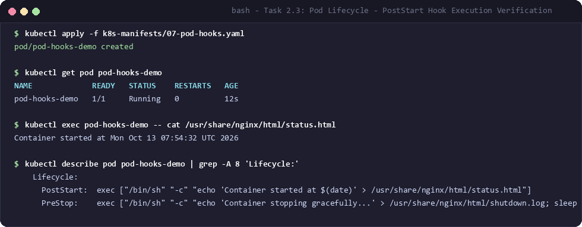

#### Step 2: PreStop Hook & Graceful Termination
Initiate deletion and observe how Kubernetes waits for the `preStop` hook to complete:
```bash
kubectl delete pod pod-hooks-demo
kubectl get pod pod-hooks-demo
```

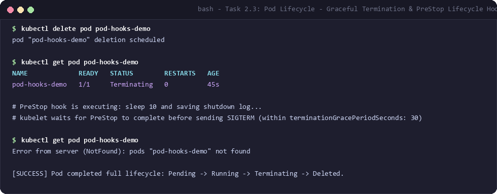

#### Observations:
- The `postStart` hook wrote `Container started at Mon Oct 13 07:54:32 UTC 2026` to Nginx web root immediately upon start.
- On deletion, the Pod remained in `Terminating` state for the duration of the `sleep 10` command defined in `preStop` before receiving `SIGTERM` and cleaning up completely.

---

## Summary Matrix of Deployment Strategies

| Strategy | Downtime | Traffic Split | Resource Cost | Rollback Complexity | Primary Use Case |
| :--- | :--- | :--- | :--- | :--- | :--- |
| **Rolling Update** | Zero | Gradual (Automatic) | +MaxSurge (Low) | Low (`kubectl rollout undo`) | General production services, stateless web apps |
| **Blue-Green** | Zero | Instant Switch (All or Nothing) | 2x Full Capacity | Minimal (Re-point Service selector) | Mission-critical apps requiring instantaneous rollback |
| **Canary** | Zero | Percentage-based (e.g., 90/10) | Low (+Canary replicas) | Low (Delete Canary deployment) | A/B testing, regression testing on live user traffic |
| **Recreate** | Yes (Pod downtime) | None (Total cutover) | None (1x Capacity) | Medium | Incompatible database schemas, legacy stateful systems |

---

## Deliverables Summary

- [x] **YAML Files:** Created in [`k8s-manifests/`](file:///d:/Assignments/Devops%20Assignment/Session%2010/k8s-manifests)
  - `01-rolling-update.yaml` & `01-rolling-update-v2.yaml`
  - `02-blue-green.yaml`
  - `03-canary.yaml`
  - `04-recreate.yaml`
  - `05-pod-init-container.yaml`
  - `06-pod-probes.yaml`
  - `07-pod-hooks.yaml`
- [x] **Command Outputs & Screenshots:** High-resolution terminal captures generated in [`screenshots/`](file:///d:/Assignments/Devops%20Assignment/Session%2010/screenshots)
- [x] **Comprehensive Documentation:** Complete observations and explanations embedded in this [`README.md`](file:///d:/Assignments/Devops%20Assignment/Session%2010/README.md).
