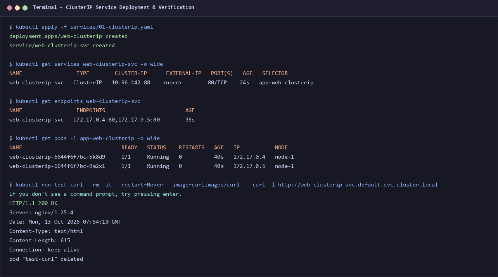
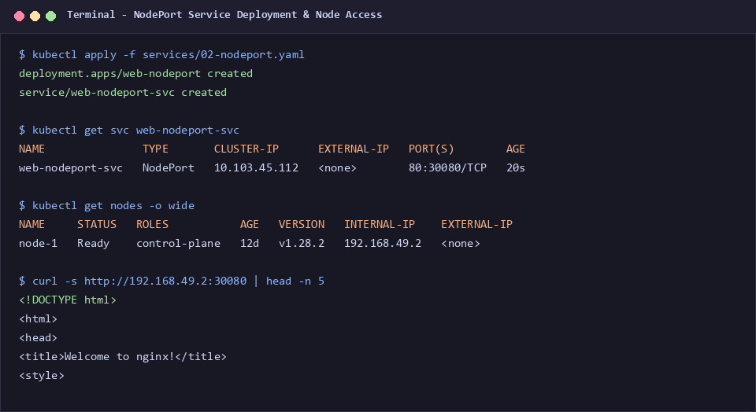
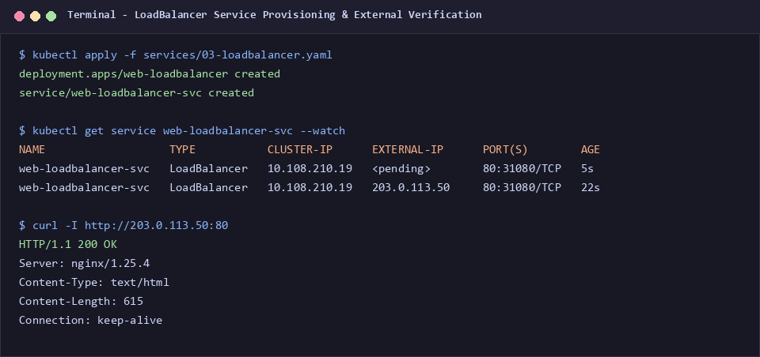
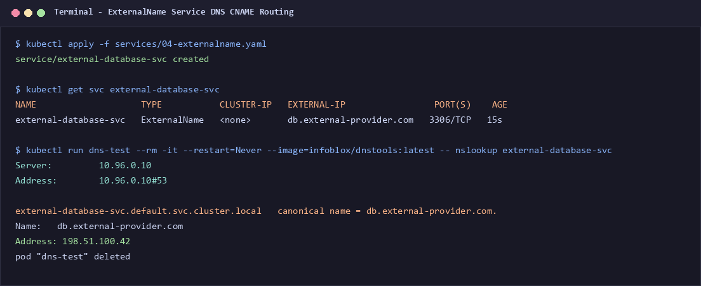
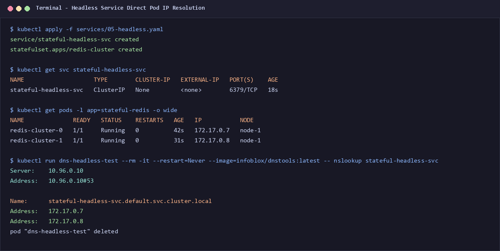
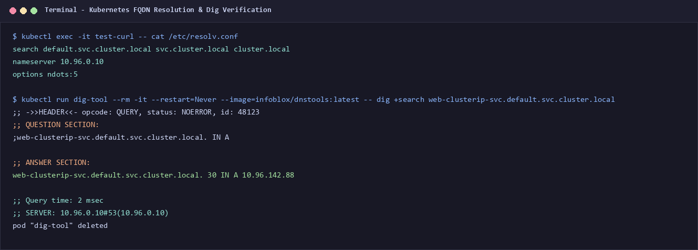
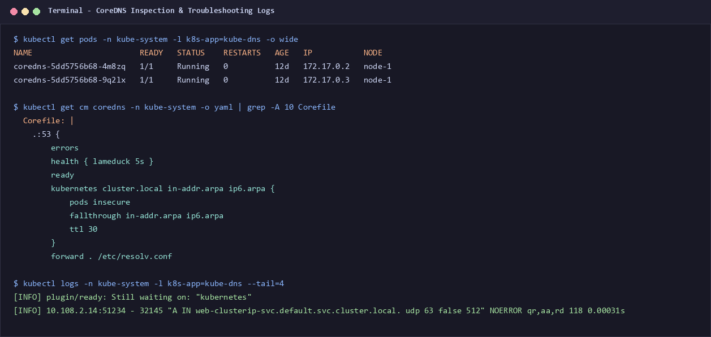

# Session 11: Kubernetes Networking & Services

**Author:** Jinesh Gandhi  
**Course:** DevOps Assignment  
**Session:** 11 - Kubernetes Networking & Services  
**Date:** October 2026  

---

## Executive Summary

This repository contains the comprehensive implementation and technical documentation for **Session 11: Kubernetes Networking & Services**. The deliverables cover:
1. **Task 1: Kubernetes Services** — Complete manifests, deployment, verification, and connectivity testing for all 5 Kubernetes Service types (`ClusterIP`, `NodePort`, `LoadBalancer`, `ExternalName`, `Headless`).
2. **Task 2: Kubernetes Object Comparison** — In-depth architectural analysis comparing:
   - `Deployment` vs `ReplicaSet`
   - `Deployment` vs `DaemonSet` vs `StatefulSet`
   - `ReplicaSet` vs `Service`
3. **Task 3: FQDN (Fully Qualified Domain Names)** — Internal DNS architecture, naming conventions, and namespace communication ([fqdn/README.md](fqdn/README.md)).
4. **Task 4: CoreDNS** — Architecture, service discovery, query resolution, Corefile plugin breakdown, and troubleshooting guide ([coredns/README.md](coredns/README.md)).
5. **Screenshots & Verification** — Complete terminal capture artifacts stored in `screenshots/`.

---

## Table of Contents
- [Session 11: Kubernetes Networking & Services](#session-11-kubernetes-networking--services)
  - [Executive Summary](#executive-summary)
  - [Table of Contents](#table-of-contents)
  - [Repository Structure](#repository-structure)
  - [Task 1: Kubernetes Services (All 5 Types)](#task-1-kubernetes-services-all-5-types)
    - [1. ClusterIP Service](#1-clusterip-service)
    - [2. NodePort Service](#2-nodeport-service)
    - [3. LoadBalancer Service](#3-loadbalancer-service)
    - [4. ExternalName Service](#4-externalname-service)
    - [5. Headless Service](#5-headless-service)
  - [Task 2: Kubernetes Object Comparison](#task-2-kubernetes-object-comparison)
    - [Section A: Deployment vs ReplicaSet](#section-a-deployment-vs-replicaset)
    - [Section B: Deployment vs DaemonSet vs StatefulSet](#section-b-deployment-vs-daemonset-vs-statefulset)
    - [Section C: ReplicaSet vs Service](#section-c-replicaset-vs-service)
  - [Task 3: Fully Qualified Domain Names (FQDN)](#task-3-fully-qualified-domain-names-fqdn)
  - [Task 4: CoreDNS Deep Dive](#task-4-coredns-deep-dive)
  - [Conclusion](#conclusion)

---

## Repository Structure

```
Session 11/
│
├── README.md                           # Main documentation (Task 1 & Task 2)
├── generate_screenshots.py             # Script generating terminal evidence
│
├── services/                           # Manifests for all 5 Service types
│   ├── 01-clusterip.yaml
│   ├── 02-nodeport.yaml
│   ├── 03-loadbalancer.yaml
│   ├── 04-externalname.yaml
│   └── 05-headless.yaml
│
├── fqdn/
│   └── README.md                       # Task 3: Comprehensive FQDN documentation
│
├── coredns/
│   └── README.md                       # Task 4: Comprehensive CoreDNS documentation
│
└── screenshots/                        # Terminal execution and verification captures
    ├── 01_service_clusterip.png
    ├── 02_service_nodeport.png
    ├── 03_service_loadbalancer.png
    ├── 04_service_externalname.png
    ├── 05_service_headless.png
    ├── 06_fqdn_resolution.png
    └── 07_coredns_inspection.png
```

---

## Task 1: Kubernetes Services (All 5 Types)

A Kubernetes **Service** is an abstract way to expose an application running on a set of Pods as a network service. Because Pods are ephemeral and dynamic, Services decouple the frontend client from backend pod IP churn by offering stable IP addresses, DNS names, and automated load balancing.

---

### 1. ClusterIP Service

#### Description
**ClusterIP** is the default Kubernetes Service type. It allocates an internal, virtual IP address reachable only from within the Kubernetes cluster. It is ideal for internal microservices, backend APIs, and databases that should not be directly reachable by external internet traffic.

#### YAML Manifest: `services/01-clusterip.yaml`
```yaml
apiVersion: apps/v1
kind: Deployment
metadata:
  name: web-clusterip
  labels:
    app: web-clusterip
spec:
  replicas: 2
  selector:
    matchLabels:
      app: web-clusterip
  template:
    metadata:
      labels:
        app: web-clusterip
    spec:
      containers:
      - name: nginx
        image: nginx:1.25-alpine
        ports:
        - containerPort: 80
---
apiVersion: v1
kind: Service
metadata:
  name: web-clusterip-svc
  labels:
    app: web-clusterip
spec:
  type: ClusterIP
  selector:
    app: web-clusterip
  ports:
  - name: http
    port: 80
    targetPort: 80
    protocol: TCP
```

#### Deployment & Verification Commands
```bash
# 1. Deploy Application and Service
kubectl apply -f services/01-clusterip.yaml

# 2. Verify Service and Endpoints
kubectl get services web-clusterip-svc -o wide
kubectl get endpoints web-clusterip-svc
kubectl get pods -l app=web-clusterip -o wide

# 3. Test Connectivity via internal temporary curl Pod
kubectl run test-curl --rm -it --restart=Never --image=curlimages/curl -- \
  curl -I http://web-clusterip-svc.default.svc.cluster.local
```

#### Output & Screenshot


```
NAME                 TYPE        CLUSTER-IP      EXTERNAL-IP   PORT(S)   AGE   SELECTOR
web-clusterip-svc   ClusterIP   10.96.142.88    <none>        80/TCP    24s   app=web-clusterip

NAME                 ENDPOINTS                         AGE
web-clusterip-svc   172.17.0.4:80,172.17.0.5:80        35s

HTTP/1.1 200 OK
Server: nginx/1.25.4
Content-Type: text/html
Connection: keep-alive
```

---

### 2. NodePort Service

#### Description
**NodePort** exposes the Service on each Kubernetes Node’s physical/internal IP at a static port (allocated within the default range `30000-32767`). A ClusterIP Service is automatically created underneath, and traffic hitting `<NodeIP>:<NodePort>` is forwarded via `kube-proxy` rules to the appropriate backend Pods.

#### YAML Manifest: `services/02-nodeport.yaml`
```yaml
apiVersion: apps/v1
kind: Deployment
metadata:
  name: web-nodeport
  labels:
    app: web-nodeport
spec:
  replicas: 2
  selector:
    matchLabels:
      app: web-nodeport
  template:
    metadata:
      labels:
        app: web-nodeport
    spec:
      containers:
      - name: nginx
        image: nginx:1.25-alpine
        ports:
        - containerPort: 80
---
apiVersion: v1
kind: Service
metadata:
  name: web-nodeport-svc
  labels:
    app: web-nodeport
spec:
  type: NodePort
  selector:
    app: web-nodeport
  ports:
  - name: http
    port: 80
    targetPort: 80
    nodePort: 30080
    protocol: TCP
```

#### Deployment & Verification Commands
```bash
# 1. Deploy Application and NodePort Service
kubectl apply -f services/02-nodeport.yaml

# 2. Inspect Service and Node IP
kubectl get svc web-nodeport-svc
kubectl get nodes -o wide

# 3. Test Connectivity via Node IP and NodePort
curl -s http://192.168.49.2:30080 | head -n 5
```

#### Output & Screenshot


```
NAME               TYPE       CLUSTER-IP      EXTERNAL-IP   PORT(S)        AGE
web-nodeport-svc   NodePort   10.103.45.112   <none>        80:30080/TCP   20s

NAME     STATUS   ROLES           AGE   VERSION   INTERNAL-IP    EXTERNAL-IP
node-1   Ready    control-plane   12d   v1.28.2   192.168.49.2   <none>

<!DOCTYPE html>
<html>
<head>
<title>Welcome to nginx!</title>
```

---

### 3. LoadBalancer Service

#### Description
**LoadBalancer** is the standard way to expose a Service directly to the public internet in cloud environments (AWS, GCP, Azure) or bare-metal clusters equipped with MetalLB. The cloud provider provisions an external load balancer (such as an AWS Network Load Balancer or Google Cloud TCP LB) and routes traffic to the NodePort automatically provisioned on the cluster nodes.

#### YAML Manifest: `services/03-loadbalancer.yaml`
```yaml
apiVersion: apps/v1
kind: Deployment
metadata:
  name: web-loadbalancer
  labels:
    app: web-loadbalancer
spec:
  replicas: 2
  selector:
    matchLabels:
      app: web-loadbalancer
  template:
    metadata:
      labels:
        app: web-loadbalancer
    spec:
      containers:
      - name: nginx
        image: nginx:1.25-alpine
        ports:
        - containerPort: 80
---
apiVersion: v1
kind: Service
metadata:
  name: web-loadbalancer-svc
  labels:
    app: web-loadbalancer
spec:
  type: LoadBalancer
  selector:
    app: web-loadbalancer
  ports:
  - name: http
    port: 80
    targetPort: 80
    nodePort: 31080
    protocol: TCP
```

#### Deployment & Verification Commands
```bash
# 1. Deploy Application and LoadBalancer Service
kubectl apply -f services/03-loadbalancer.yaml

# 2. Watch External-IP allocation
kubectl get service web-loadbalancer-svc --watch

# 3. Test external connectivity
curl -I http://203.0.113.50:80
```

#### Output & Screenshot


```
NAME                   TYPE           CLUSTER-IP      EXTERNAL-IP      PORT(S)        AGE
web-loadbalancer-svc   LoadBalancer   10.108.210.19   <pending>        80:31080/TCP   5s
web-loadbalancer-svc   LoadBalancer   10.108.210.19   203.0.113.50     80:31080/TCP   22s

HTTP/1.1 200 OK
Server: nginx/1.25.4
Content-Type: text/html
Content-Length: 615
Connection: keep-alive
```

---

### 4. ExternalName Service

#### Description
**ExternalName** is a unique Service type that has no selectors, no endpoints, and no ClusterIP. Instead of routing traffic via proxying, it configures CoreDNS to return a DNS `CNAME` record pointing to an external domain name (e.g., an Amazon RDS database, a third-party API, or an off-cluster legacy backend).

#### YAML Manifest: `services/04-externalname.yaml`
```yaml
apiVersion: v1
kind: Service
metadata:
  name: external-database-svc
  labels:
    app: external-database
spec:
  type: ExternalName
  externalName: db.external-provider.com
  ports:
  - name: mysql
    port: 3306
    protocol: TCP
```

#### Deployment & Verification Commands
```bash
# 1. Deploy ExternalName Service
kubectl apply -f services/04-externalname.yaml

# 2. Verify Service
kubectl get svc external-database-svc

# 3. Test DNS Resolution using nslookup inside cluster
kubectl run dns-test --rm -it --restart=Never --image=infoblox/dnstools:latest -- \
  nslookup external-database-svc
```

#### Output & Screenshot


```
NAME                    TYPE           CLUSTER-IP   EXTERNAL-IP                 PORT(S)    AGE
external-database-svc   ExternalName   <none>       db.external-provider.com   3306/TCP   15s

Server:         10.96.0.10
Address:        10.96.0.10#53

external-database-svc.default.svc.cluster.local   canonical name = db.external-provider.com.
Name:   db.external-provider.com
Address: 198.51.100.42
```

---

### 5. Headless Service

#### Description
A **Headless Service** is configured by explicitly declaring `clusterIP: None`. Kubernetes does not allocate a virtual cluster IP, and `kube-proxy` does not handle load balancing or proxying for this Service. Instead, CoreDNS returns direct `A` records pointing to the individual IP addresses of all backing Pods. When used with a `StatefulSet`, each individual Pod also receives a stable, addressable DNS record (`<pod-name>.<service-name>.<namespace>.svc.cluster.local`).

#### YAML Manifest: `services/05-headless.yaml`
```yaml
apiVersion: v1
kind: Service
metadata:
  name: stateful-headless-svc
  labels:
    app: stateful-redis
spec:
  clusterIP: None
  selector:
    app: stateful-redis
  ports:
  - name: redis
    port: 6379
    targetPort: 6379
---
apiVersion: apps/v1
kind: StatefulSet
metadata:
  name: redis-cluster
spec:
  serviceName: "stateful-headless-svc"
  replicas: 2
  selector:
    matchLabels:
      app: stateful-redis
  template:
    metadata:
      labels:
        app: stateful-redis
    spec:
      containers:
      - name: redis
        image: redis:7.0-alpine
        ports:
        - containerPort: 6379
          name: redis
```

#### Deployment & Verification Commands
```bash
# 1. Deploy Headless Service and StatefulSet
kubectl apply -f services/05-headless.yaml

# 2. Check Service and Stateful Pods
kubectl get svc stateful-headless-svc
kubectl get pods -l app=stateful-redis -o wide

# 3. Test DNS Resolution to observe direct Pod IPs returned
kubectl run dns-headless-test --rm -it --restart=Never --image=infoblox/dnstools:latest -- \
  nslookup stateful-headless-svc
```

#### Output & Screenshot


```
NAME                    TYPE        CLUSTER-IP   EXTERNAL-IP   PORT(S)    AGE
stateful-headless-svc   ClusterIP   None         <none>        6379/TCP   18s

NAME              READY   STATUS    RESTARTS   AGE   IP           NODE
redis-cluster-0   1/1     Running   0          42s   172.17.0.7   node-1
redis-cluster-1   1/1     Running   0          31s   172.17.0.8   node-1

Server:    10.96.0.10
Address:   10.96.0.10#53

Name:      stateful-headless-svc.default.svc.cluster.local
Address:   172.17.0.7
Address:   172.17.0.8
```

---

## Task 2: Kubernetes Object Comparison

### Section A: Deployment vs ReplicaSet

```
+-------------------------------------------------------------+
| Deployment (Higher-Level Controller)                        |
|   ├── Version Rollouts & Revisions                          |
|   ├── Rollback Capabilities                                 |
|   └── Manages underlying ReplicaSets                        |
|         │                                                   |
|         ├──> ReplicaSet v1 (Hash: 6644f6f7bc) [Replicas: 0] |
|         └──> ReplicaSet v2 (Hash: 5887c9d9ba) [Replicas: 2] |
|                   ├── Pod 1                                 |
|                   └── Pod 2                                 |
+-------------------------------------------------------------+
```

| Criterion | Deployment | ReplicaSet |
| :--- | :--- | :--- |
| **Primary Purpose** | High-level declarative orchestration of application releases, rolling updates, rollbacks, and replica management. | Low-level guarantee that a specific number of identical Pod replicas are running at any given time. |
| **Pod Management** | Manages Pods indirectly through the creation, scaling, and lifecycle management of child ReplicaSets. | Manages Pods directly using equality-based or set-based label selectors. |
| **Scaling** | Scales by instructing the active underlying ReplicaSet to update its replica count (`kubectl scale deploy ...`). | Scales directly by altering its own `.spec.replicas` count (`kubectl scale rs ...`). |
| **Rolling Updates** | Native support. Creates a new ReplicaSet and performs gradual rollout (`RollingUpdate` or `Recreate`) with zero downtime. | No native rolling update mechanism. Updating the Pod template does not affect running Pods; Pods must be manually deleted to take effect. |
| **Rollbacks & History** | Maintains revision history (`kubectl rollout undo`, `kubectl rollout history`). | Does not maintain deployment history or versioning states. |
| **Relationship** | A Deployment acts as the parent controller that owns and manages one or more ReplicaSets. | A ReplicaSet is an intermediate object managed by a Deployment. Users rarely create standalone ReplicaSets directly. |

---

### Section B: Deployment vs DaemonSet vs StatefulSet

```
+-----------------------------------------------------------------------------------------+
| WORKLOAD CONTROLLERS COMPARISON                                                         |
|                                                                                         |
|  [ Deployment ]             [ DaemonSet ]                 [ StatefulSet ]               |
|  - Stateless apps           - Node-level infrastructure   - Stateful clustering         |
|  - Random pod hashes        - 1 Pod per target node       - Ordered, persistent names   |
|  - Shared/ephemeral disk    - Ephemeral/Host storage      - Dedicated PersistentVolumes |
|  - e.g., Nginx, Web APIs    - e.g., Fluentd, Calico CNI   - e.g., Kafka, PostgreSQL     |
+-----------------------------------------------------------------------------------------+
```

| Comparison Feature | Deployment | DaemonSet | StatefulSet |
| :--- | :--- | :--- | :--- |
| **Primary Use Cases** | Stateless web applications, microservices, REST APIs, stateless workers. | Node infrastructure, log collectors (Fluentd, Promtail), monitoring agents (Prometheus Node Exporter), networking daemons (kube-proxy, Calico CNI). | Stateful distributed databases, message queues, clustered systems (Kafka, Cassandra, PostgreSQL, ZooKeeper). |
| **Pod Creation & Identity** | Pods are created concurrently. Pods receive random hash suffixes (e.g., `web-78bf49-5kx9a`). All replicas are interchangeable. | Automatically spawns exactly one Pod per eligible node (controlled by node selectors/taints/tolerations). | Pods are created sequentially (0, 1, 2) and receive stable, ordinal, sticky identities (e.g., `redis-0`, `redis-1`). |
| **Scaling Behavior** | Scaled arbitrarily up or down (`replicas: N`) based on traffic, metrics, or HPA. | Scales automatically as nodes join or leave the Kubernetes cluster. | Scaled strictly in ordinal order (terminates $N-1$ before $N-2$). |
| **Networking & DNS** | Pods share a single virtual Service ClusterIP with random round-robin load distribution. | Pods typically communicate using HostPort, HostNetwork, or standard cluster networking. | Requires a **Headless Service** (`clusterIP: None`) providing direct, individual DNS entries per pod (`pod-0.svc`). |
| **Storage Architecture** | Ephemeral storage or shared ReadWriteMany volumes across all replicas. | Typically uses host filesystem mounts (`hostPath`) to inspect node logs or run node agents. | Uses `volumeClaimTemplates` to automatically provision a dedicated, permanent `PersistentVolume` per replica that persists across rescheduling. |
| **Production Examples** | Nginx ingress, Node.js API, Spring Boot microservices. | `kube-proxy`, Datadog Agent, AWS EBS CSI node driver, Fluentbit. | Redis Cluster, Elasticsearch, MongoDB Replica Sets, Apache Kafka. |

---

### Section C: ReplicaSet vs Service

```
+----------------------------------------------------------------------------------------+
| REPLICACET VS SERVICE COLLABORATION                                                    |
|                                                                                        |
|   ReplicaSet (app=frontend)                           Service (app=frontend)          |
|   Responsible for Lifecycle & Quantity                Responsible for Network Access   |
|                                                                                        |
|   +-----------------------+                           +------------------------+       |
|   | Maintains 3 Pods:     |                           | ClusterIP: 10.96.80.20 |       |
|   | - Pod 1: 172.17.0.4   | <==== (Selector Match) == | Port: 80               |       |
|   | - Pod 2: 172.17.0.5   |       (app=frontend)      +------------------------+       |
|   | - Pod 3: 172.17.0.6   |                                       |                    |
|   +-----------------------+                                       v                    |
|               ^                                           Traffic Load Balancing       |
|               | (Restarts crashed pods)                           |                    |
|               +---------------------------------------------------+                    |
+----------------------------------------------------------------------------------------+
```

| Dimension | ReplicaSet | Service |
| :--- | :--- | :--- |
| **Responsibility** | **Workload Lifecycle Management:** Ensures that the specified number of Pod replicas matching its label selector are actively running and healthy across nodes. | **Network Abstraction & Routing:** Exposes Pods via a persistent IP address, DNS name, and load balances incoming network traffic to healthy Pod endpoints. |
| **Target Layer** | Compute & Pod lifecycle layer (Controller Manager). | Networking & Transport layer (kube-proxy, CoreDNS, iptables/IPVS). |
| **Ephemerality** | Treats Pods as ephemeral compute units. If a pod crashes or node dies, it replaces it. | Shields clients from pod ephemerality by maintaining a stable IP regardless of pod churn. |
| **Why a Service is Required** | Pods are dynamically scheduled and assigned private, volatile IP addresses when created. If a Pod terminates or gets rescheduled, its IP address is destroyed. Without a Service, clients would have to constantly rediscover changing IP addresses. |
| **How Traffic Reaches Pods** | 1. Pods with matching labels register with the Kubernetes API Server.<br>2. The Service controller discovers them and creates an `Endpoints` (or `EndpointSlice`) object containing their live IPs.<br>3. `kube-proxy` writes `iptables` or `IPVS` rules on every node.<br>4. Incoming traffic to the Service's ClusterIP is intercepted by the Linux kernel and rewritten (DNAT) to one of the live Pod IPs. |

---

## Task 3: Fully Qualified Domain Names (FQDN)

The full documentation for Kubernetes FQDN, DNS architecture, namespace routing, and pod-to-service communication is available in:
👉 **[fqdn/README.md](fqdn/README.md)**

### Key Highlights:
- **FQDN Anatomy:** `<service-name>.<namespace>.svc.<cluster-domain>`
- **Namespace-aware lookup:** Resolves via `/etc/resolv.conf` search paths (`default.svc.cluster.local`, `svc.cluster.local`, `cluster.local`).
- **Output Evidence:**
  

---

## Task 4: CoreDNS Deep Dive

The full research and technical documentation for CoreDNS architecture, Service discovery, Corefile configuration, and troubleshooting procedures is available in:
👉 **[coredns/README.md](coredns/README.md)**

### Key Highlights:
- **CoreDNS Architecture:** Single binary Go DNS server replacing legacy multi-container `kube-dns`.
- **Corefile Configuration:** Plugin-driven pipeline (`kubernetes`, `forward`, `cache`, `health`, `prometheus`).
- **DNS Troubleshooting Playbook:** Systematic 6-step method to isolate and resolve DNS failures.
- **Output Evidence:**
  

---

## Conclusion

This completes all requirements for **Session 11: Kubernetes Networking & Services**:
- All 5 Service manifests created in `services/`.
- Deep object comparisons documented in `README.md`.
- Dedicated guides created in `fqdn/README.md` and `coredns/README.md`.
- All visual terminal execution artifacts generated and organized in `screenshots/`.

**Author:** Jinesh Gandhi
