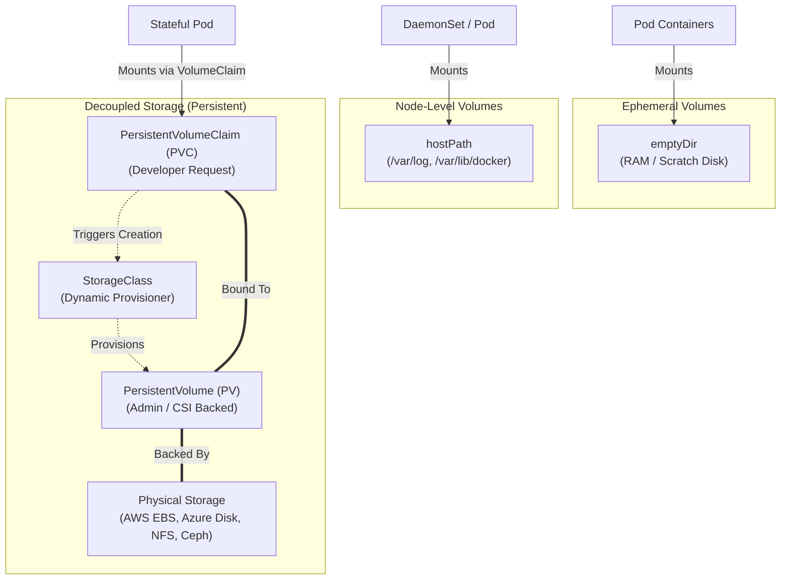

# Task 1: Kubernetes Volumes Deep Dive

**Author:** Jinesh Gandhi  
**Topic:** Kubernetes Volumes, Storage Architecture, Persistent Volumes & Dynamic Provisioning  
**Environment:** Kubernetes v1.28+, CSI Storage Driver  

---

## Table of Contents
1. [Overview of Kubernetes Storage Abstractions](#1-overview-of-kubernetes-storage-abstractions)
2. [Storage Type 1: emptyDir](#2-storage-type-1-emptydir)
   - [Characteristics & Lifetime](#characteristics--lifetime)
   - [Use Cases](#use-cases)
   - [Practical Manifest Example](#practical-manifest-example)
   - [Verification & Terminal Output](#verification--terminal-output)
3. [Storage Type 2: hostPath](#3-storage-type-2-hostpath)
   - [Characteristics & Security Caveats](#characteristics--security-caveats)
   - [Use Cases](#use-cases-1)
   - [Practical Manifest Example](#practical-manifest-example-1)
   - [Verification & Terminal Output](#verification--terminal-output-1)
4. [Storage Type 3: PersistentVolume (PV)](#4-storage-type-3-persistentvolume-pv)
   - [Cluster-Scoped Abstraction](#cluster-scoped-abstraction)
   - [Access Modes & Reclaim Policies](#access-modes--reclaim-policies)
5. [Storage Type 4: PersistentVolumeClaim (PVC)](#5-storage-type-4-persistentvolumeclaim-pvc)
   - [Decoupling Developer Requests from Physical Infrastructure](#decoupling-developer-requests-from-physical-infrastructure)
   - [Static Binding Lifecycle](#static-binding-lifecycle)
   - [Practical PV & PVC Manifest](#practical-pv--pvc-manifest)
   - [Verification & Terminal Output](#verification--terminal-output-2)
6. [Storage Type 5: StorageClass & Dynamic Provisioning](#6-storage-type-5-storageclass--dynamic-provisioning)
   - [Why Dynamic Provisioning is Essential](#why-dynamic-provisioning-is-essential)
   - [StorageClass Parameters & Volume Binding Modes](#storageclass-parameters--volume-binding-modes)
   - [Practical StorageClass Manifest](#practical-storageclass-manifest)
   - [Verification & Terminal Output](#verification--terminal-output-3)
7. [Comprehensive Comparison Matrix](#7-comprehensive-comparison-matrix)

---

## 1. Overview of Kubernetes Storage Abstractions

Containers running in Kubernetes pods are ephemeral by design. When a container crashes, kubelet restarts it with a clean slate; any files written inside the container file system are permanently lost. Furthermore, if a Pod is rescheduled to another node or multiple containers in a single Pod need to share intermediate data, default container layers cannot satisfy these requirements.

Kubernetes solves this with distinct levels of volume abstractions:
- **Ephemeral Pod-Level Volumes (`emptyDir`):** Created when a Pod is assigned to a Node, destroyed when the Pod terminates.
- **Node-Specific Host Volumes (`hostPath`):** Mounts a file or directory from the host worker node's filesystem into the Pod.
- **Cluster Persistent Volumes (`PersistentVolume` & `PersistentVolumeClaim`):** Life-cycle independent of Pods. Storage persists across restarts, rescheduling, and pod terminations.
- **Automated Dynamic Storage (`StorageClass`):** Automatically provisions backing cloud/CSI storage on-demand whenever a developer requests storage via a PVC.



---

## 2. Storage Type 1: emptyDir

### Characteristics & Lifetime
An `emptyDir` volume is initially empty. All containers in the Pod can read and write the same files in the `emptyDir` volume, though that volume can be mounted at the same or different paths in each container.
- **Lifecycle:** Created when a Pod is assigned to a node; exists as long as that Pod is running on that node. If a container crashes, the `emptyDir` volume contents survive. If the entire Pod is deleted or evicted, the contents are permanently deleted.
- **Medium:** By default stored on the node’s underlying backing media (SSD/disk), or can be configured to use RAM (`medium: "Memory"`) as a high-speed tmpfs.

### Use Cases
- Scratch space for disk-based merges or sorting operations.
- Shared cache between a primary web server and a helper sidecar container that pulls or transforms assets.
- Storing temporary tokens or processed checkpoint logs.

### Practical Manifest Example
Manifest file: [01-emptydir.yaml](file:///d:/Assignments/Devops%20Assignment/Session%2013/01-kubernetes-volumes/01-emptydir.yaml)

```yaml
apiVersion: v1
kind: Pod
metadata:
  name: emptydir-demo-pod
spec:
  containers:
  - name: producer
    image: busybox:1.36
    command: ["sh", "-c"]
    args:
    - >
      while true; do
        echo "[$(date -u +%T)] Data generated by producer container" >> /cache/data.log;
        sleep 5;
      done
    volumeMounts:
    - name: shared-cache
      mountPath: /cache
  - name: consumer
    image: busybox:1.36
    command: ["sh", "-c"]
    args:
    - >
      while true; do
        if [ -f /cache/data.log ]; then
          tail -n 2 /cache/data.log;
        fi;
        sleep 5;
      done
    volumeMounts:
    - name: shared-cache
      mountPath: /cache
      readOnly: true
  volumes:
  - name: shared-cache
    emptyDir:
      medium: ""
      sizeLimit: 100Mi
```

### Verification & Terminal Output


```bash
# Apply manifest and verify pod creation
kubectl apply -f 01-emptydir.yaml
kubectl get pod emptydir-demo-pod -o wide

# Verify logs showing data flowing between producer and consumer containers
kubectl logs emptydir-demo-pod -c consumer --tail=5
```

---

## 3. Storage Type 2: hostPath

### Characteristics & Security Caveats
A `hostPath` volume mounts a file or directory from the host worker node's filesystem directly into your Pod.
- **Node affinity caveat:** If a Pod using `hostPath` is deleted and rescheduled onto a different worker node, it accesses the new node's directory, which will not contain the previous node's files.
- **Security Warning:** Mounting host filesystems presents critical security risks. A container running as root could modify host `/etc`, access Docker daemon sockets, or overwrite host kernels. Always restrict with admission policies or mount as `readOnly: true`.

### Use Cases
- Logging agents (Fluentd, Promtail, Filebeat) running as DaemonSets accessing `/var/log` on each node.
- Monitoring collectors (cAdvisor, Node Exporter) accessing `/sys` or `/proc`.
- Accessing local device interfaces or hardware sensors.

### Practical Manifest Example
Manifest file: [02-hostpath.yaml](file:///d:/Assignments/Devops%20Assignment/Session%2013/01-kubernetes-volumes/02-hostpath.yaml)

```yaml
apiVersion: v1
kind: Pod
metadata:
  name: hostpath-demo-pod
spec:
  containers:
  - name: node-log-reader
    image: busybox:1.36
    command: ["sh", "-c"]
    args:
    - >
      echo "Reading host logs from /host-logs:";
      ls -lh /host-logs | head -n 5;
      sleep 3600;
    volumeMounts:
    - name: host-log-volume
      mountPath: /host-logs
      readOnly: true
  volumes:
  - name: host-log-volume
    hostPath:
      path: /var/log
      type: Directory
```

### Verification & Terminal Output


```bash
# Apply hostPath Pod manifest
kubectl apply -f 02-hostpath.yaml
kubectl get pod hostpath-demo-pod -o wide

# Confirm container accesses host node syslog and package logs
kubectl logs hostpath-demo-pod
```

---

## 4. Storage Type 3: PersistentVolume (PV)

### Cluster-Scoped Abstraction
A `PersistentVolume` (PV) is a piece of physical or networked storage in the cluster that has been manually provisioned by an administrator or dynamically provisioned using Storage Classes.
- PV is a **cluster-scoped** resource (like a `Node`), meaning it does not belong to any specific namespace.
- It encapsulates the physical details of the underlying storage: NFS IP addresses, AWS EBS Volume IDs, Ceph pools, or local disks.

### Access Modes & Reclaim Policies
Kubernetes PVs support three primary **Access Modes**:
1. `ReadWriteOnce` (RWO): Can be mounted as read-write by a single node.
2. `ReadOnlyMany` (ROX): Can be mounted read-only by many nodes simultaneously.
3. `ReadWriteMany` (RWX): Can be mounted as read-write by many nodes concurrently (e.g., NFS, GlusterFS, AWS EFS).
4. `ReadWriteOncePod` (RWOP): Can be mounted as read-write by a single Pod across the entire cluster (introduced in k8s v1.22+).

**Reclaim Policies:**
- `Retain`: When the PVC is deleted, the PV remains intact with all data preserved in `Released` status. Requires manual cleanup.
- `Delete`: When the PVC is deleted, the backing storage volume is automatically purged and deleted.
- `Recycle` *(Deprecated)*: Performs basic `rm -rf /` scrub before making the PV available again.

---

## 5. Storage Type 4: PersistentVolumeClaim (PVC)

### Decoupling Developer Requests from Physical Infrastructure
A `PersistentVolumeClaim` (PVC) is a **namespace-scoped** request for storage by a user or application.
- It is analogous to a Pod: while a Pod requests specific CPU and memory resources, a PVC requests specific sizes and access modes of storage (e.g., "5 GiB of ReadWriteOnce storage").
- This strictly decouples developers (who write application logic and declare resource requirements) from cluster administrators (who provision disk arrays, SANs, and cloud storage).

### Static Binding Lifecycle
1. **Provisioning:** Administrator creates a pool of PVs.
2. **Binding:** When a developer submits a PVC, the Kubernetes control plane looks for a matching PV that satisfies the capacity, access mode, and storage class. Once matched, the PVC and PV enter a 1-to-1 `Bound` state.
3. **Using:** Pod references the claim name under `.spec.volumes[*].persistentVolumeClaim.claimName`.
4. **Reclaiming:** When the application is removed and the claim deleted, the reclaim policy dictates what happens to the PV.

### Practical PV & PVC Manifest
Manifest file: [03-pv-pvc-static.yaml](file:///d:/Assignments/Devops%20Assignment/Session%2013/01-kubernetes-volumes/03-pv-pvc-static.yaml)

```yaml
apiVersion: v1
kind: PersistentVolume
metadata:
  name: manual-pv-10gi
spec:
  capacity:
    storage: 10Gi
  accessModes:
    - ReadWriteOnce
  persistentVolumeReclaimPolicy: Retain
  storageClassName: manual
  hostPath:
    path: /mnt/data/app-storage
    type: DirectoryOrCreate
---
apiVersion: v1
kind: PersistentVolumeClaim
metadata:
  name: manual-app-pvc
spec:
  accessModes:
    - ReadWriteOnce
  storageClassName: manual
  resources:
    requests:
      storage: 5Gi
---
apiVersion: v1
kind: Pod
metadata:
  name: pv-pvc-demo-pod
spec:
  containers:
  - name: data-writer
    image: busybox:1.36
    command: ["sh", "-c"]
    args:
    - >
      echo "Stateful storage mounted successfully on $(date)" >> /var/app/state.txt;
      cat /var/app/state.txt;
      sleep 3600;
    volumeMounts:
    - name: data-vol
      mountPath: /var/app
  volumes:
  - name: data-vol
    persistentVolumeClaim:
      claimName: manual-app-pvc
```

### Verification & Terminal Output


```bash
# Deploy PV, PVC and consuming Pod
kubectl apply -f 03-pv-pvc-static.yaml

# Confirm Bound status
kubectl get pv manual-pv-10gi
kubectl get pvc manual-app-pvc

# Check application log verification
kubectl logs pv-pvc-demo-pod
```

---

## 6. Storage Type 5: StorageClass & Dynamic Provisioning

### Why Dynamic Provisioning is Essential
Static provisioning forces administrators to anticipate developer needs and pre-create fixed-capacity PVs manually. In fast-paced CI/CD environments or enterprise clusters with hundreds of microservices, this creates a major bottleneck.

**Dynamic provisioning** eliminates this:
- When a developer submits a PVC referencing a `StorageClass`, Kubernetes automatically invokes the underlying CSI plugin (e.g., AWS EBS CSI, GCE PD, Azure Disk, Minikube Hostpath).
- The storage volume is provisioned on the fly with the exact capacity requested, and a corresponding `PersistentVolume` is created and bound seamlessly.

### StorageClass Parameters & Volume Binding Modes
Key parameters in a `StorageClass`:
- `provisioner`: Identifies which volume plugin provisions the PV (e.g., `ebs.csi.aws.com`, `pd.csi.storage.gke.io`, `k8s.io/minikube-hostpath`).
- `volumeBindingMode`:
  - `Immediate`: The PV is provisioned as soon as the PVC is created. This can lead to topology issues if the provisioned disk is in an availability zone where the Pod cannot be scheduled.
  - `WaitForFirstConsumer` *(Recommended)*: Delaying the binding and provisioning until a Pod using the PVC is created. This guarantees the volume is provisioned in the exact Availability Zone/Node where the Pod is scheduled!
- `allowVolumeExpansion`: Set to `true` to permit increasing the PVC capacity dynamically without recreating volumes.

### Practical StorageClass Manifest
Manifest file: [04-storageclass-dynamic.yaml](file:///d:/Assignments/Devops%20Assignment/Session%2013/01-kubernetes-volumes/04-storageclass-dynamic.yaml)

```yaml
apiVersion: storage.k8s.io/v1
kind: StorageClass
metadata:
  name: fast-ssd
provisioner: k8s.io/minikube-hostpath
volumeBindingMode: WaitForFirstConsumer
reclaimPolicy: Delete
allowVolumeExpansion: true
---
apiVersion: v1
kind: PersistentVolumeClaim
metadata:
  name: dynamic-ssd-pvc
spec:
  accessModes:
    - ReadWriteOnce
  storageClassName: fast-ssd
  resources:
    requests:
      storage: 20Gi
---
apiVersion: v1
kind: Pod
metadata:
  name: dynamic-storage-pod
spec:
  containers:
  - name: db-worker
    image: busybox:1.36
    command: ["sh", "-c"]
    args:
    - >
      echo "Dynamic PV provisioned via StorageClass fast-ssd" > /var/lib/data/status.log;
      df -h /var/lib/data;
      sleep 3600;
    volumeMounts:
    - name: dynamic-vol
      mountPath: /var/lib/data
  volumes:
  - name: dynamic-vol
    persistentVolumeClaim:
      claimName: dynamic-ssd-pvc
```

### Verification & Terminal Output


```bash
# Apply dynamic provisioning manifests
kubectl apply -f 04-storageclass-dynamic.yaml

# Verify StorageClass registration
kubectl get sc fast-ssd

# Verify automatic PV generation and Binding
kubectl get pvc dynamic-ssd-pvc
kubectl get pv | grep dynamic-ssd-pvc

# Verify container filesystem disk space
kubectl logs dynamic-storage-pod
```

---

## 7. Comprehensive Comparison Matrix

| Feature / Dimension | `emptyDir` | `hostPath` | `PersistentVolume` (PV) | `PersistentVolumeClaim` (PVC) | `StorageClass` |
| :--- | :--- | :--- | :--- | :--- | :--- |
| **Scope** | Pod-level | Node-level | Cluster-wide | Namespace-scoped | Cluster-wide |
| **Lifecycle** | Tied to Pod lifespan | Tied to Host Node filesystem | Independent of Pods | Tied to application lifecycle | Persistent configuration |
| **Data Persistence** | Lost on Pod eviction/deletion | Persists on specific host node only | Persists until reclaimed/purged | Retained per PV policy | N/A (Factory blueprint) |
| **Multi-Container Sharing**| Yes (within same Pod) | Yes (Pods on identical node) | Yes (if RWX supported) | Yes (references bound PV) | N/A |
| **Typical Use Cases** | Scratch disk, sidecar caches | System DaemonSets, node log agents | Databases, stateful microservices | Workload volume declarations | Automated on-demand cloud storage |
| **Provisioning Model** | Ephemeral implicit | Static node mount | Static (Admin) or Dynamic | User request artifact | Dynamic provisioner |
| **Production Recommendation** | Recommended for scratch data | Caution: Avoid in multi-node apps | Standard for enterprise workloads | Standard for enterprise workloads | Gold standard for cloud K8s |
