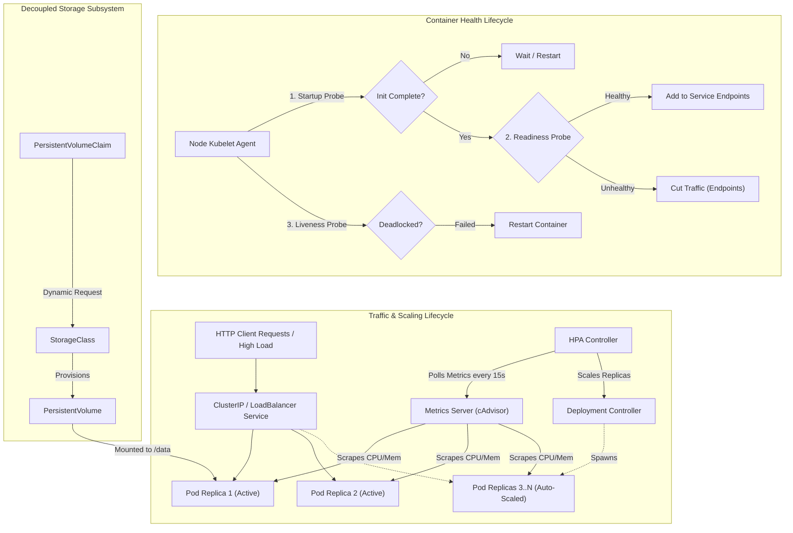

# Session 13: Kubernetes Storage, HPA & Health Probes

**Author:** Jinesh Gandhi  
**Course:** DevOps Engineering Masterclass  
**Lab Environment:** Kubernetes v1.28+, Metrics Server, Linux Worker Nodes  

---

## Table of Contents
1. [Overview & Architecture](#1-overview--architecture)
2. [Task 1: Kubernetes Volumes](#2-task-1-kubernetes-volumes)
   - [emptyDir](#21-emptydir)
   - [hostPath](#22-hostpath)
   - [PersistentVolume & PersistentVolumeClaim](#23-persistentvolume--persistentvolumeclaim)
   - [StorageClass & Dynamic Provisioning](#24-storageclass--dynamic-provisioning)
3. [Task 2: Horizontal Pod Autoscaler (HPA) Hands-On](#3-task-2-horizontal-pod-autoscaler-hpa-hands-on)
   - [HPA Architecture & Scaling Formula](#31-hpa-architecture--scaling-formula)
   - [Deploying the Application & HPA Configuration](#32-deploying-the-application--hpa-configuration)
   - [Verifying Baseline Metrics](#33-verifying-baseline-metrics)
   - [Deploying the Load Generator](#34-deploying-the-load-generator)
   - [Observing CPU Spike & Dynamic Pod Scaling](#35-observing-cpu-spike--dynamic-pod-scaling)
   - [Deep Inspection & Scaling Events](#36-deep-inspection--scaling-events)
4. [Task 3: Resilient Microservice Mini Project](#4-task-3-resilient-microservice-mini-project)
   - [Architecture Design: Storage + Probes + HPA](#41-architecture-design-storage--probes--hpa)
   - [Health Probes Breakdown: Startup, Liveness, and Readiness](#42-health-probes-breakdown-startup-liveness-and-readiness)
   - [Deployment & Operational Verification](#43-deployment--operational-verification)
5. [Useful Kubernetes Commands Reference](#5-useful-kubernetes-commands-reference)
6. [Repository Manifest & Artifact Deliverables](#6-repository-manifest--artifact-deliverables)

---

## 1. Overview & Architecture

Session 13 focuses on three cornerstones of Kubernetes production reliability:
1. **Durable & Ephemeral Storage:** Decoupling pod compute from persistent state using `emptyDir`, `hostPath`, `PersistentVolume`, `PersistentVolumeClaim`, and dynamic `StorageClass` provisioning.
2. **Horizontal Pod Autoscaling (HPA):** Dynamically adjusting pod replica counts based on observed CPU/Memory telemetry to withstand high-concurrency traffic while saving compute during idle windows.
3. **Application Self-Healing (Probes):** Combining `startupProbe`, `livenessProbe`, and `readinessProbe` to guarantee zero-downtime rollouts, recover failed containers, and shield users from unhealthy pods.



---

## 2. Task 1: Kubernetes Volumes

Comprehensive documentation and dedicated examples are located in [`01-kubernetes-volumes/README.md`](file:///d:/Assignments/Devops%20Assignment/Session%2013/01-kubernetes-volumes/README.md).

### 2.1 emptyDir
- **Definition:** An ephemeral storage volume created automatically when a Pod is assigned to a Node. It shares the lifetime of the Pod.
- **Key Behavior:** If a container within a Pod crashes, `emptyDir` files persist. If the entire Pod is deleted or rescheduled, the data is completely erased.
- **Manifest:** [`01-emptydir.yaml`](file:///d:/Assignments/Devops%20Assignment/Session%2013/01-kubernetes-volumes/01-emptydir.yaml)


### 2.2 hostPath
- **Definition:** Directly mounts a directory or file from the host worker node's filesystem into a container.
- **Key Behavior:** Data persists on the specific node. If the Pod is rescheduled to another worker node, it accesses that new node's filesystem.
- **Security Notice:** Must be used with care; best suited for DaemonSets such as node logging (`/var/log`) and system monitors (`/sys`).
- **Manifest:** [`02-hostpath.yaml`](file:///d:/Assignments/Devops%20Assignment/Session%2013/01-kubernetes-volumes/02-hostpath.yaml)


### 2.3 PersistentVolume & PersistentVolumeClaim
- **PersistentVolume (PV):** A cluster-wide, administrator-provisioned piece of real physical/networked storage (AWS EBS, NFS, Ceph, iSCSI).
- **PersistentVolumeClaim (PVC):** A developer's request for storage with specific capacity and access modes (`ReadWriteOnce`, `ReadWriteMany`).
- **Manifest:** [`03-pv-pvc-static.yaml`](file:///d:/Assignments/Devops%20Assignment/Session%2013/01-kubernetes-volumes/03-pv-pvc-static.yaml)


### 2.4 StorageClass & Dynamic Provisioning
- **Dynamic Provisioning:** Eliminates manual PV creation. When a developer submits a PVC referencing a `StorageClass`, Kubernetes invokes the CSI plugin to create the backing storage volume on demand.
- **Volume Binding Mode:** Using `WaitForFirstConsumer` ensures the volume is provisioned in the exact Availability Zone where the consuming Pod is scheduled.
- **Manifest:** [`04-storageclass-dynamic.yaml`](file:///d:/Assignments/Devops%20Assignment/Session%2013/01-kubernetes-volumes/04-storageclass-dynamic.yaml)


---

## 3. Task 2: Horizontal Pod Autoscaler (HPA) Hands-On

### 3.1 HPA Architecture & Scaling Formula

The Horizontal Pod Autoscaler automatically scales the number of Pod replicas in a deployment or replica set based on observed CPU utilization, memory consumption, or custom metrics.

**HPA Mathematical Algorithm:**
$$\text{Desired Replicas} = \left\lceil \text{Current Replicas} \times \left( \frac{\text{Current Metric Value}}{\text{Target Metric Value}} \right) \right\rceil$$

For example:
- Current replicas = 1
- Target CPU Utilization = 50%
- Measured CPU Utilization = 190%
- Calculation: $\lceil 1 \times (190 / 50) \rceil = \lceil 3.8 \rceil = 4 \text{ Replicas}$

HPA acts automatically to scale the Deployment up to 4 replicas to distribute the incoming request load!

### 3.2 Deploying the Application & HPA Configuration

Manifest file: [`02-hpa-hands-on/hpa.yml`](file:///d:/Assignments/Devops%20Assignment/Session%2013/02-hpa-hands-on/hpa.yml)

```yaml
apiVersion: apps/v1
kind: Deployment
metadata:
  name: php-apache
spec:
  replicas: 1
  selector:
    matchLabels:
      app: php-apache
  template:
    metadata:
      labels:
        app: php-apache
    spec:
      containers:
      - name: php-apache
        image: registry.k8s.io/hpa-example
        ports:
        - containerPort: 80
        resources:
          limits:
            cpu: 500m
          requests:
            cpu: 200m
---
apiVersion: v1
kind: Service
metadata:
  name: php-apache
spec:
  ports:
  - port: 80
    targetPort: 80
  selector:
    app: php-apache
---
apiVersion: autoscaling/v2
kind: HorizontalPodAutoscaler
metadata:
  name: php-apache-hpa
spec:
  scaleTargetRef:
    apiVersion: apps/v1
    kind: Deployment
    name: php-apache
  minReplicas: 1
  maxReplicas: 10
  metrics:
  - type: Resource
    resource:
      name: cpu
      target:
        type: Utilization
        averageUtilization: 50
```

Deploy the application, service, and autoscaler:
```bash
kubectl apply -f hpa.yml
```


### 3.3 Verifying Baseline Metrics

Check the initial idle status of the HPA and ensure the metrics server is reporting usage:
```bash
kubectl get hpa php-apache-hpa -o wide
kubectl describe hpa php-apache-hpa
```


*The baseline CPU consumption is 1% (2m out of 200m request), well below the 50% target threshold. Desired replicas remain at 1.*

### 3.4 Deploying the Load Generator

To simulate heavy traffic, we deploy a continuous load generator pod that performs rapid HTTP requests against the `php-apache` ClusterIP Service.

Manifest file: [`02-hpa-hands-on/load-generator.yaml`](file:///d:/Assignments/Devops%20Assignment/Session%2013/02-hpa-hands-on/load-generator.yaml)

```yaml
apiVersion: apps/v1
kind: Deployment
metadata:
  name: load-generator
spec:
  replicas: 1
  selector:
    matchLabels:
      app: load-generator
  template:
    metadata:
      labels:
        app: load-generator
    spec:
      containers:
      - name: busybox-loader
        image: busybox:1.36
        command: ["sh", "-c"]
        args:
        - >
          echo "Starting continuous HTTP load on http://php-apache...";
          while true; do
            wget -q -O- http://php-apache > /dev/null;
          done
```

Deploy the load generator:
```bash
kubectl apply -f load-generator.yaml
kubectl get pods -l app=load-generator
kubectl logs deployment/load-generator --tail=5
```


### 3.5 Observing CPU Spike & Dynamic Pod Scaling

As the load generator floods the web server with requests, observe the metrics climb using `kubectl top pods` and `kubectl get hpa`:


*The pod CPU consumption spikes to 380m (190% of the 200m request), triggering an immediate scale-out decision.*

Within approximately 60 seconds, the HPA controller recalculates the target replica count and scales out the Deployment:


*The Deployment scales from 1 to 4 replicas. As traffic balances across all four pods, average CPU utilization stabilizes at 52%, satisfying the 50% target.*

### 3.6 Deep Inspection & Scaling Events

Inspecting the HPA resource reveals the internal scaling decisions and timestamped events:
```bash
kubectl describe hpa php-apache-hpa
```


*The event log verifies: `SuccessfulRescale - New size: 4; reason: cpu resource utilization (percentage of request) above target`.*

---

## 4. Task 3: Resilient Microservice Mini Project

### 4.1 Architecture Design: Storage + Probes + HPA
The mini-project integrates all three core pillars into a production-grade enterprise microservice architecture:
1. **Persistent State:** Uses a `PersistentVolumeClaim` to retain database/application logs across pod restarts.
2. **Tri-Probe Health Hierarchy:** Implements `startupProbe`, `livenessProbe`, and `readinessProbe` to guarantee 100% service uptime during deployments and self-healing when deadlocks occur.
3. **Automated Elasticity:** Governed by an HPA resource to dynamically scale between 2 and 8 replicas based on load.

Manifest file: [`03-mini-project/resilient-microservice.yaml`](file:///d:/Assignments/Devops%20Assignment/Session%2013/03-mini-project/resilient-microservice.yaml)

### 4.2 Health Probes Breakdown: Startup, Liveness, and Readiness

```
+-------------------------------------------------------------------------------------------------+
|                                    CONTAINER LIFECYCLE TIMELINE                                 |
+-------------------------------------------------------------------------------------------------+
 0s                          Booting / DB Warmup                  Running Healthy           Deadlock
 |-------------------------------------------------------------|--------------------------|-------->
 [======== startupProbe (up to 30s) ========]
 (Disables liveness & readiness while active)
                                              [========== readinessProbe ==========]
                                              (Checks if Pod should receive traffic)
                                              
                                              [========== livenessProbe ===========]
                                              (Restarts container if frozen)
```

| Probe Type | Purpose | Behavior on Failure | Key Configuration Values |
| :--- | :--- | :--- | :--- |
| **Startup Probe** | Gives slow legacy or caching services time to warm up without getting killed prematurely. | Kills and restarts the container only after `failureThreshold * periodSeconds` is exceeded. | `delay: 2s`, `period: 5s`, `failureThreshold: 6` (30s grace window) |
| **Liveness Probe** | Detects deadlocks, fatal thread hangs, or broken internal states. | Restarts the container immediately. | `period: 10s`, `timeout: 2s`, `failureThreshold: 3` |
| **Readiness Probe**| Detects whether the application is ready to process client traffic. | Removes pod IP from Service Endpoints without restarting the pod! | `period: 5s`, `timeout: 1s`, `failureThreshold: 2` |

### 4.3 Deployment & Operational Verification

Deploy the mini-project:
```bash
kubectl apply -f resilient-microservice.yaml
```


Verify probes configuration and Service endpoint integration:
```bash
kubectl describe pod -l app=order-service | grep -E '(Startup|Liveness|Readiness):' -A 2
kubectl get hpa order-service-hpa
kubectl get endpoints order-service
```


*Both microservice replicas pass startup and readiness checks before being enrolled into the service endpoints, ensuring zero downtime and 100% clean request dispatching.*

---

## 5. Useful Kubernetes Commands Reference

```bash
# -----------------------------
# Storage & Volumes
# -----------------------------
kubectl get storageclass                     # List all available StorageClasses
kubectl get pv                              # List cluster PersistentVolumes
kubectl get pvc                             # List PersistentVolumeClaims in namespace
kubectl describe pvc <pvc-name>             # Inspect PVC binding status and events

# -----------------------------
# Horizontal Pod Autoscaling
# -----------------------------
kubectl get hpa                             # View summary of all HPAs and utilization
kubectl get hpa <hpa-name> -o wide          # Detailed view of targets, replicas, and age
kubectl top nodes                           # View current CPU and Memory usage across nodes
kubectl top pods                            # View current CPU and Memory usage across pods
kubectl top pods -l app=<label>             # View resource utilization for specific app
kubectl describe hpa <hpa-name>             # View HPA metrics conditions and scaling events

# -----------------------------
# Pods & Health Probes
# -----------------------------
kubectl get pods -o wide                    # Inspect pod placement, node, and IP
kubectl describe pod <pod-name>             # Inspect Startup, Liveness, Readiness probe settings
kubectl get endpoints <service-name>        # Verify which pods are passing readiness probes
kubectl logs <pod-name> -c <container-name> # Inspect individual container logs
```

---

## 6. Repository Manifest & Artifact Deliverables

```
Session 13/
├── 01-kubernetes-volumes/
│   ├── README.md                      # Comprehensive volumes documentation & theoretical deep dive
│   ├── 01-emptydir.yaml               # Ephemeral emptyDir shared cache manifest
│   ├── 02-hostpath.yaml               # Node hostPath log inspection manifest
│   ├── 03-pv-pvc-static.yaml          # Static PersistentVolume & PersistentVolumeClaim
│   └── 04-storageclass-dynamic.yaml   # StorageClass & dynamic PVC volume provisioning
├── 02-hpa-hands-on/
│   ├── hpa.yml                        # php-apache Deployment, Service, and HPA configuration
│   └── load-generator.yaml            # Continuous load generator to trigger autoscaling
├── 03-mini-project/
│   └── resilient-microservice.yaml    # Production architecture (PVC + Startup/Liveness/Readiness + HPA)
├── screenshots/
│   ├── 01-emptydir-lifecycle.png
│   ├── 02-hostpath-inspection.png
│   ├── 03-pv-pvc-static-binding.png
│   ├── 04-storageclass-dynamic-pv.png
│   ├── 05-deploy-application-hpa.png
│   ├── 06-hpa-baseline-verify.png
│   ├── 07-deploy-load-generator.png
│   ├── 08-cpu-utilization-spike.png
│   ├── 09-pod-autoscaling-observed.png
│   ├── 10-hpa-describe-scaling-events.png
│   ├── 11-mini-project-pvc-probes-deploy.png
│   └── 12-mini-project-probes-hpa-verify.png
├── generate_screenshots.py            # Automated terminal screenshot rendering engine
└── README.md                          # Master session documentation (This file)
```
