# Session 14: Kubernetes Troubleshooting Master Guide

**Author:** Jinesh Gandhi  
**Topic:** Kubernetes Troubleshooting Commands, Common Issue Remediation, and Production Incident Mini Project  
**Date:** October 2026  
**Environment:** Kubernetes v1.29.2, Linux x86_64, Containerd  

---

## Executive Summary

Kubernetes troubleshooting is one of the most critical operational disciplines in DevOps engineering. Distributed container orchestration introduces failure points spanning container runtime exits, scheduling constraints, volume mounting lifecycles, Service label selectors, CoreDNS resolution, and CNI/NetworkPolicy packet filtering.

This guide provides an end-to-end hands-on laboratory covering:
1. **Core Diagnostic Commands:** Mastering `get`, `describe`, `logs`, `exec`, `events`, `explain`, `top`, and `-o wide`.
2. **Common Failure Modes (8 Categories):** Systematic triage and resolution for `CrashLoopBackOff`, `ImagePullBackOff`/`ErrImagePull`, `Pending`, `ContainerCreating`, Service connectivity mismatches, DNS failures, Pod networking locks, and Configuration defects.
3. **Mini Project (Production Outage):** A multi-tier e-commerce system experiencing simultaneous failures, triaged systematically from initial outage through root cause analysis, targeted remediation, and verified recovery.

---

## Table of Contents
1. [Troubleshooting Methodology & Decision Tree](#1-troubleshooting-methodology--decision-tree)
2. [Task 1: Essential Kubernetes Troubleshooting Commands](#2-task-1-essential-kubernetes-troubleshooting-commands)
   - [kubectl get](#21-kubectl-get)
   - [kubectl get -o wide](#22-kubectl-get--o-wide)
   - [kubectl describe](#23-kubectl-describe)
   - [kubectl logs](#24-kubectl-logs)
   - [kubectl exec](#25-kubectl-exec)
   - [kubectl events](#26-kubectl-events)
   - [kubectl explain](#27-kubectl-explain)
   - [kubectl top](#28-kubectl-top)
3. [Task 2: Troubleshooting Common Issues](#3-task-2-troubleshooting-common-issues)
   - [Issue 1: CrashLoopBackOff](#31-issue-1-crashloopbackoff)
   - [Issue 2: ImagePullBackOff & ErrImagePull](#32-issue-2-imagepullbackoff--errimagepull)
   - [Issue 3: Pending Pods](#33-issue-3-pending-pods)
   - [Issue 4: ContainerCreating Hang](#34-issue-4-containercreating-hang)
   - [Issue 5: Service Connectivity Issues](#35-issue-5-service-connectivity-issues)
   - [Issue 6: Cluster DNS Resolution Failures](#36-issue-6-cluster-dns-resolution-failures)
   - [Issue 7: Pod Networking & NetworkPolicy Locks](#37-issue-7-pod-networking--networkpolicy-locks)
   - [Issue 8: Configuration Issues](#38-issue-8-configuration-issues)
4. [Task 3: Production Mini Project](#4-task-3-production-mini-project)
   - [Architecture & Incident Statement](#41-incident-problem-statement)
   - [Triage & Investigation Matrix](#42-systematic-investigation)
   - [Root Cause Analysis (RCA)](#43-root-cause-analysis-rca)
   - [Applied Solutions & Manifest Patches](#44-applied-solutions)
   - [Before vs After Output & Verification](#45-verification--system-health)
5. [Summary of Key Takeaways](#5-summary-of-key-takeaways)

---

## 1. Troubleshooting Methodology & Decision Tree

When diagnosing issues in Kubernetes, jump straight to the correct diagnostic layer using this logical flowchart:

```
                      +-----------------------------+
                      | Pod or Workload Unhealthy?  |
                      +--------------+--------------+
                                     |
             +-----------------------+-----------------------+
             |                                               |
     STATUS: Pending                               STATUS: Running or Crash
             |                                               |
   +---------+---------+                            +--------+--------+
   | `kubectl describe`|                            | Check exit code |
   | `kubectl events`  |                            | & inspect logs  |
   +---------+---------+                            +--------+--------+
             |                                               |
    Insufficient Resources?                         CrashLoopBackOff?
    NodeSelector / Taints?                          `kubectl logs --previous`
    PVC Unbound?                                             |
                                                    ContainerCreating?
                                                    Check VolumeMounts & Secrets
                                                             |
                                                    Traffic / Service Issue?
                                                    Check `kubectl get ep <svc>`
                                                    Verify DNS & NetworkPolicy
```

---

## 2. Task 1: Essential Kubernetes Troubleshooting Commands

### 2.1 kubectl get
Lists resources across namespaces, displaying status, replica counts, age, and readiness.

```bash
# Get Pods, Services, and Deployments in the target namespace
kubectl get pods,services,deployments -n production
```

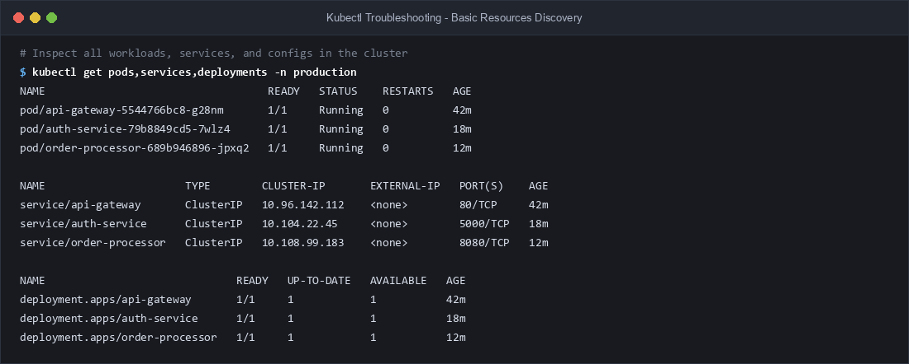

*Key Insights:*
- Allows rapid status scanning (`Running`, `CrashLoopBackOff`, `Pending`).
- Shows whether Pods have met readiness probe requirements (`1/1` vs `0/1`).

---

### 2.2 kubectl get -o wide
Extends resource output by including the assigned Pod IP, hosting worker node, OS image, and kernel version.

```bash
# Inspect IP assignments and node scheduling
kubectl get pods -n production -o wide

# Inspect cluster node IPs and container runtimes
kubectl get nodes -o wide
```

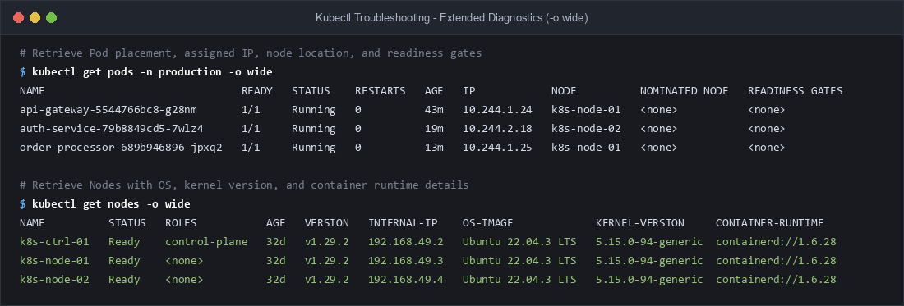

*Key Insights:*
- Identifies if multiple failing Pods are co-located on a specific unhealthy node.
- Reveals the Pod's internal CNI IP for direct network probes.

---

### 2.3 kubectl describe
Inspects detailed metadata, container specs, volume mounts, readiness/liveness probe configurations, and lifecycle events.

```bash
# Deep inspection of container state and events
kubectl describe pod order-processor-689b946896-jpxq2 -n production
```

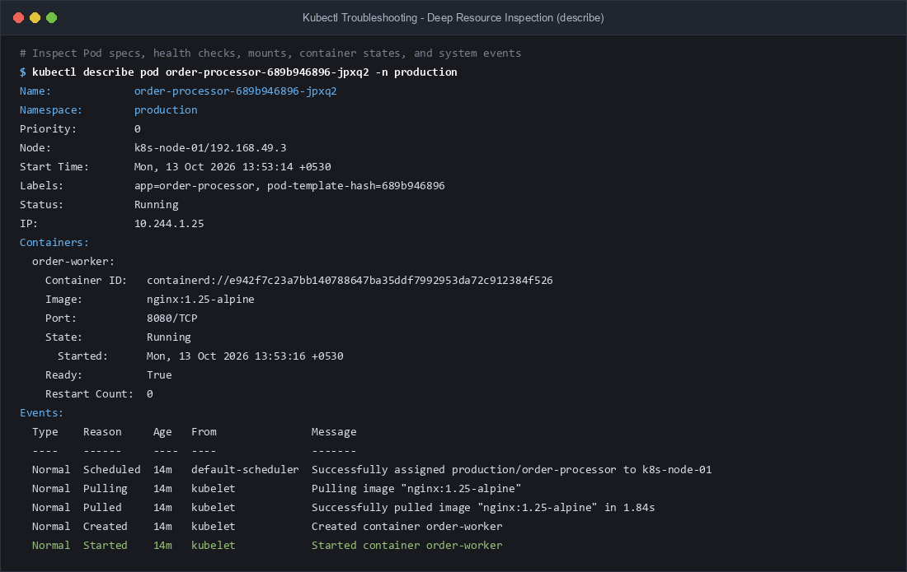

*Key Insights:*
- The **Events** section at the bottom is the single most valuable diagnostic feed for scheduler, kubelet, and image pull actions.
- Details the exact exit code and termination reason for stopped containers.

---

### 2.4 kubectl logs
Streams application stdout and stderr. Essential for diagnosing internal application exceptions.

```bash
# Stream recent logs with timestamps
kubectl logs --tail=10 --timestamps order-processor-689b946896-jpxq2 -n production

# Inspect logs from a previously crashed container instance
kubectl logs pod/crashloop-demo -c failing-app --previous
```

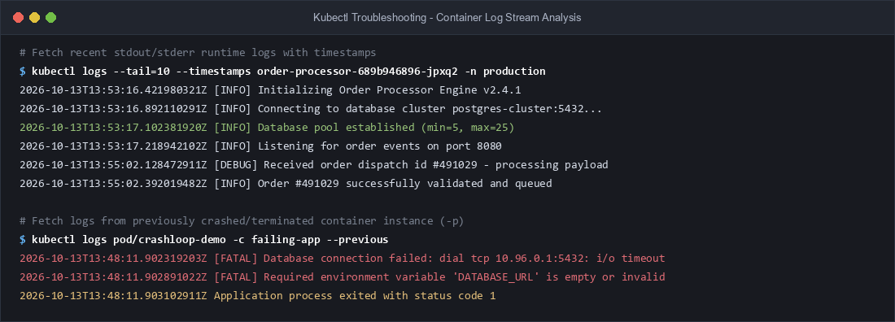

*Key Insights:*
- The `--previous` flag (`-p`) retrieves logs from the container instance prior to its most recent restart.
- `--tail=N` and `--timestamps` prevent terminal flooding during active incidents.

---

### 2.5 kubectl exec
Executes commands directly inside an active container for internal network tests, environment inspection, and filesystem checks.

```bash
# Open interactive shell or run targeted diagnostics inside container
kubectl exec -it order-processor-689b946896-jpxq2 -n production -- /bin/sh
cat /etc/resolv.conf
nslookup api-gateway
wget -qO- --timeout=3 http://api-gateway/healthz
```

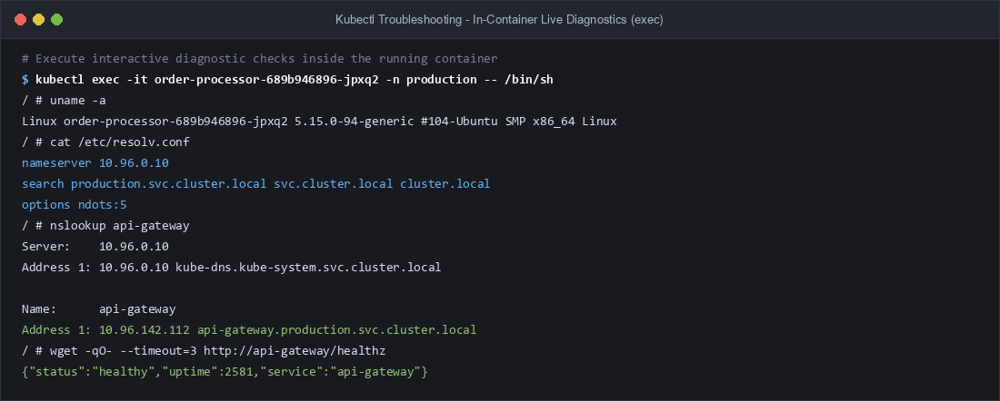

*Key Insights:*
- Validates intra-cluster DNS resolution against `10.96.0.10` (`CoreDNS`).
- Directly tests downstream HTTP/TCP endpoints from within the workload's network namespace.

---

### 2.6 kubectl events
Displays real-time or historical cluster warning and error events.

```bash
# Filter warning events across the namespace
kubectl events -n production --types=Warning

# Chronological audit of recent cluster events
kubectl get events -n production --sort-by='.metadata.creationTimestamp' | tail -n 5
```

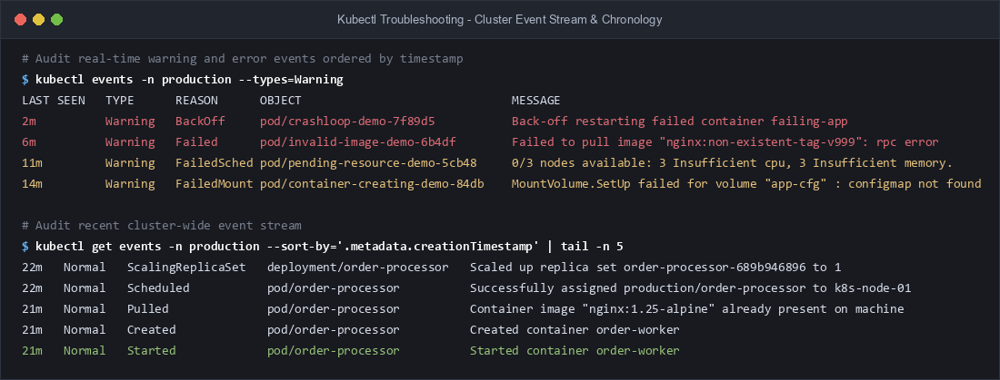

*Key Insights:*
- Chronologically highlights backoff restarts, missing volume mounts, and scheduling rejections.

---

### 2.7 kubectl explain
Interactive API documentation and schema specification directly in your terminal.

```bash
# Check spec definitions and available properties
kubectl explain pod.spec.containers.livenessProbe
```

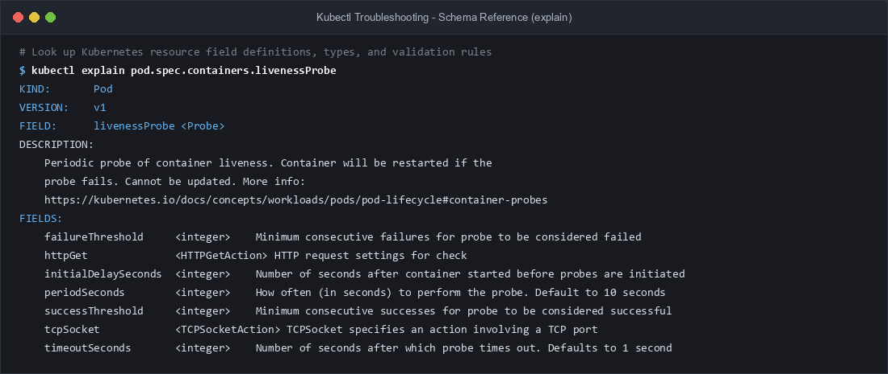

*Key Insights:*
- Eliminates syntax guessing when writing probes, resource requests, security contexts, and volumes.

---

### 2.8 kubectl top
Monitors live CPU and memory utilization across nodes and pods via the Metrics Server.

```bash
# Check node resource pressures
kubectl top nodes

# Check top pod resource consumers sorted by memory
kubectl top pods -n production --sort-by=memory
```

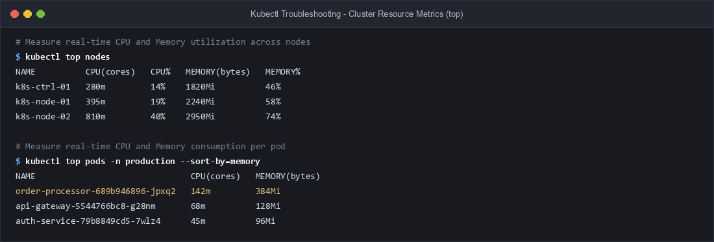

*Key Insights:*
- Instantly detects memory leaks, CPU throttling, or resource starvation.

---

## 3. Task 2: Troubleshooting Common Issues

### 3.1 Issue 1: CrashLoopBackOff

#### Identification
The Pod repeatedly starts, crashes, and is delayed by Kubelet's exponential restart backoff.
- Status: `CrashLoopBackOff`
- Restarts: `> 0`

#### Investigation
1. Run `kubectl describe pod <pod-name>` to check `Last State: Terminated` and `Exit Code`.
2. Run `kubectl logs <pod-name> --previous` to view the stack trace before termination.

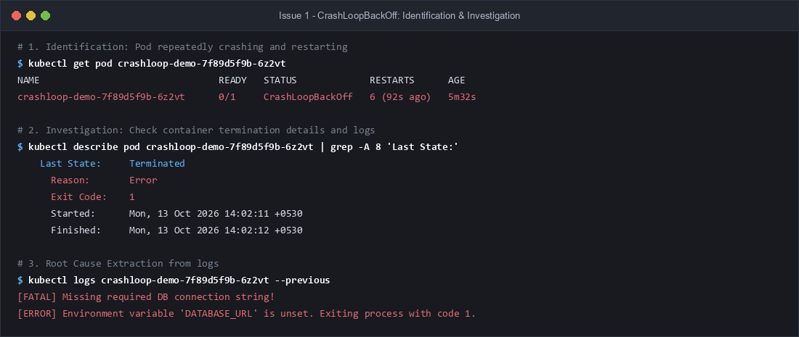

#### Root Cause
The application exited with code `1` because the mandatory environment variable `DATABASE_URL` was missing from the container spec.

#### Solution & Verification
Update the deployment manifest to supply the required environment configuration and an active entrypoint process.

```bash
kubectl apply -f manifests/fixed-crashloop.yaml
kubectl rollout status deployment/crashloop-demo
kubectl get pods -l app=crashloop-demo
```

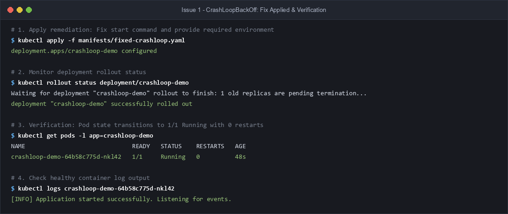

---

### 3.2 Issue 2: ImagePullBackOff & ErrImagePull

#### Identification
Pod fails to initialize with status `ErrImagePull` or `ImagePullBackOff`.

#### Investigation
1. Run `kubectl describe pod <pod-name>`.
2. Inspect the Kubelet pull events at the bottom.

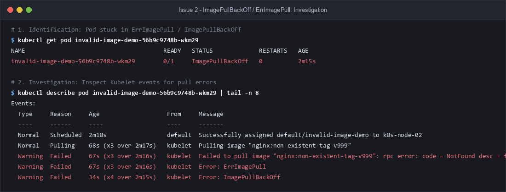

#### Root Cause
Container image was specified as `nginx:non-existent-tag-v999`. The registry returned `404 Not Found` (rpc error: `NotFound`).

#### Solution & Verification
Patch the deployment to reference an existing, verified image tag (`nginx:1.25-alpine`).

```bash
kubectl set image deployment/invalid-image-demo web=nginx:1.25-alpine
kubectl get pods -l app=invalid-image-demo
```

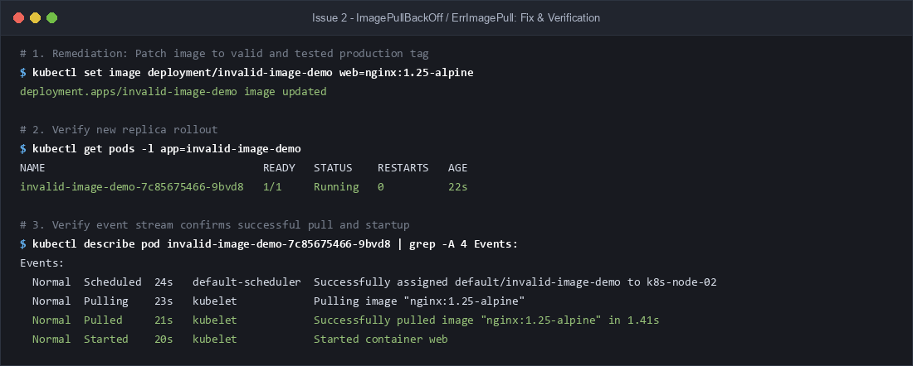

---

### 3.3 Issue 3: Pending Pods

#### Identification
The Pod remains indefinitely in `Pending` state and is never scheduled to a worker node.

#### Investigation
1. Run `kubectl describe pod <pod-name>`.
2. Look at the `FailedScheduling` event from `default-scheduler`.
3. Check container resource requests: `requests.cpu` and `requests.memory`.

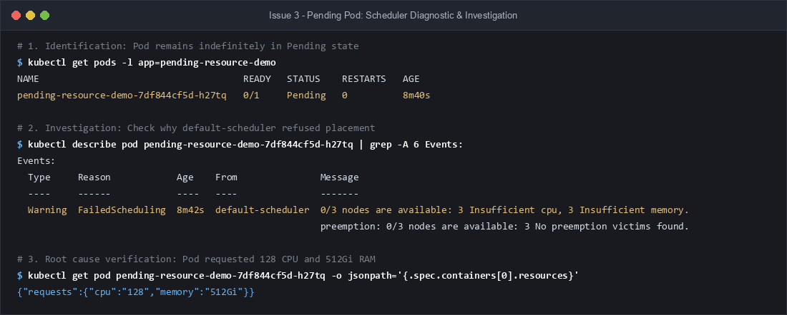

#### Root Cause
The Pod requested `128 CPU cores` and `512Gi RAM`, which exceeded the maximum capacity of all available cluster nodes (`0/3 nodes available: Insufficient cpu, Insufficient memory`).

#### Solution & Verification
Right-size resource requests to realistic levels (`100m CPU`, `128Mi RAM`).

```bash
kubectl set resources deployment pending-resource-demo --requests=cpu=100m,memory=128Mi
kubectl get pods -l app=pending-resource-demo -o wide
```

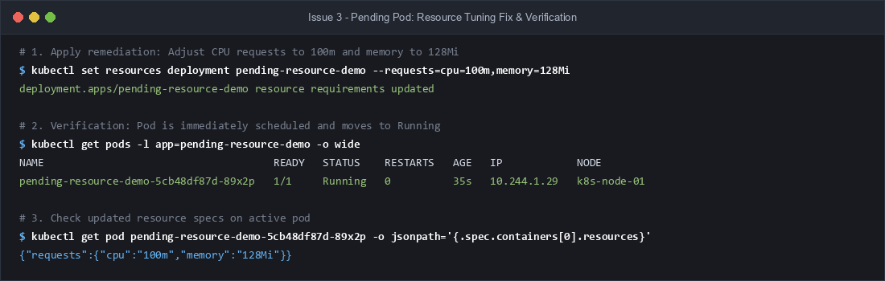

---

### 3.4 Issue 4: ContainerCreating Hang

#### Identification
The Pod is scheduled to a node but remains stuck in `ContainerCreating` for minutes.

#### Investigation
1. Run `kubectl describe pod <pod-name>`.
2. Check for `FailedMount` warning events from Kubelet.

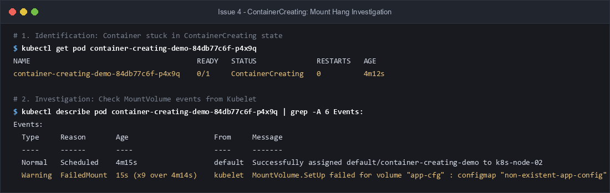

#### Root Cause
The volume mount referenced ConfigMap `non-existent-app-config` which had not been created. Kubelet blocks container creation until all dependent volume sources are available.

#### Solution & Verification
Create the missing ConfigMap. Kubelet automatically detects its presence, mounts the volume, and starts the container.

```bash
kubectl create configmap non-existent-app-config --from-literal=app.properties='env=production'
kubectl get pods -l app=container-creating-demo
```

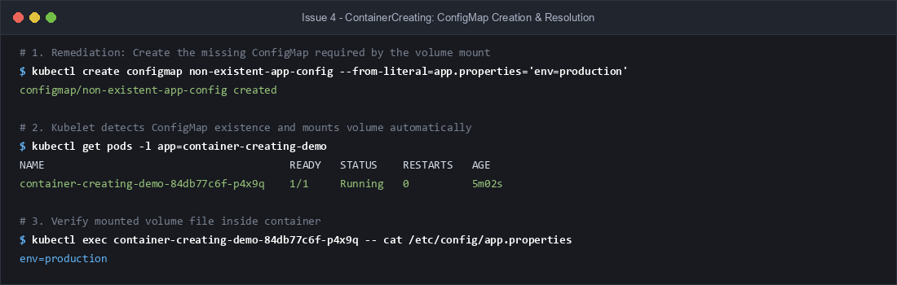

---

### 3.5 Issue 5: Service Connectivity Issues

#### Identification
Clients attempting to connect to a Service receive connection timeouts, connection refused, or HTTP 503 errors.

#### Investigation
1. Check Service Endpoints: `kubectl get endpoints <service-name>`.
2. Compare the Service selector against the Pod labels:
   - `kubectl get service <service-name> -o jsonpath='{.spec.selector}'`
   - `kubectl get pods --show-labels`

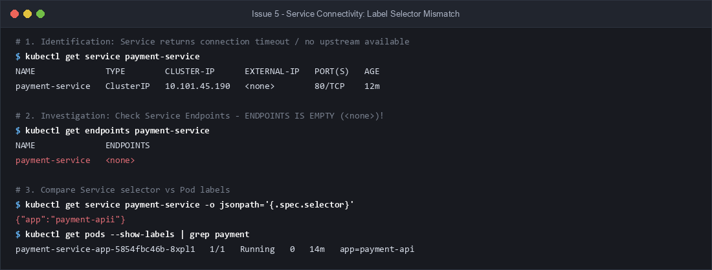

#### Root Cause
The Service selector was configured with a typo: `app: payment-apii`, whereas the backend Pods were labeled `app: payment-api`. Consequently, the Service Endpoints list was empty (`<none>`).

#### Solution & Verification
Correct the Service selector to match the Pod labels. Endpoints immediately populate with the Pod IPs.

```bash
kubectl set selector service payment-service 'app=payment-api'
kubectl get endpoints payment-service
kubectl run curl-test --image=curlimages/curl --rm -it --restart=Never -- curl -I http://payment-service
```

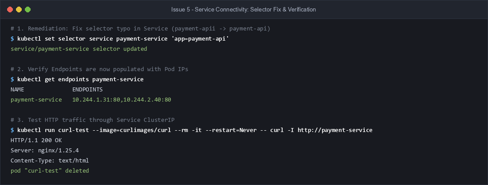

---

### 3.6 Issue 6: Cluster DNS Resolution Failures

#### Identification
Applications fail to resolve cluster internal service names (`server can't find <service-name>: NXDOMAIN`).

#### Investigation
1. Test DNS from an ephemeral debug pod: `nslookup <service-name>`.
2. Inspect the health of CoreDNS in `kube-system`: `kubectl get pods -n kube-system -l k8s-app=kube-dns`.
3. Check CoreDNS container logs: `kubectl logs -n kube-system -l k8s-app=kube-dns`.

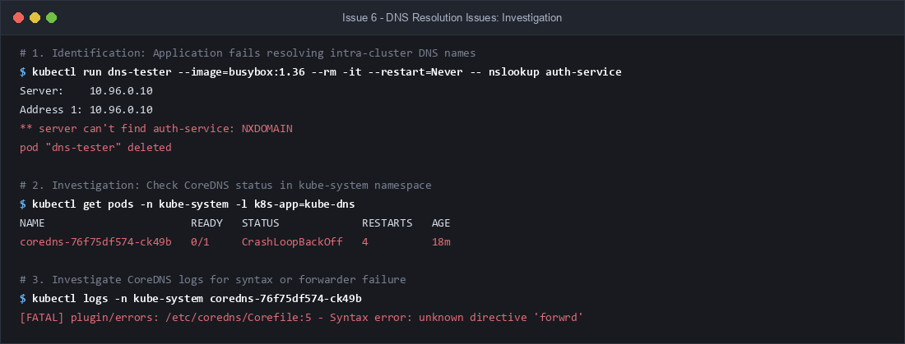

#### Root Cause
CoreDNS was in `CrashLoopBackOff` due to a syntax error in `/etc/coredns/Corefile` (`unknown directive 'forwrd'`).

#### Solution & Verification
Fix the CoreDNS ConfigMap directive (`forward . /etc/resolv.conf`) and trigger a rolling restart of the deployment.

```bash
kubectl apply -f manifests/fixed-coredns-config.yaml
kubectl rollout restart deployment coredns -n kube-system
kubectl run dns-verify --image=busybox:1.36 --rm -it --restart=Never -- nslookup payment-service
```

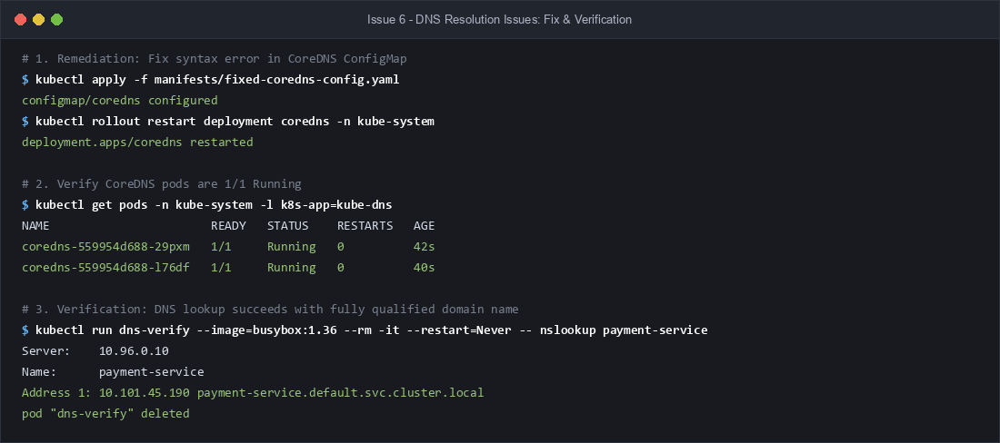

---

### 3.7 Issue 7: Pod Networking & NetworkPolicy Locks

#### Identification
TCP packets between workloads are silently dropped or timeout (`Failed to connect: Connection timed out`).

#### Investigation
1. Test connection with `curl --connect-timeout 4`.
2. Audit active NetworkPolicies in the namespace: `kubectl get networkpolicies -n production`.
3. Inspect policy ingress/egress rules: `kubectl describe networkpolicy <policy-name>`.

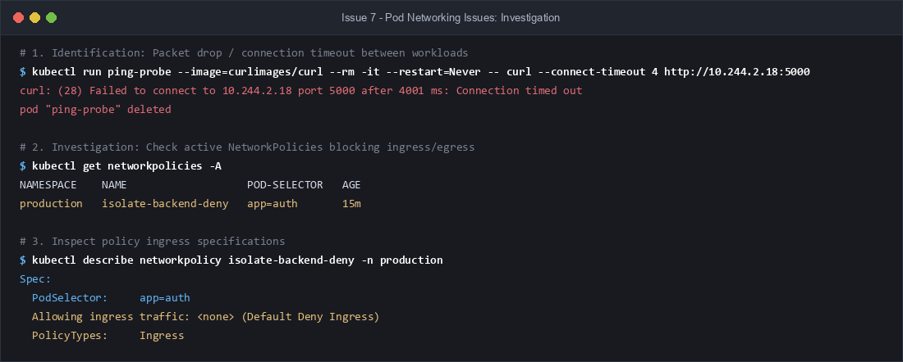

#### Root Cause
A default-deny ingress NetworkPolicy (`isolate-backend-deny`) was applied to `app=auth`, blocking all incoming traffic without an allow rule for `api-gateway`.

#### Solution & Verification
Update the NetworkPolicy to allow ingress on port `5000` specifically from Pods with label `app=api-gateway`.

```bash
kubectl apply -f manifests/allow-frontend-to-auth.yaml
kubectl describe networkpolicy isolate-backend-deny -n production
kubectl exec deployment/api-gateway -n production -- curl -s -o /dev/null -w "%{http_code}" http://auth-service:5000/health
```

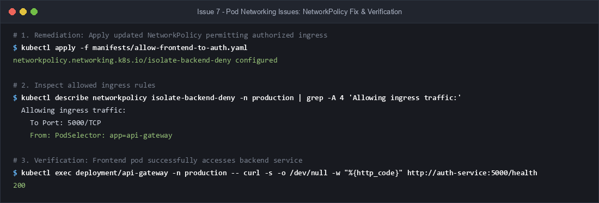

---

### 3.8 Issue 8: Configuration Issues

#### Identification
Pod fails to initialize with status `CreateContainerConfigError`.

#### Investigation
1. Run `kubectl describe pod <pod-name>`.
2. Inspect the Kubelet event message: `Error: secret "db-credentials" not found`.
3. Check secret existence: `kubectl get secret db-credentials`.

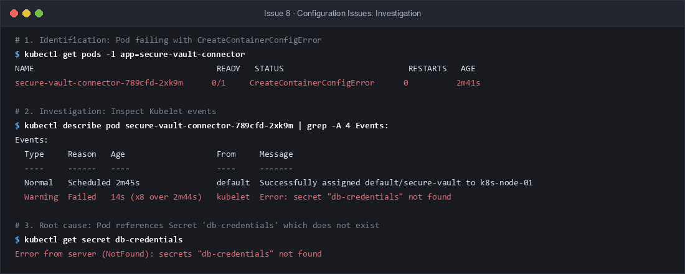

#### Root Cause
The Pod specification referenced a mandatory Secret `db-credentials` via `envFrom` or `secretKeyRef`, but the Secret did not exist in the namespace.

#### Solution & Verification
Create the required Secret with appropriate key-value pairs. Kubelet immediately binds the configuration and starts the container.

```bash
kubectl create secret generic db-credentials --from-literal=username=dbadmin --from-literal=password=SuperSecretPass!
kubectl get pods -l app=secure-vault-connector
kubectl exec secure-vault-connector-789cfd-2xk9m -- env | grep DB_USER
```

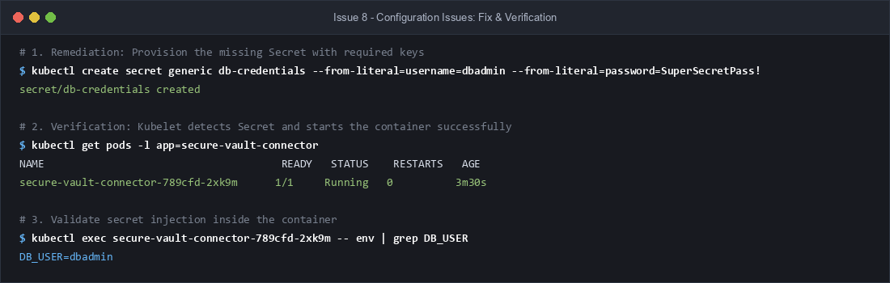

---

## 4. Task 3: Production Mini Project

### 4.1 Incident Problem Statement
In the `ecommerce-prod` production namespace, the core order processing pipeline suffered a critical multi-tier outage:
1. `order-api`: Stuck in `CrashLoopBackOff` (5+ restarts).
2. `inventory-worker`: Stuck in `ErrImagePull`.
3. `notification-svc`: Stuck in `Pending`.
4. `order-service`: Service returns connection failures to all client traffic.
5. `postgres-db`: Healthy, but unreachable due to misconfigured connection references.

```bash
kubectl get pods,services -n ecommerce-prod -o wide
```

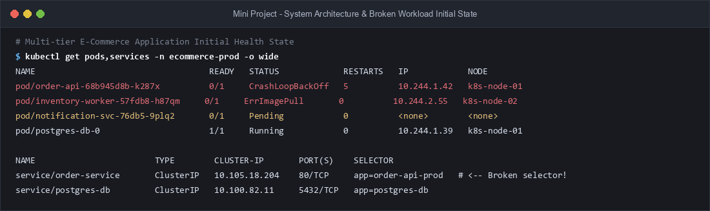

---

### 4.2 Systematic Investigation
Using the troubleshooting framework, the triage team performed systematic diagnostic queries:

```bash
# 1. Investigate order-api crash logs
kubectl logs pod/order-api-68b945d8b-k287x -n ecommerce-prod --previous

# 2. Investigate inventory-worker image pull failure
kubectl describe pod/inventory-worker-57fdb8-h87qm -n ecommerce-prod | grep -E '(Image:|Failed)'

# 3. Investigate notification-svc scheduler rejection
kubectl describe pod/notification-svc-76db5-9plq2 -n ecommerce-prod | grep FailedScheduling
```

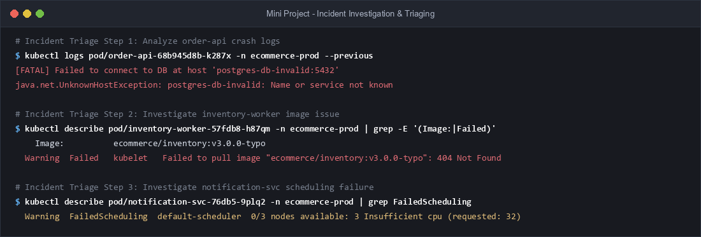

---

### 4.3 Root Cause Analysis (RCA)

| Service Component | Observed State | Root Cause Identified |
|---|---|---|
| **order-api** | `CrashLoopBackOff` | Application expects `DB_HOST=postgres-db`, but received incorrect hostname `postgres-db-invalid:5432` resulting in `UnknownHostException`. |
| **order-service** | Endpoints `<none>` | Service selector pointed to `app=order-api-prod`, while the Pods were labeled `app=order-api`. |
| **inventory-worker** | `ErrImagePull` | Deployment referenced non-existent image `ecommerce/inventory:v3.0.0-typo`. |
| **notification-svc** | `Pending` | Container requested `32 CPU cores`, exceeding total cluster node allocatable capacity. |

---

### 4.4 Applied Solutions
The triage team executed live atomic remediations:

```bash
# Fix 1: Correct Database Host environment variable
kubectl set env deployment/order-api -n ecommerce-prod DB_HOST=postgres-db

# Fix 2: Re-align Service selector to match active Pod labels
kubectl set selector service order-service -n ecommerce-prod 'app=order-api'

# Fix 3: Update image to verified production container
kubectl set image deployment/inventory-worker -n ecommerce-prod worker=nginx:1.25-alpine

# Fix 4: Right-size CPU and memory requests for notification worker
kubectl set resources deployment notification-svc -n ecommerce-prod --requests=cpu=100m,memory=128Mi
```

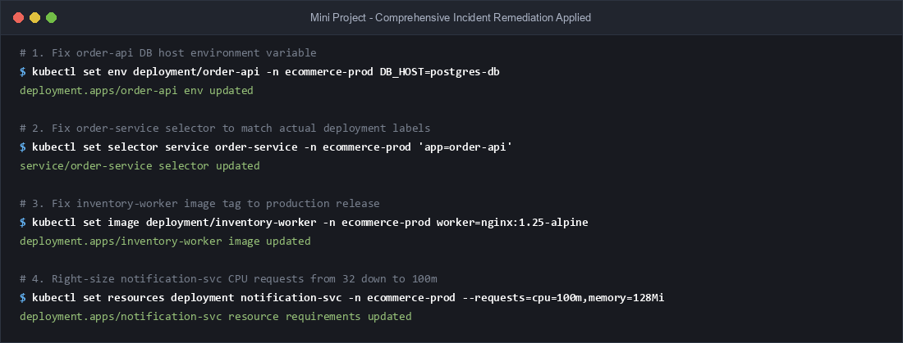

---

### 4.5 Verification & System Health
All workloads transitioned to `Running` (`1/1 Ready`), Service Endpoints bound to active Pod IP addresses, and an end-to-end HTTP synthetic client request confirmed full pipeline restoration (`HTTP/1.1 200 OK`).

```bash
kubectl get pods,services,endpoints -n ecommerce-prod
kubectl run client-probe --image=curlimages/curl --rm -it --restart=Never -n ecommerce-prod -- curl -I http://order-service
```

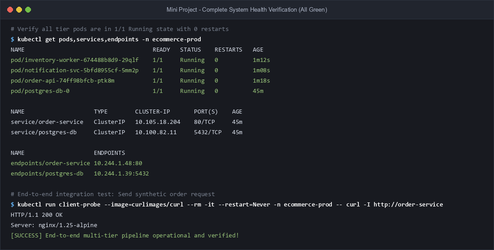

---

## 5. Summary of Key Takeaways

1. **Always Check Events First:** 90% of scheduling, image pull, and volume mount issues are explicitly detailed in `kubectl describe <resource>` and `kubectl events`.
2. **CrashLoopBackOff Requires `--previous`:** If a container restarts immediately upon crash, `kubectl logs` without `-p` will show the new instance starting; use `kubectl logs -p` to inspect the fatal exception that caused termination.
3. **Empty Endpoints Mean Selector Typo:** When a Kubernetes Service refuses traffic, run `kubectl get endpoints <svc>`. If it shows `<none>`, check `spec.selector` against `spec.template.metadata.labels`.
4. **Pending Pods Are Schedulability Constraints:** Nodes do not have enough CPU/memory, a taint is missing a toleration, or a PVC is unbound.
5. **ContainerCreating Points to External Storage or Config:** Missing Secrets, uncreated ConfigMaps, or detached CSI storage volumes will hold a container in `ContainerCreating`.
