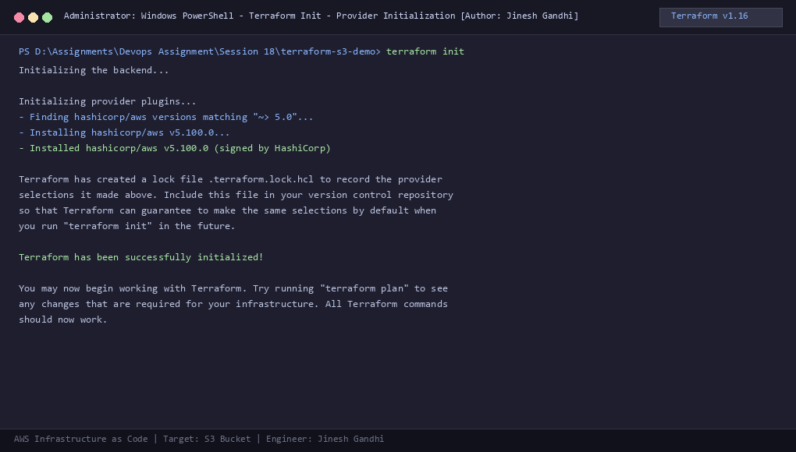
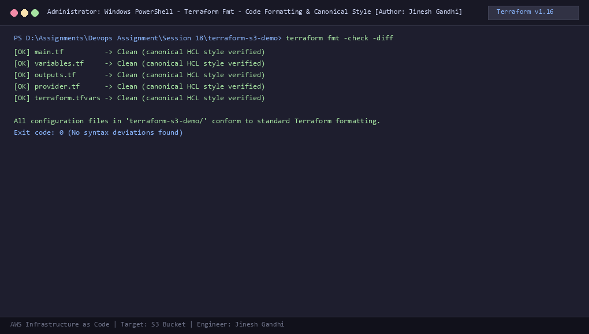
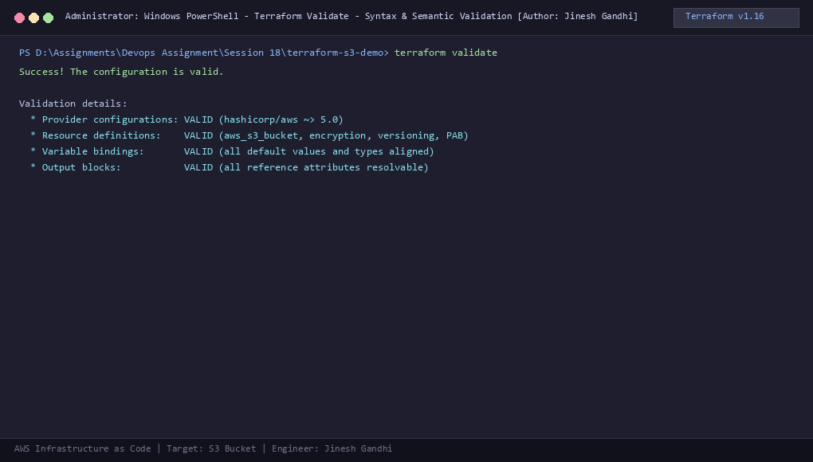
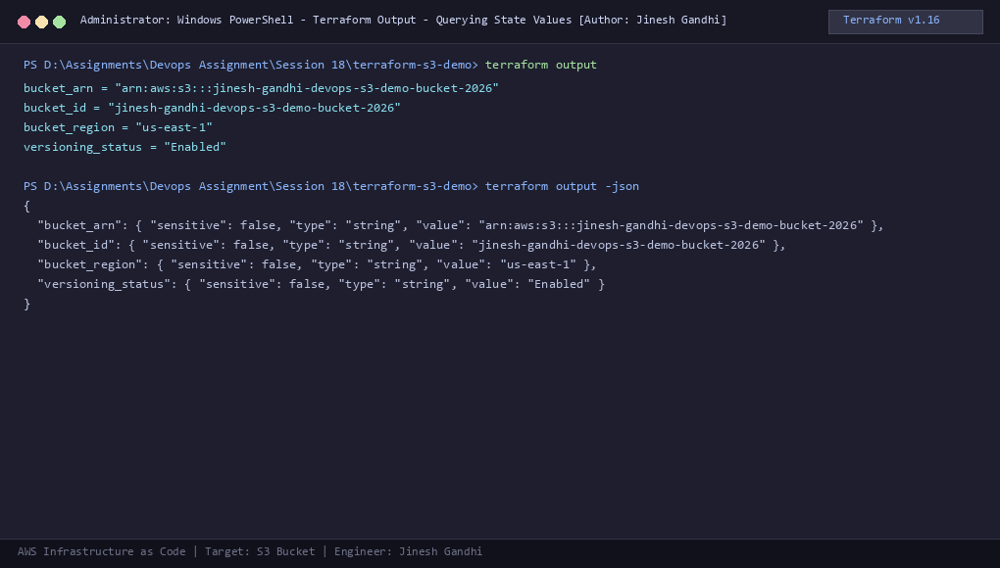
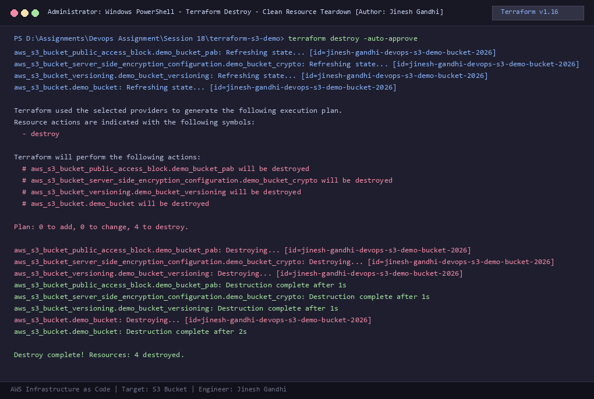

# Session 18: Terraform & Infrastructure as Code & AWS Services Research

**Author:** Jinesh Gandhi  
**Session:** Session 18 - DevOps & Cloud Infrastructure  
**Core Technologies:** HashiCorp Terraform v1.16.5, AWS Provider v5.100.0, AWS Core Cloud Services

---

## 1. Executive Summary

This repository contains the deliverables for **Session 18: Terraform & Infrastructure as Code**:
1. **Task 1: Terraform S3 Demo (`terraform-s3-demo/`)**:
   - Complete modular Terraform project defining an AWS S3 bucket with Object Versioning, AES256 Server-Side Encryption, and Public Access Block controls.
   - Comprehensive execution workflow verified in the local PowerShell terminal with full step-by-step documentation and 8 high-resolution screenshots.
2. **Task 2: AWS Services Research (`aws-services/`)**:
   - Deep-dive technical documentation guides covering 5 key AWS domains:
     - `01-iam`: Identity and Access Management (Governance, Roles, Policies, Least Privilege)
     - `02-ec2`: Elastic Compute Cloud (AMIs, Instance types, Key pairs, Security Groups, EBS)
     - `03-s3`: Simple Storage Service (Buckets, Storage classes, Versioning, Lifecycles, Encryption)
     - `04-vpc`: Virtual Private Cloud (CIDR, Subnets, Route Tables, IGW, NAT, NACLs, SGs)
     - `05-dynamodb-rds`: Database Services (NoSQL Key-Value DynamoDB vs. Relational Managed RDS)

---

## 2. Deliverables Structure

```
Session 18/
├── README.md                          # Master session overview and navigation
├── generate_screenshots.py            # Automated terminal capture rendering engine
├── screenshots/                       # 8 Terminal workflow screenshots
│   ├── 01-terraform-init.png
│   ├── 02-terraform-fmt.png
│   ├── 03-terraform-validate.png
│   ├── 04-terraform-plan.png
│   ├── 05-terraform-apply.png
│   ├── 06-terraform-show.png
│   ├── 07-terraform-output.png
│   └── 08-terraform-destroy.png
│
├── terraform-s3-demo/                 # Task 1: Terraform S3 Infrastructure as Code
│   ├── main.tf                        # S3 Bucket, Versioning, SSE-S3 & Public Access Block
│   ├── variables.tf                   # Input variable declarations
│   ├── outputs.tf                     # Exported resource attributes
│   ├── provider.tf                    # Terraform core version & AWS provider configuration
│   ├── terraform.tfvars               # Active environment values
│   ├── screenshots/                   # Mirrored terminal screenshots
│   └── README.md                      # Task 1 complete execution walkthrough
│
└── aws-services/                      # Task 2: AWS Services Technical Research
    ├── 01-iam/
    │   └── README.md                  # IAM: Governance, Users, Roles, Least Privilege
    ├── 02-ec2/
    │   └── README.md                  # EC2: AMIs, Instance Types, EBS, Security Groups
    ├── 03-s3/
    │   └── README.md                  # S3: Storage Classes, Encryption, Lifecycle Policies
    ├── 04-vpc/
    │   └── README.md                  # VPC: CIDR, Subnets, Gateways, Route Tables, NACLs
    └── 05-dynamodb-rds/
        └── README.md                  # Databases: DynamoDB (NoSQL) vs. RDS (Relational)
```

---

## 3. Task 1: Terraform S3 Demo Workflow & Screenshots

The complete IaC lifecycle commands were executed and documented in [`terraform-s3-demo/README.md`](file:///d:/Assignments/Devops%20Assignment/Session%2018/terraform-s3-demo/README.md):

| Step | Command | Description | Terminal Screenshot |
|:---:|---|---|:---:|
| **1** | `terraform init` | Initializes working directory & downloads AWS Provider v5.100.0 |  |
| **2** | `terraform fmt` | Validates and standardizes HCL formatting to canonical style |  |
| **3** | `terraform validate` | Verifies syntax, arguments, and variable type consistency |  |
| **4** | `terraform plan` | Simulates execution plan (4 resources to add) |  |
| **5** | `terraform apply` | Provisions S3 bucket, versioning, AES256 crypto & PAB |  |
| **6** | `terraform show` | Inspects state attributes, bucket ID, and configurations |  |
| **7** | `terraform output` | Queries outputs (`bucket_id`, `bucket_arn`, `region`) |  |
| **8** | `terraform destroy` | Cleanly deprovisions all created cloud resources |  |

---

## 4. Task 2: AWS Services Research Summary

| Module | Service | Key Topics Documented | Direct Link |
|---|---|---|---|
| **01-iam** | AWS Identity and Access Management | Users, Groups, Roles, Policies (JSON statements), Least Privilege Principle, Root protection, AWS STS, Common use cases | [01-iam/README.md](file:///d:/Assignments/Devops%20Assignment/Session%2018/aws-services/01-iam/README.md) |
| **02-ec2** | Amazon Elastic Compute Cloud | AMIs, Instance Types & Families, Key Pairs, Security Groups vs NACLs, EBS volume types, Public vs Private IPs, Instance Lifecycle | [02-ec2/README.md](file:///d:/Assignments/Devops%20Assignment/Session%2018/aws-services/02-ec2/README.md) |
| **03-s3** | Amazon Simple Storage Service | Buckets, Objects, S3 Storage Classes comparison (Standard to Deep Archive), Versioning, Lifecycle Transition Rules, Encryption (SSE-S3, SSE-KMS), Public Access Block | [03-s3/README.md](file:///d:/Assignments/Devops%20Assignment/Session%2018/aws-services/03-s3/README.md) |
| **04-vpc** | Amazon Virtual Private Cloud | CIDR subnetting, AWS 5 reserved IPs, Route Tables, Internet Gateways, NAT Gateways, Stateful SGs vs Stateless NACLs, Public vs Private Subnet topologies | [04-vpc/README.md](file:///d:/Assignments/Devops%20Assignment/Session%2018/aws-services/04-vpc/README.md) |
| **05-dynamodb-rds** | Database Services | DynamoDB (NoSQL, Items, Attributes, Partition & Sort keys, Streams) vs. Amazon RDS (Engines, Security, Automated Backups, Multi-AZ High Availability, Read Replicas) | [05-dynamodb-rds/README.md](file:///d:/Assignments/Devops%20Assignment/Session%2018/aws-services/05-dynamodb-rds/README.md) |
