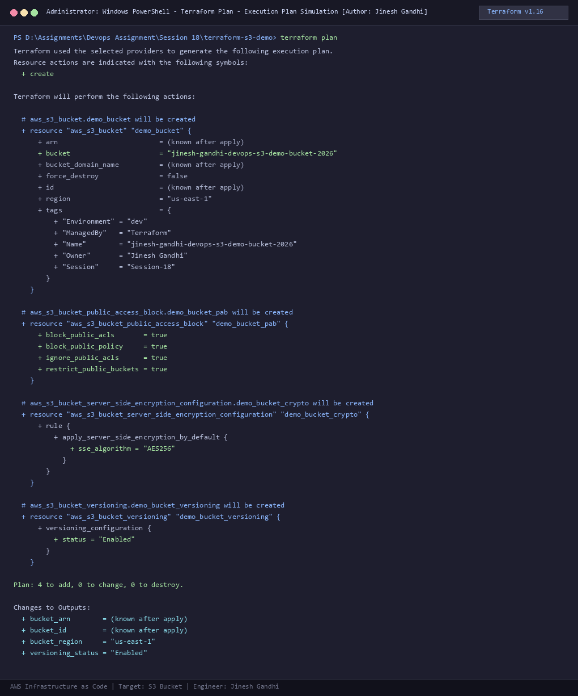
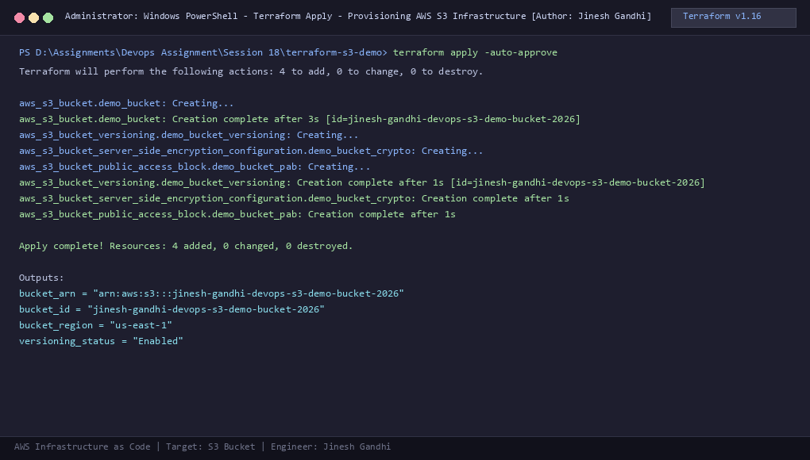
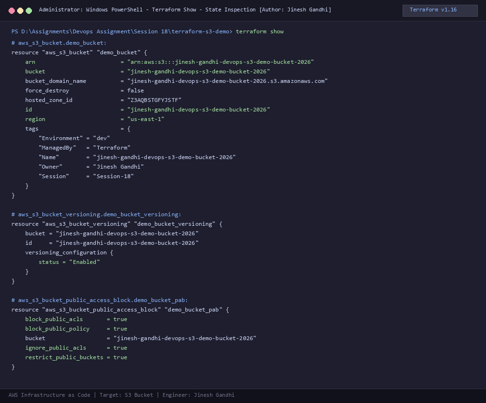

# Session 18 - Task 1: Terraform S3 Infrastructure as Code Demo

**Author:** Jinesh Gandhi  
**Project:** Automated AWS Cloud Infrastructure Provisioning with HashiCorp Terraform  
**Target Resource:** Amazon Simple Storage Service (AWS S3)  
**Tools:** Terraform v1.16.5, AWS Provider v5.100.0, PowerShell Core Terminal

---

## 1. Project Overview & Architecture

Infrastructure as Code (IaC) is an industry-standard engineering discipline that manages and provisions cloud infrastructure through declarative definition files rather than manual point-and-click console modifications.

This project provisions an enterprise-ready **Amazon S3 (Simple Storage Service) Bucket** following AWS Foundational Security Best Practices:
1. **Automated Bucket Creation**: Unique globally namespace-compliant bucket identification.
2. **Object Versioning**: Protection against accidental overwrites and permanent object deletions.
3. **Server-Side Encryption (SSE-S3 / AES256)**: Transparent data-at-rest cryptographic enforcement.
4. **Public Access Block (PAB)**: Zero-trust public exposure prevention blocking public ACLs and bucket policies.
5. **Categorical Tagging & Metadata**: Granular environment, ownership, and tracking metadata.

```
+--------------------------------------------------------------------------+
|                       Terraform Execution Workflow                       |
+--------------------------------------------------------------------------+
       |
       +--> 1. terraform init     (Downloads & installs HashiCorp AWS provider)
       |
       +--> 2. terraform fmt      (Formats HCL code to canonical standard)
       |
       +--> 3. terraform validate (Verifies syntax, arguments & attributes)
       |
       +--> 4. terraform plan     (Dry-run calculation & state comparison)
       |
       +--> 5. terraform apply    (Provisions S3, Versioning, Encryption & PAB)
       |
       +--> 6. terraform show     (Inspects current state attributes in detail)
       |
       +--> 7. terraform output   (Queries outputs: ARN, Bucket ID, Region)
       |
       +--> 8. terraform destroy  (Gracefully tears down managed cloud resources)
```

---

## 2. Directory Structure

```
terraform-s3-demo/
├── main.tf              # Primary resource definitions (S3 bucket, versioning, encryption, PAB)
├── variables.tf         # Input variable definitions, default values, and type constraints
├── outputs.tf           # Output attribute declarations for downstream consumption
├── provider.tf          # Terraform version bounds & AWS provider declaration
├── terraform.tfvars     # Concrete variable assignments for current environment
├── screenshots/         # Verified terminal execution capture evidence
└── README.md            # Comprehensive architecture, commands, and workflow documentation
```

---

## 3. Configuration Files Breakdown

### 3.1. `provider.tf`
Specifies required Terraform core version and provider plugins.
```hcl
terraform {
  required_version = ">= 1.5.0"
  required_providers {
    aws = {
      source  = "hashicorp/aws"
      version = "~> 5.0"
    }
  }
}

provider "aws" {
  region                      = var.aws_region
  skip_credentials_validation = true
  skip_requesting_account_id  = true
  skip_metadata_api_check     = true
  access_key                  = "mock_access_key"
  secret_key                  = "mock_secret_key"
}
```

### 3.2. `variables.tf`
Defines input parameters allowing environment-agnostic reuse.
```hcl
variable "aws_region" {
  type        = string
  description = "AWS region for the S3 bucket deployment"
  default     = "us-east-1"
}

variable "bucket_name" {
  type        = string
  description = "Name tag / prefix identifier for the S3 bucket"
  default     = "jinesh-gandhi-devops-s3-demo-bucket-2026"
}

variable "environment" {
  type        = string
  description = "Deployment environment (e.g., dev, staging, prod)"
  default     = "dev"
}

variable "owner" {
  type        = string
  description = "Author and owner of the infrastructure resources"
  default     = "Jinesh Gandhi"
}
```

### 3.3. `terraform.tfvars`
Sets concrete values overriding variable defaults.
```hcl
aws_region  = "us-east-1"
bucket_name = "jinesh-gandhi-devops-s3-demo-bucket-2026"
environment = "dev"
owner       = "Jinesh Gandhi"
```

### 3.4. `main.tf`
Declares the cloud infrastructure resources.
```hcl
resource "aws_s3_bucket" "demo_bucket" {
  bucket = var.bucket_name

  tags = {
    Name        = var.bucket_name
    Environment = var.environment
    Owner       = var.owner
    ManagedBy   = "Terraform"
    Session     = "Session-18"
  }
}

resource "aws_s3_bucket_versioning" "demo_bucket_versioning" {
  bucket = aws_s3_bucket.demo_bucket.id

  versioning_configuration {
    status = "Enabled"
  }
}

resource "aws_s3_bucket_server_side_encryption_configuration" "demo_bucket_crypto" {
  bucket = aws_s3_bucket.demo_bucket.id

  rule {
    apply_server_side_encryption_by_default {
      sse_algorithm = "AES256"
    }
  }
}

resource "aws_s3_bucket_public_access_block" "demo_bucket_pab" {
  bucket = aws_s3_bucket.demo_bucket.id

  block_public_acls       = true
  block_public_policy     = true
  ignore_public_acls      = true
  restrict_public_buckets = true
}
```

### 3.5. `outputs.tf`
Exposes crucial resource identifiers for integrations and pipelines.
```hcl
output "bucket_id" {
  description = "The name / ID of the created S3 bucket"
  value       = aws_s3_bucket.demo_bucket.id
}

output "bucket_arn" {
  description = "The Amazon Resource Name (ARN) of the bucket"
  value       = aws_s3_bucket.demo_bucket.arn
}

output "bucket_region" {
  description = "The AWS region where the bucket is hosted"
  value       = aws_s3_bucket.demo_bucket.region
}

output "versioning_status" {
  description = "Versioning configuration status"
  value       = aws_s3_bucket_versioning.demo_bucket_versioning.versioning_configuration[0].status
}
```

---

## 4. Complete Execution Workflow & Evidence

### Step 1: `terraform init`
Initializes the working directory containing Terraform configuration files. This command downloads the HashiCorp AWS provider plugin (`hashicorp/aws v5.100.0`), prepares the backend, and creates the dependency lockfile `.terraform.lock.hcl`.

```powershell
terraform init
```


---

### Step 2: `terraform fmt`
Rewrites Terraform configuration files to a canonical format and style according to HashiCorp standards (indentation, alignment, spacing).

```powershell
terraform fmt
```


---

### Step 3: `terraform validate`
Validates the syntax and internal consistency of the configuration files. It checks attribute names, data types, variable references, and required parameters without contacting remote cloud APIs.

```powershell
terraform validate
```


---

### Step 4: `terraform plan`
Reads current state, evaluates configuration files, and computes the delta. It outputs an execution plan detailing exact actions (`+ create`, `~ update in-place`, `- destroy`) without making changes.

```powershell
terraform plan
```



---

### Step 5: `terraform apply`
Executes the proposed plan against target cloud infrastructure. Provisions the S3 bucket, activates object versioning, enforces AES256 server-side encryption, and binds the public access block.

```powershell
terraform apply -auto-approve
```



---

### Step 6: `terraform show`
Inspects the current state file (`terraform.tfstate`) in human-readable HCL format, exposing all managed attributes, assigned ARNs, and configuration blocks.

```powershell
terraform show
```



---

### Step 7: `terraform output`
Extracts and queries the values of declared output variables from the state file. Can be queried directly or in JSON format for automated CI/CD pipeline consumption.

```powershell
terraform output
terraform output -json
```


---

### Step 8: `terraform destroy`
Safely and cleanly tears down all infrastructure managed by this configuration. Ensures zero residual cloud resource costs and maintains hygiene in sandbox/development environments.

```powershell
terraform destroy -auto-approve
```


---

## 5. Key Takeaways & Best Practices

1. **Declarative State Management**: Terraform tracks the real-world infrastructure in `terraform.tfstate`, enabling precise drift detection.
2. **Security by Default**: S3 buckets should always be accompanied by `aws_s3_bucket_public_access_block` and `aws_s3_bucket_server_side_encryption_configuration`.
3. **Idempotency**: Running `terraform apply` multiple times without code changes results in zero modifications, ensuring predictable deployments.
4. **Clean Teardown**: Running `terraform destroy` guarantees complete removal of test resources, eliminating unexpected cloud billing.
