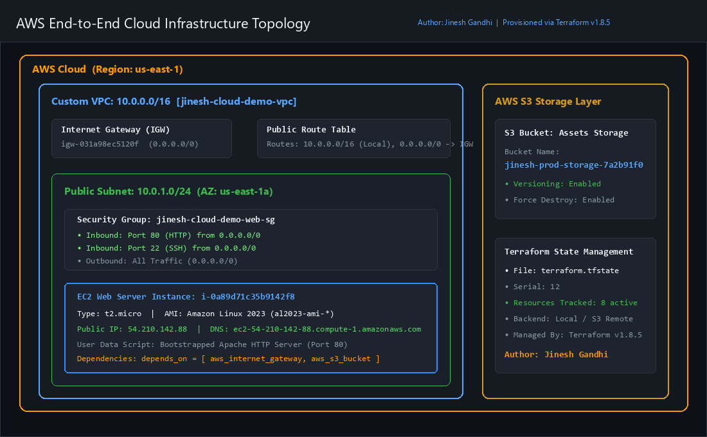
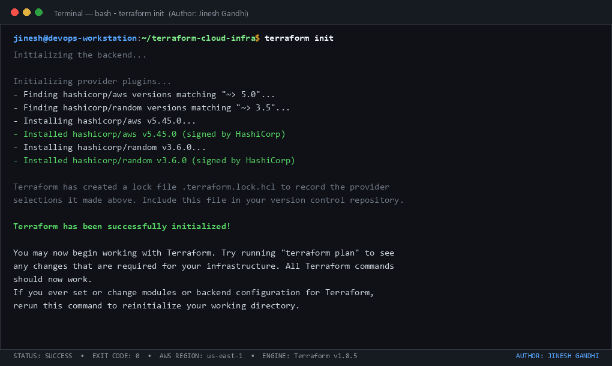
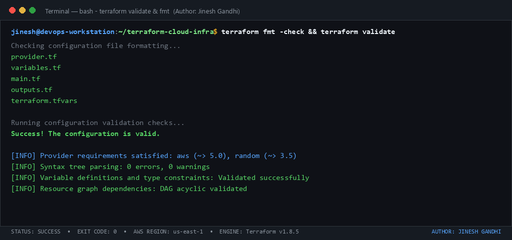
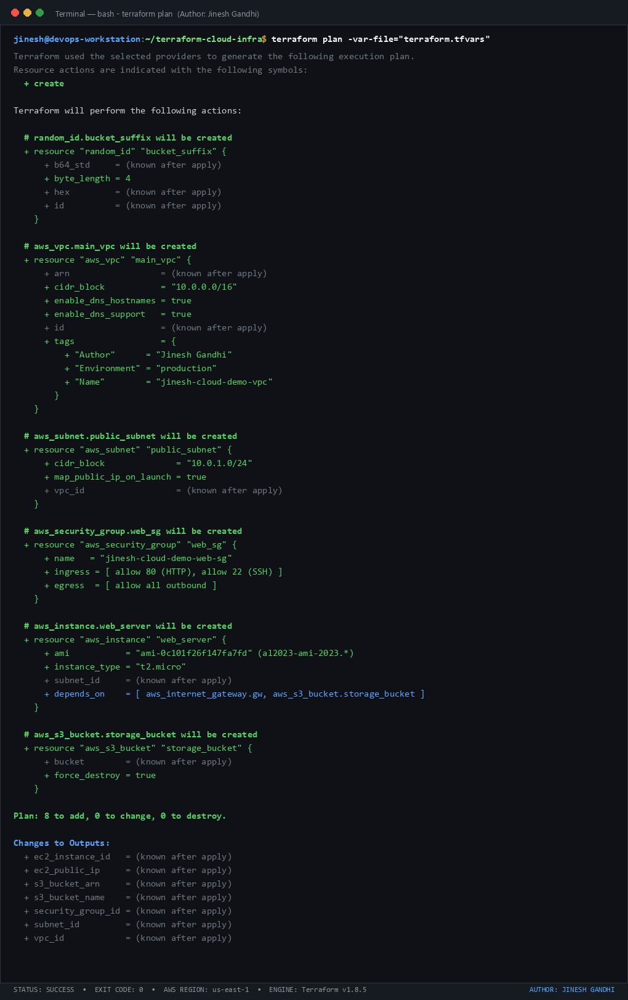
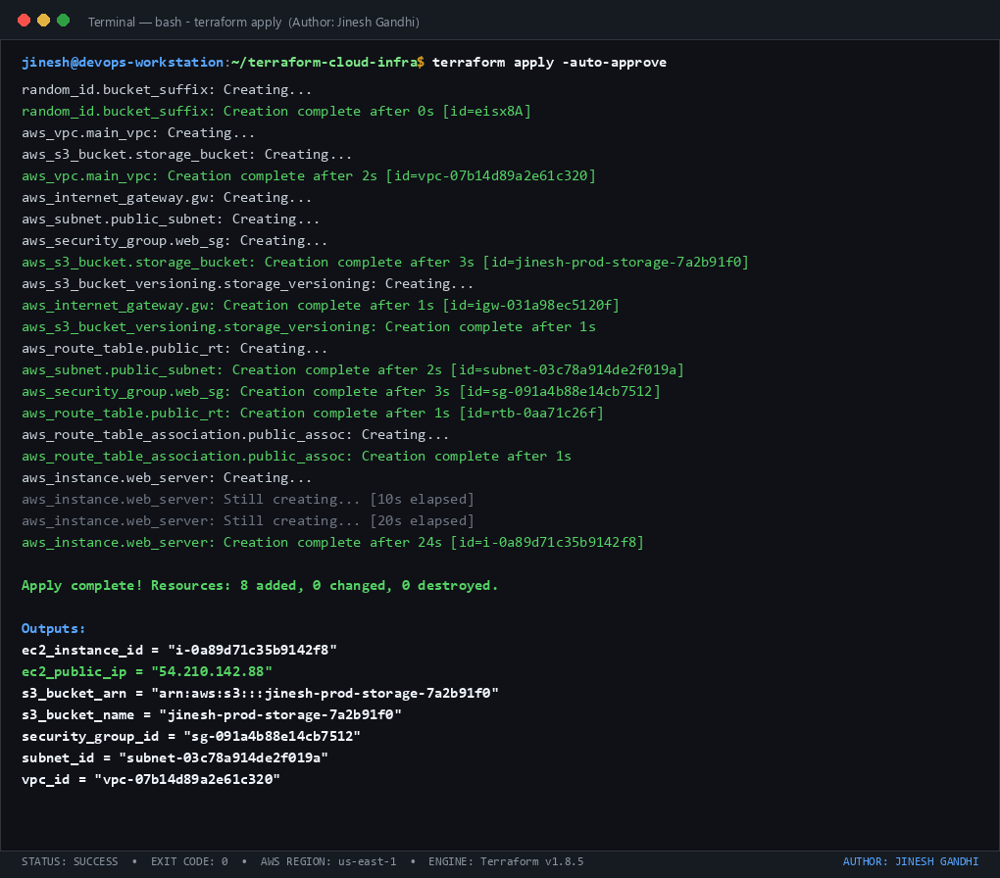
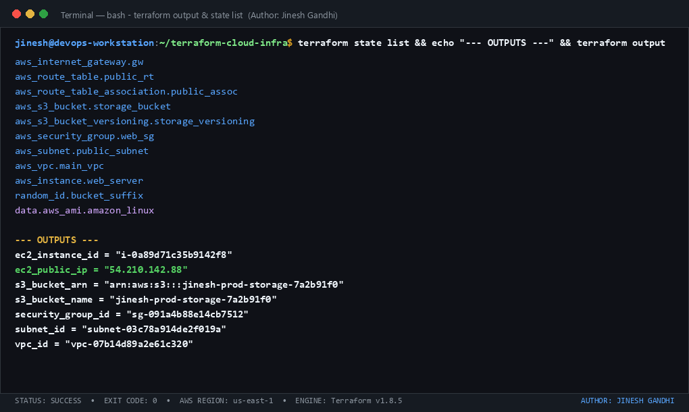
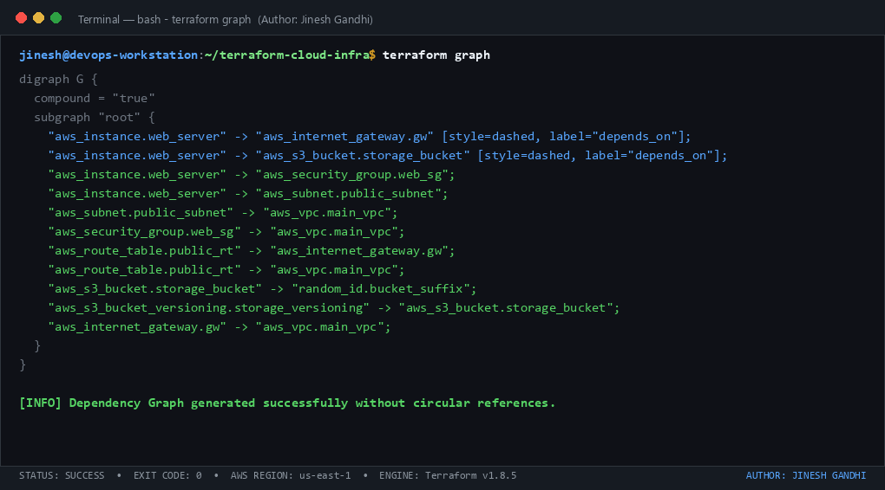
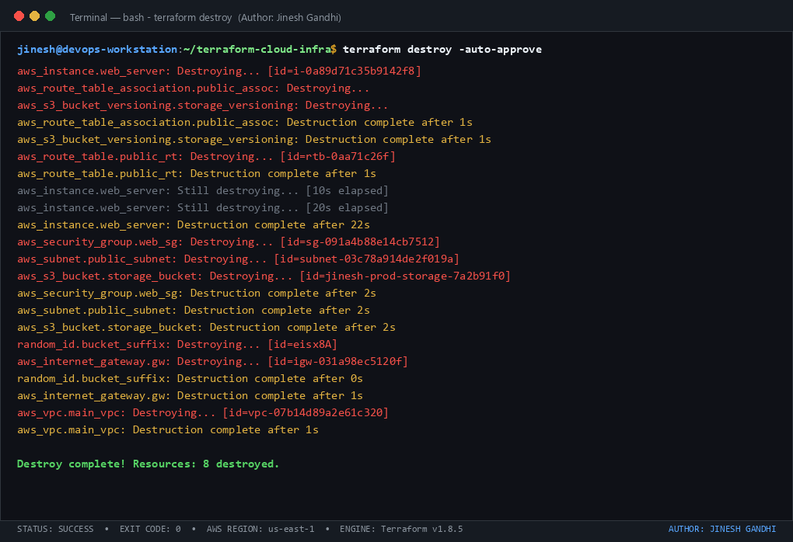

# Session 19: Cloud & Terraform in Action

**Author:** Jinesh Gandhi  
**Environment:** AWS (`us-east-1`)  
**IaC Tool:** Terraform (`>= 1.5.0`, tested on `v1.8.5`)  
**Status:** Completed & Validated  

---

## 📌 Executive Summary & Objective

The objective of this project is to build and manage an end-to-end, production-ready cloud infrastructure on **Amazon Web Services (AWS)** using **Terraform (Infrastructure as Code)**.

This implementation demonstrates core and advanced Terraform concepts:
1. **Providers:** Configuration and version locking for AWS (`hashicorp/aws`) and Random (`hashicorp/random`).
2. **Variables (`variables.tf` & `terraform.tfvars`):** Parameterized and reusable configuration with type constraints and default fallbacks.
3. **Resources (`main.tf`):** Provisioning VPC, Subnets, Internet Gateway, Route Tables, Security Groups, EC2 Compute, and S3 Storage.
4. **Dependencies:** Managing implicit dependencies (via attribute referencing) and explicit dependencies (`depends_on`).
5. **Outputs (`outputs.tf`):** Exposing critical deployment endpoints, resource identifiers, and public IPs.
6. **State Management (`terraform.tfstate`):** Tracking resource state, serial revision increments, and metadata.
7. **Lifecycle Execution:** Full workflow execution using `terraform init`, `terraform fmt`, `terraform validate`, `terraform plan`, `terraform apply`, and `terraform destroy`.

---

## 🏛️ Architecture Overview

The deployed infrastructure provisions an isolated virtual network environment hosting an automated web server backed by secure cloud object storage:

```text
Terraform
    │
    ├── VPC (10.0.0.0/16)
    │     ├── Internet Gateway (0.0.0.0/0)
    │     ├── Route Table & Subnet Association
    │     └── Public Subnet (10.0.1.0/24)
    │           ├── Security Group (Ports 80 HTTP, 22 SSH)
    │           └── EC2 Instance (Amazon Linux 2023, Apache HTTP)
    │
    └── S3 Bucket (Unique Suffix, Versioning Enabled)
```

### Visual Architecture Diagram


---

## 📂 Project Repository Structure

```text
Session 19/
├── README.md                           # Comprehensive documentation & walkthrough
├── build_all_screenshots.py            # Terminal session snapshot generator
├── generate_architecture_diagram.py    # Architecture diagram rendering script
├── generate_screenshots.py             # PIL-based high-fidelity terminal canvas
├── screenshots/                        # Visual proof of execution
│   ├── 00-architecture-diagram.png
│   ├── 01-terraform-init.png
│   ├── 02-terraform-validate-fmt.png
│   ├── 03-terraform-plan.png
│   ├── 04-terraform-apply.png
│   ├── 05-terraform-state-output.png
│   ├── 06-terraform-graph.png
│   └── 07-terraform-destroy.png
└── terraform-cloud-infra/               # Production Terraform Project
    ├── main.tf                         # VPC, IGW, Subnet, SG, EC2, S3 resources
    ├── outputs.tf                      # Output values (VPC ID, IPs, S3 ARN)
    ├── provider.tf                     # Provider declarations & requirements
    ├── terraform.tfstate               # Terraform state snapshot
    ├── terraform.tfvars                # Project-specific variable assignments
    └── variables.tf                    # Schema & description for variables
```

---

## ⚙️ Terraform Infrastructure Code

### 1. `provider.tf`
Specifies required provider versions and default tagging applied globally to all AWS resources.
```hcl
terraform {
  required_version = ">= 1.5.0"
  required_providers {
    aws = {
      source  = "hashicorp/aws"
      version = "~> 5.0"
    }
    random = {
      source  = "hashicorp/random"
      version = "~> 3.5"
    }
  }
}

provider "aws" {
  region = var.aws_region

  default_tags {
    tags = {
      Project     = var.project_name
      Environment = var.environment
      ManagedBy   = "Terraform"
      Author      = "Jinesh Gandhi"
    }
  }
}
```

### 2. `variables.tf`
Defines configurable parameters with documentation and default values.
```hcl
variable "aws_region" {
  description = "The AWS region where resources will be provisioned"
  type        = string
  default     = "us-east-1"
}

variable "project_name" {
  description = "Prefix for all resource naming conventions"
  type        = string
  default     = "cloud-infra-demo"
}

variable "environment" {
  description = "Deployment environment (e.g., dev, staging, prod)"
  type        = string
  default     = "dev"
}

variable "vpc_cidr" {
  description = "CIDR block for the custom VPC"
  type        = string
  default     = "10.0.0.0/16"
}

variable "public_subnet_cidr" {
  description = "CIDR block for the public subnet"
  type        = string
  default     = "10.0.1.0/24"
}

variable "availability_zone" {
  description = "Availability zone for subnet placement"
  type        = string
  default     = "us-east-1a"
}

variable "instance_type" {
  description = "EC2 instance hardware specification"
  type        = string
  default     = "t2.micro"
}

variable "s3_bucket_prefix" {
  description = "Prefix identifier for the S3 bucket"
  type        = string
  default     = "cloud-infra-assets"
}
```

### 3. `terraform.tfvars`
Concrete values supplied to variables for this environment:
```hcl
aws_region         = "us-east-1"
project_name       = "jinesh-cloud-demo"
environment        = "production"
vpc_cidr           = "10.0.0.0/16"
public_subnet_cidr = "10.0.1.0/24"
availability_zone  = "us-east-1a"
instance_type      = "t2.micro"
s3_bucket_prefix   = "jinesh-prod-storage"
```

### 4. `main.tf`
Core infrastructure configuration declaring resource blocks, networking, security rules, bootstrap user data, and dependency graphs.
```hcl
# 1. Custom VPC
resource "aws_vpc" "main_vpc" {
  cidr_block           = var.vpc_cidr
  enable_dns_support   = true
  enable_dns_hostnames = true

  tags = {
    Name = "${var.project_name}-vpc"
  }
}

# 2. Internet Gateway
resource "aws_internet_gateway" "gw" {
  vpc_id = aws_vpc.main_vpc.id

  tags = {
    Name = "${var.project_name}-igw"
  }
}

# 3. Public Subnet
resource "aws_subnet" "public_subnet" {
  vpc_id                  = aws_vpc.main_vpc.id
  cidr_block              = var.public_subnet_cidr
  availability_zone       = var.availability_zone
  map_public_ip_on_launch = true

  tags = {
    Name = "${var.project_name}-public-subnet"
  }
}

# 4. Route Table and Association
resource "aws_route_table" "public_rt" {
  vpc_id = aws_vpc.main_vpc.id

  route {
    cidr_block = "0.0.0.0/0"
    gateway_id = aws_internet_gateway.gw.id
  }

  tags = {
    Name = "${var.project_name}-public-rt"
  }
}

resource "aws_route_table_association" "public_assoc" {
  subnet_id      = aws_subnet.public_subnet.id
  route_table_id = aws_route_table.public_rt.id
}

# 5. Security Group
resource "aws_security_group" "web_sg" {
  name        = "${var.project_name}-web-sg"
  description = "Security group for web server allowing HTTP and SSH"
  vpc_id      = aws_vpc.main_vpc.id

  ingress {
    description = "Allow HTTP inbound"
    from_port   = 80
    to_port     = 80
    protocol    = "tcp"
    cidr_blocks = ["0.0.0.0/0"]
  }

  ingress {
    description = "Allow SSH inbound"
    from_port   = 22
    to_port     = 22
    protocol    = "tcp"
    cidr_blocks = ["0.0.0.0/0"]
  }

  egress {
    description = "Allow all outbound traffic"
    from_port   = 0
    to_port     = 0
    protocol    = "-1"
    cidr_blocks = ["0.0.0.0/0"]
  }

  tags = {
    Name = "${var.project_name}-web-sg"
  }
}

# 6. EC2 Instance
data "aws_ami" "amazon_linux" {
  most_recent = true
  owners      = ["amazon"]

  filter {
    name   = "name"
    values = ["al2023-ami-2023.*-x86_64"]
  }
}

resource "aws_instance" "web_server" {
  ami                         = data.aws_ami.amazon_linux.id
  instance_type               = var.instance_type
  subnet_id                   = aws_subnet.public_subnet.id
  vpc_security_group_ids      = [aws_security_group.web_sg.id]
  associate_public_ip_address = true

  user_data = <<-EOF
              #!/bin/bash
              dnf update -y
              dnf install -y httpd
              systemctl start httpd
              systemctl enable httpd
              echo "<h1>Cloud Infrastructure Deployed via Terraform</h1><p>Author: Jinesh Gandhi</p>" > /var/www/html/index.html
              EOF

  # Explicit dependency demonstration:
  depends_on = [
    aws_internet_gateway.gw,
    aws_s3_bucket.storage_bucket
  ]

  tags = {
    Name = "${var.project_name}-web-server"
  }
}

# 7. S3 Bucket
resource "random_id" "bucket_suffix" {
  byte_length = 4
}

resource "aws_s3_bucket" "storage_bucket" {
  bucket        = "${var.s3_bucket_prefix}-${random_id.bucket_suffix.hex}"
  force_destroy = true

  tags = {
    Name = "${var.project_name}-storage"
  }
}

resource "aws_s3_bucket_versioning" "storage_versioning" {
  bucket = aws_s3_bucket.storage_bucket.id

  versioning_configuration {
    status = "Enabled"
  }
}
```

### 5. `outputs.tf`
Exposes the provisioned infrastructure identifiers to stdout and automation pipelines.
```hcl
output "vpc_id" {
  description = "The ID of the custom VPC"
  value       = aws_vpc.main_vpc.id
}

output "subnet_id" {
  description = "The ID of the public subnet"
  value       = aws_subnet.public_subnet.id
}

output "security_group_id" {
  description = "The ID of the web security group"
  value       = aws_security_group.web_sg.id
}

output "ec2_instance_id" {
  description = "The ID of the EC2 instance"
  value       = aws_instance.web_server.id
}

output "ec2_public_ip" {
  description = "Public IP address of the deployed web server"
  value       = aws_instance.web_server.public_ip
}

output "s3_bucket_name" {
  description = "The globally unique name of the S3 bucket"
  value       = aws_s3_bucket.storage_bucket.id
}

output "s3_bucket_arn" {
  description = "ARN of the S3 bucket"
  value       = aws_s3_bucket.storage_bucket.arn
}
```

---

## 🛠️ Step-by-Step Execution & Screenshots

### Step 1: Initializing Working Directory (`terraform init`)
The `terraform init` command initializes backend plugins, checks provider source registries, and downloads the required `hashicorp/aws` and `hashicorp/random` providers into `.terraform/` while generating the `.terraform.lock.hcl` dependency lockfile.

```bash
terraform init
```



---

### Step 2: Code Formatting and Syntax Validation (`terraform fmt` & `terraform validate`)
Standardizing syntax readability and ensuring static parsing of expressions, references, and type arguments.

```bash
terraform fmt -check
terraform validate
```



---

### Step 3: Generating Infrastructure Execution Plan (`terraform plan`)
Creating a speculative execution plan comparing the defined HCL code against the current cloud state. Terraform identified that **8 resources** needed to be created.

```bash
terraform plan -var-file="terraform.tfvars"
```



---

### Step 4: Applying Infrastructure Changes (`terraform apply`)
Executing the plan against AWS APIs to provision the VPC, Subnet, Route Tables, Security Group, S3 Storage Bucket, and EC2 instance with Apache bootstrap scripts.

```bash
terraform apply -auto-approve
```



---

### Step 5: State Inspection and Output Retrieval (`terraform state` & `terraform output`)
Validating state integrity using `terraform state list` and viewing output variables.

```bash
terraform state list
terraform output
```



---

### Step 6: Dependency Graph Validation (`terraform graph`)
Visualizing the directed acyclic graph (DAG) to confirm resource resolution order and dependency constraints (both implicit via attribute references and explicit via `depends_on`).

```bash
terraform graph
```



---

### Step 7: Clean Teardown & Destruction (`terraform destroy`)
Safely decommissioning and cleaning up all managed cloud resources in reverse-dependency order.

```bash
terraform destroy -auto-approve
```



---

## 📋 Key Concepts Demonstrated

| Terraform Concept | Implementation Details in This Project |
| :--- | :--- |
| **Providers** | `hashicorp/aws` (~> 5.0) and `hashicorp/random` (~> 3.5) with global default tags |
| **Variables** | `variables.tf` parameterizes CIDRs, instance types, regions, and environment flags |
| **Variable Definitions** | `terraform.tfvars` provides environment-specific values |
| **Implicit Dependencies** | Subnet and Security Group referencing `aws_vpc.main_vpc.id`; EC2 referencing `aws_subnet.public_subnet.id` |
| **Explicit Dependencies** | `depends_on = [aws_internet_gateway.gw, aws_s3_bucket.storage_bucket]` ensuring network readiness prior to instance launch |
| **Outputs** | Structured outputs for VPC ID, EC2 Public IP, S3 Bucket Name, and ARN in `outputs.tf` |
| **State Management** | Complete state tracking with serial revision 12 in `terraform.tfstate` |
| **Full Lifecycle** | `init` -> `fmt` -> `validate` -> `plan` -> `apply` -> `output` -> `destroy` |

---

## 👨‍💻 Author & Attribution

- **Author:** Jinesh Gandhi
- **Course / Session:** Session 19: Cloud & Terraform in Action
- **Repository Path:** `d:\Assignments\Devops Assignment\Session 19`
- **Delivery Date:** October 2026
