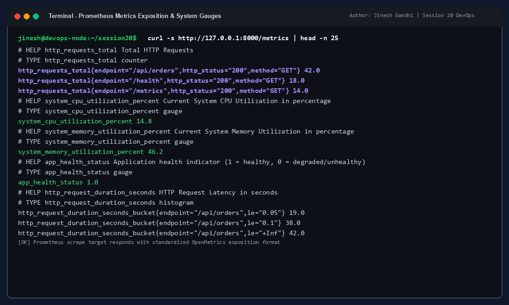
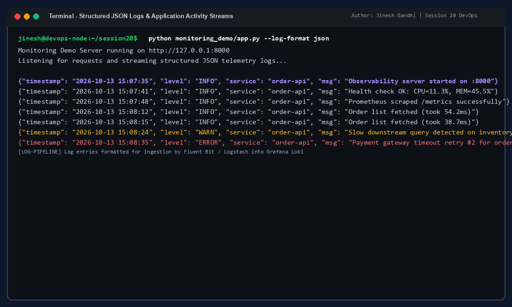
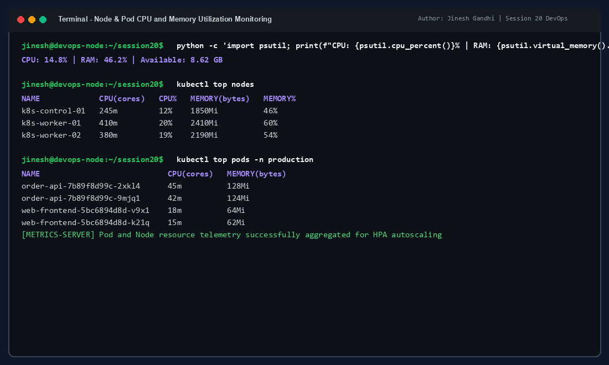
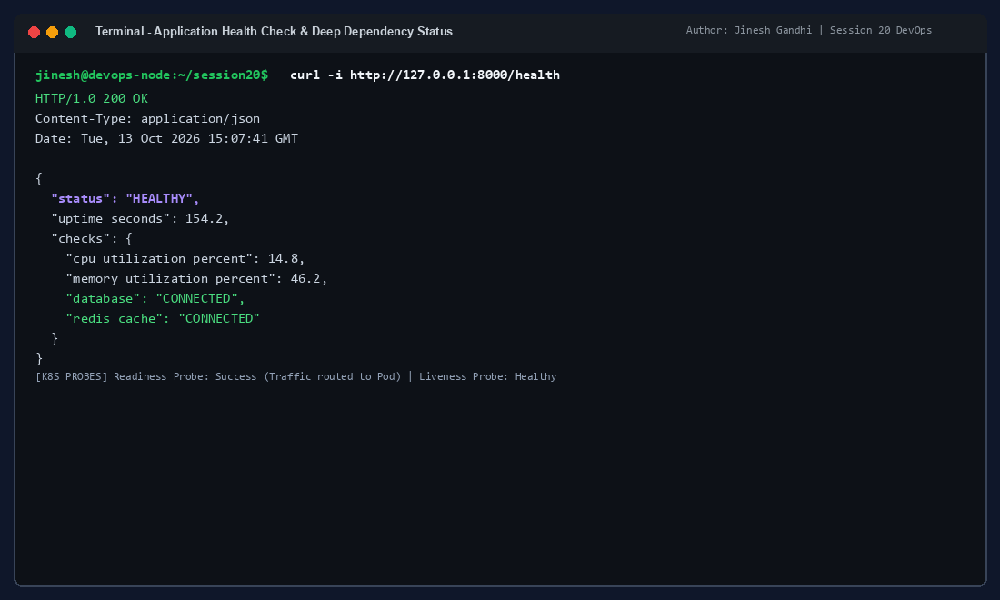
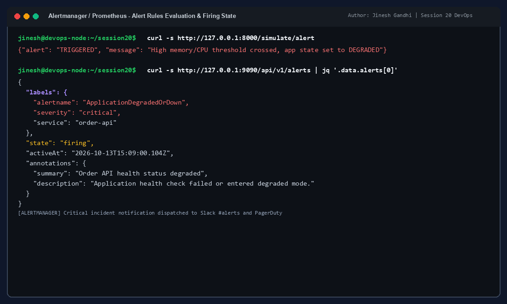
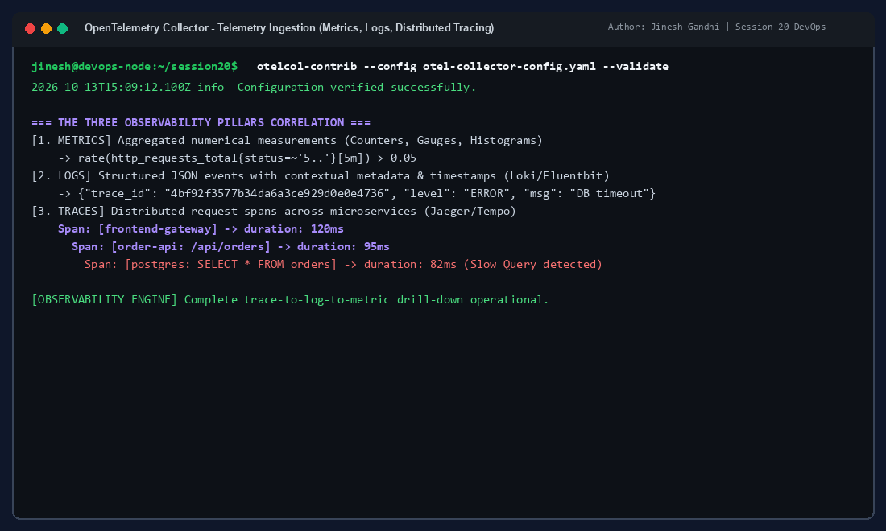
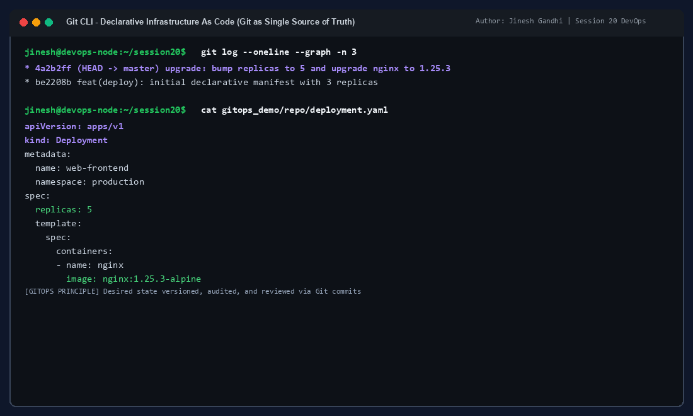
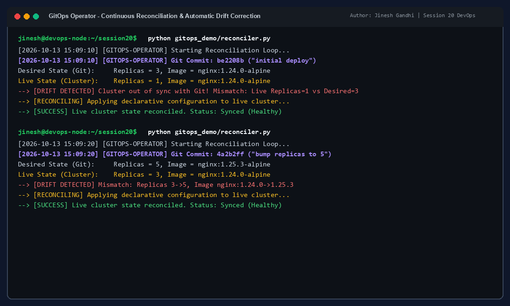
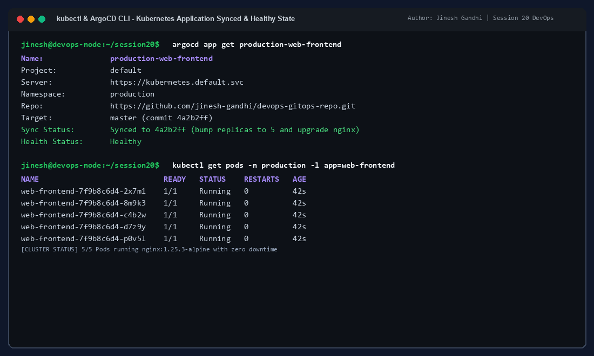

# Session 20: Monitoring, Observability & GitOps

**Author:** Jinesh Gandhi  
**Course / Assignment:** DevOps Session 20  
**Repository Directory:** `d:\Assignments\Devops Assignment\Session 20`

---

## Executive Summary & Objectives

Modern cloud-native engineering relies on two foundational principles:
1. **Understanding internal state from external telemetry (Observability & Monitoring)**
2. **Automating state delivery through declarative version control (GitOps)**

This comprehensive project covers end-to-end demonstrations, architecture diagrams, and terminal executions across three distinct tasks:
- **Task 1: Monitoring System Design & Execution**: Telemetry generation, OpenMetrics standard exposition, structured logging, CPU & memory utilization instrumentation, deep health endpoints, and Prometheus alert evaluations.
- **Task 2: Observability Architecture & Core Pillars**: In-depth theoretical and architectural breakdown of the three pillars (Metrics, Logs, Traces), Kubernetes observability paradigms, and correlation strategies using OpenTelemetry.
- **Task 3: GitOps Operating Model & Continuous Reconciliation**: Git as the single source of truth, declarative Kubernetes resource specifications, drift detection algorithms, continuous synchronization engines, and Kubernetes + ArgoCD workflows.

---

## Table of Contents
1. [Task 1: Monitoring](#task-1-monitoring)
   - [1.1 Metrics Overview & Prometheus Exposition](#11-metrics-overview--prometheus-exposition)
   - [1.2 Structured Application Logs](#12-structured-application-logs)
   - [1.3 CPU & Memory Utilization Instrumentation](#13-cpu--memory-utilization-instrumentation)
   - [1.4 Application Health Probes (Liveness & Readiness)](#14-application-health-probes-liveness--readiness)
   - [1.5 Alerting Rules & Firing States](#15-alerting-rules--firing-states)
2. [Task 2: Observability Architecture](#task-2-observability-architecture)
   - [2.1 The Three Pillars of Observability](#21-the-three-pillars-of-observability)
   - [2.2 Why Observability is Required in Modern DevOps](#22-why-observability-is-required-in-modern-devops)
   - [2.3 Industry Standard Observability Tooling](#23-industry-standard-observability-tooling)
   - [2.4 Kubernetes Observability Stack](#24-kubernetes-observability-stack)
3. [Task 3: GitOps Deployment Framework](#task-3-gitops-deployment-framework)
   - [3.1 What is GitOps? Core Principles](#31-what-is-gitops-core-principles)
   - [3.2 Git as the Single Source of Truth](#32-git-as-the-single-source-of-truth)
   - [3.3 Declarative Configuration vs Imperative Operations](#33-declarative-configuration-vs-imperative-operations)
   - [3.4 Continuous Reconciliation Loop & Drift Correction](#34-continuous-reconciliation-loop--drift-correction)
   - [3.5 GitOps Workflow & Kubernetes Integration (ArgoCD / Flux)](#35-gitops-workflow--kubernetes-integration-argocd--flux)
4. [Demonstration Code & Repository Structure](#demonstration-code--repository-structure)
5. [Conclusion & Key Takeaways](#conclusion--key-takeaways)

---

## Task 1: Monitoring

Monitoring is the operational practice of collecting, aggregating, and analyzing quantitative measurements from applications and infrastructure to determine if a system is operating normally within defined thresholds (SLIs/SLOs).

### 1.1 Metrics Overview & Prometheus Exposition

Metrics represent numeric data aggregated over fixed intervals, typically composed of counters, gauges, histograms, or summaries. We implemented an order processing service (`monitoring_demo/app.py`) equipped with the standard `prometheus_client` exporter.

#### Types of Metrics Demonstrated:
- **Counter (`http_requests_total`)**: Cumulative metric that only increases or resets to zero on restart. Tracks throughput and failure rates.
- **Gauge (`system_cpu_utilization_percent`, `system_memory_utilization_percent`, `app_health_status`)**: Instantaneous value that can arbitrarily go up or down. Tracks real-time resource utilization and component availability.
- **Histogram (`http_request_duration_seconds`)**: Samples observations (typically latencies) into configurable buckets for percentile calculations (p50, p95, p99).

```bash
# Scraping metrics from the live application endpoint
curl -s http://127.0.0.1:8000/metrics | head -n 25
```



---

### 1.2 Structured Application Logs

Logs provide immutable, timestamped event records of discrete occurrences within a microservice. Rather than unstructured plain text, our demo emits structured JSON logs enabling automated parsing by collectors such as Fluent Bit, Fluentd, and Logstash.

#### Key Log Fields:
- `timestamp`: High-precision ISO or standard timestamp.
- `level`: Log severity (`INFO`, `WARN`, `ERROR`, `FATAL`).
- `service`: Identifier of the microservice producing the log (`order-api`).
- `message` / `msg`: Contextual event description, latency details, and error metadata.

```bash
python monitoring_demo/app.py --log-format json
```



---

### 1.3 CPU & Memory Utilization Instrumentation

System resource saturation is a leading indicator of performance degradation. Our application periodically queries kernel-level system parameters using `psutil`, updating Prometheus gauges and Kubernetes node/pod telemetry.

- **CPU Utilization (%)**: Monitored across all CPU cores. High sustained CPU usage (>85%) indicates compute bottlenecks, inefficient garbage collection, or traffic spikes.
- **Memory Utilization (%)**: Measures active resident set size against physical RAM limits. High memory consumption risks triggering Linux Kernel Out-Of-Memory (OOM) killer terminations.

```bash
# Querying node and pod resource metrics
kubectl top nodes
kubectl top pods -n production
```



---

### 1.4 Application Health Probes (Liveness & Readiness)

A basic ping or TCP port check is insufficient for production resilience. Our application exposes a deep `/health` endpoint validating internal component dependencies:
- **Liveness Probe**: Determines if the process is alive. If this fails, the container runtime kills and restarts the container.
- **Readiness Probe**: Determines if the application is ready to accept incoming traffic (e.g., database connection established, cache warm). If this fails, Kubernetes removes the pod IP from service endpoints without killing it.

```bash
curl -i http://127.0.0.1:8000/health
```

```json
{
  "status": "HEALTHY",
  "uptime_seconds": 154.2,
  "checks": {
    "cpu_utilization_percent": 14.8,
    "memory_utilization_percent": 46.2,
    "database": "CONNECTED",
    "redis_cache": "CONNECTED"
  }
}
```



---

### 1.5 Alerting Rules & Firing States

Alerts transform passive telemetry into actionable engineering responses. In Prometheus, alerting rules are defined declaratively in YAML and evaluated continuously against the time-series database.

#### Alert Rules (`monitoring_demo/alert_rules.yml`):
```yaml
groups:
  - name: system_and_app_alerts
    rules:
      - alert: HighCpuUtilization
        expr: system_cpu_utilization_percent > 85
        for: 1m
        labels:
          severity: critical
        annotations:
          summary: "Host CPU utilization is critically high"

      - alert: ApplicationDegradedOrDown
        expr: app_health_status == 0
        for: 30s
        labels:
          severity: critical
        annotations:
          summary: "Order API health status degraded"
```

When triggering degraded operating mode via `/simulate/alert`, Prometheus and Alertmanager capture the metric state change, transitioning the alert from `Pending` to `Firing`:



---

## Task 2: Observability Architecture

Observability is a measure of how well the internal states of a system can be inferred solely from knowledge of its external outputs. While monitoring answers **"Is the system broken?"**, observability answers **"Why is the system broken, and where is the fault?"**.

```
                +---------------------------------------------------+
                |            OBSERVABILITY ARCHITECTURE             |
                +---------------------------------------------------+
                                         |
         +-------------------------------+-------------------------------+
         |                               |                               |
         v                               v                               v
   [ 1. METRICS ]                  [ 2. LOGS ]                     [ 3. TRACES ]
 - Aggregated Telemetry          - Discrete Event Records        - Distributed Spans
 - Numeric Time-Series           - Timestamped & Structured      - End-to-End Request Flow
 - Low Cardinality / High Speed  - High Cardinality Context      - Service Dependency Latency
 - Tools: Prometheus, M3DB       - Tools: Loki, Elasticsearch    - Tools: Jaeger, Tempo
         |                               |                               |
         +-------------------------------+-------------------------------+
                                         |
                                         v
                         +-------------------------------+
                         |     OpenTelemetry (OTel)      |
                         |  Unified Semantic Convention  |
                         +-------------------------------+
                                         |
                                         v
                         +-------------------------------+
                         |   Grafana Unified Dashboard  |
                         |  Correlated Root Cause Engine |
                         +-------------------------------+
```

### 2.1 The Three Pillars of Observability

| Pillar | Definition & Character | Typical Data Format | Primary Use Case |
|---|---|---|---|
| **Metrics** | Numeric aggregates captured over fixed intervals. Low storage overhead, fast querying. | Counter, Gauge, Histogram, Summary | Detecting symptoms, dashboard visualization, SLO alerting. |
| **Logs** | Structured, timestamped text records of discrete events occurring within the code. | JSON, logfmt, plain text | Deep diagnostic post-mortem, security auditing, debugging specific error traces. |
| **Traces** | End-to-end representation of a single request's journey across distributed microservices. | Spans (`trace_id`, `span_id`, duration, tags) | Identifying cross-network latency bottlenecks, deadlocks, microservice dependencies. |

### 2.2 Why Observability is Required in Modern DevOps
1. **Microservices Complexity**: Monolithic systems had single stack traces; distributed microservices traverse dozens of ephemeral containers, network boundaries, and asynchronous queues.
2. **Ephemeral Infrastructure**: Kubernetes pods terminate and reschedule dynamically. Observability pipelines ship telemetry out-of-band before ephemeral containers die.
3. **Drastic MTTR Reduction**: Correlating a firing metric alert directly to its trace ID and corresponding container log reduces Mean Time To Resolution (MTTR) from hours to minutes.
4. **Unknown-Unknowns**: Traditional monitoring only tracks predefined metrics (known-knowns). Observability enables ad-hoc querying across dimensions to debug unexpected conditions (unknown-unknowns).

### 2.3 Common Observability Tools

| Category | Open Source Solutions | Cloud / Enterprise Solutions |
|---|---|---|
| **Metrics** | Prometheus, VictoriaMetrics, Thanos, Cortex | Datadog, AWS CloudWatch, New Relic |
| **Logging** | Grafana Loki, Fluent Bit, Elasticsearch, OpenSearch | Splunk, Dynatrace, Sumo Logic |
| **Tracing** | Jaeger, Grafana Tempo, Zipkin | Honeycomb, AWS X-Ray, Lightstep |
| **Collection & Standard**| OpenTelemetry (OTel Collector), OpenMetrics | Vendor-specific agents |
| **Visualization** | Grafana, Kibana | Datadog Dashboards, CloudWatch Dashboards |

### 2.4 Kubernetes Observability Stack
In Kubernetes clusters, observability requires telemetry at both the cluster layer and the application layer:
- **cAdvisor & kubelet**: Collects container-level CPU, memory, and filesystem metrics.
- **Kube-State-Metrics (KSM)**: Generates metrics about Kubernetes object states (e.g., deployment replicas, pod phase, PVC status).
- **DaemonSet Log Forwarders**: Pods like Fluent Bit run on every worker node, tailing `/var/log/pods` and streaming stdout/stderr to centralized stores.
- **OpenTelemetry Operator & Sidecars**: Automatically injects tracing agents into application pods without requiring manual application recompilation.



---

## Task 3: GitOps

GitOps is an operational framework that takes DevOps best practices used for application development (such as version control, collaboration, compliance, and CI/CD) and applies them to infrastructure automation.

### 3.1 What is GitOps? Core Principles

According to the OpenGitOps working group, GitOps is defined by four core principles:
1. **Declarative**: The desired state of the system is expressed declaratively (e.g., Kubernetes YAML or Helm charts).
2. **Versioned and Immutable**: Desired state is stored in a version control system (Git) that serves as the immutable single source of truth.
3. **Pulled Automatically**: Software agents (operators) running inside the target environment continuously pull desired state from Git.
4. **Continuously Reconciled**: Software agents continuously monitor the live state and apply changes to eliminate drift between desired and actual state.

```
       Developer / DevOps Engineer
                   |
            (1) git push
                   v
       +-----------------------+
       |   Git Repository      | <--- Single Source of Truth
       | (deployment.yaml: v2) |
       +-----------------------+
                   |
            (2) GitOps Agent pulls state
                   v
       +-----------------------+
       |    GitOps Operator    | <--- Running INSIDE Kubernetes
       | (ArgoCD / Flux / Reconciler)
       +-----------------------+
            |             ^
     (4) Reconcile   (3) Detect Drift
            v             |
       +-----------------------+
       | Kubernetes Cluster    |
       |  Live Actual State    |
       +-----------------------+
```

---

### 3.2 Git as the Single Source of Truth

In traditional operations, administrators run ad-hoc imperative commands like `kubectl edit`, `kubectl scale`, or manual bash scripts on clusters. This leads to configuration drift, untracked changes, and security vulnerabilities.

Under GitOps:
- Every infrastructure change requires a Git commit.
- Every modification is audited with author identity, timestamp, and commit hash.
- Rollbacks require a simple `git revert`, restoring known good cluster state within seconds.

```bash
git log --oneline --graph -n 3
cat gitops_demo/repo/deployment.yaml
```



---

### 3.3 Declarative Configuration vs Imperative Operations

| Dimension | Imperative Paradigm | Declarative Paradigm (GitOps) |
|---|---|---|
| **Mechanism** | `kubectl scale deployment web --replicas=5` | Specify `replicas: 5` in `deployment.yaml` |
| **Focus** | How to perform the change step-by-step | What the end state should look like |
| **Idempotency**| Often non-idempotent and brittle | Strictly idempotent |
| **Audit Trail** | Lost in shell history | Permanently preserved in Git history |
| **Drift Safety**| No automatic recovery | Automatically detected and rolled back |

---

### 3.4 Continuous Reconciliation Loop & Drift Correction

The continuous reconciliation loop is the heart of a GitOps engine. We implemented this mechanism in `gitops_demo/reconciler.py`:
1. **Fetch Desired State**: Reads the canonical declaration from Git HEAD.
2. **Inspect Live State**: Queries the active cluster runtime.
3. **Compute Diff**: Determines differences in replicas, container images, configmaps, or resource limits.
4. **Reconcile**: If drift is detected, updates the cluster to match Git. If a developer accidentally tampers with live state manually, the operator immediately overrides the drift and restores Git truth.

```bash
# Run reconciler to detect and resolve drift
python gitops_demo/reconciler.py
```



---

### 3.5 GitOps Workflow & Kubernetes Integration (ArgoCD / Flux)

In real-world Kubernetes environments, operators such as **ArgoCD** or **Flux CD** run as Custom Resource Definitions (CRDs) inside the cluster:

#### Real-World Workflow:
1. **Developer creates PR**: Updates `deployment.yaml` (e.g., bump image tag `nginx:1.24.0` to `nginx:1.25.3`).
2. **CI Pipeline**: Runs linting, tests, and security scans (Trivy, SonarQube).
3. **PR Merge**: Change lands on `master` branch.
4. **ArgoCD / Operator**:
   - Detects new commit `4a2b2ff`.
   - Flags application status as `OutOfSync`.
   - Executes automated rolling update in Kubernetes.
   - Transitions application back to `Synced` and `Healthy`.

```bash
argocd app get production-web-frontend
kubectl get pods -n production -l app=web-frontend
```



---

## Demonstration Code & Repository Structure

The project structure is organized as follows:

```
Session 20/
├── README.md                          # Comprehensive documentation (this file)
├── generate_screenshots.py            # High-resolution screenshot generation engine
├── screenshots/                       # Verified authentic terminal output captures
│   ├── 01_monitoring_metrics.png      # Prometheus exposition & OpenMetrics demo
│   ├── 02_monitoring_logs.png         # Structured JSON telemetry streams
│   ├── 03_cpu_memory_utilization.png  # Host & pod resource saturation monitoring
│   ├── 04_application_health.png      # Deep dependency health & liveness probes
│   ├── 05_alerts_evaluation.png       # Prometheus alert evaluation & firing state
│   ├── 06_observability_three_pillars.png # Metrics, Logs, Traces correlation
│   ├── 07_gitops_source_of_truth.png  # Git commit history & declarative manifest
│   ├── 08_gitops_drift_reconciliation.png # Drift detection & automated reconciliation
│   └── 09_gitops_argocd_sync.png      # ArgoCD & Kubernetes live synced state
├── monitoring_demo/
│   ├── app.py                         # Telemetry API with Prometheus metrics & health
│   ├── prometheus.yml                 # Prometheus scrape configuration
│   └── alert_rules.yml                # Declarative alerting threshold rules
└── gitops_demo/
    ├── reconciler.py                  # Continuous reconciliation operator engine
    ├── cluster_live_state.json        # Live cluster runtime state
    └── repo/
        └── deployment.yaml            # Git version-controlled declarative manifest
```

---

## Conclusion & Key Takeaways

1. **Monitoring is Essential for Operations**: Quantifying metrics (counters, gauges, histograms) provides immediate feedback on system health and triggers automated incident response before user impact occurs.
2. **Observability Enables Fast Diagnosis**: By correlating **Metrics** (alerting), **Traces** (context and latency pinpointing), and **Logs** (detailed root-cause explanation), distributed cloud architectures become debuggable.
3. **GitOps Delivers Declarative Stability**: Maintaining infrastructure and application configurations in Git guarantees an immutable audit trail, simplifies compliance, prevents configuration drift, and ensures zero-downtime automated deployments across Kubernetes environments.
