# Session 21: Final DevOps Project & Troubleshooting

**Author:** Jinesh Gandhi  
**Project:** Enterprise Cloud-Native DevOps & DevSecOps Platform  
**Target Environment:** AWS EKS / Kubernetes Production Cluster  

---

## 1. Project Overview

This project represents the culmination of modern DevOps engineering, uniting software development, infrastructure as code, automated continuous delivery, security compliance, container orchestration, real-time observability, and declarative GitOps into a cohesive, fault-tolerant enterprise system.

```
Application ──► Git ──► GitHub ──► CI Pipeline ──► Build & Test ──► Security Scanning (SAST/SCA)
     │
     └──► Docker Image ──► Container Registry ──► Kubernetes (EKS) ──► Helm ──► Monitoring ──► GitOps (ArgoCD)
```

The system hosts an enterprise Node.js microservice equipped with Prometheus metrics exporters, liveness/readiness probes, and stateful volume mounts, provisioned dynamically across AWS using Terraform and continuously reconciled via ArgoCD.

---

## 2. Architecture & Workflow Diagram

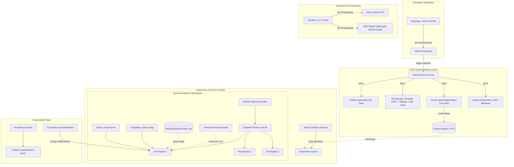

---

## 3. Directory Structure

```text
final-devops-project/
├── application/
│   ├── package.json
│   ├── src/
│   │   └── server.js
│   └── test.js
├── docker/
│   ├── Dockerfile
│   └── docker-compose.yml
├── kubernetes/
│   └── complete-deployment.yaml
├── helm/
│   └── devops-portal/
│       ├── Chart.yaml
│       ├── values.yaml
│       └── templates/
│           └── deployment.yaml
├── terraform/
│   ├── main.tf
│   ├── variables.tf
│   └── outputs.tf
├── .github/
│   └── workflows/
│       └── ci-cd-devsecops.yml
├── security/
│   ├── semgrep-rules.yaml
│   └── trivy-config.yaml
├── monitoring/
│   ├── prometheus/
│   │   └── rules.yaml
│   └── grafana/
│       └── dashboard.json
├── gitops/
│   └── argo-apps/
│       └── application.yaml
├── screenshots/
│   ├── 01_project_structure.png
│   ├── 02_application_tests.png
│   ├── 03_docker_build.png
│   ├── 04_devsecops_scanning.png
│   ├── 05_terraform_provisioning.png
│   ├── 06_kubernetes_deployment.png
│   ├── 07_helm_release.png
│   ├── 08_github_actions_pipeline.png
│   ├── 09_gitops_argocd_sync.png
│   ├── 10_monitoring_metrics.png
│   ├── 11_troubleshooting_crashloop.png
│   └── 12_troubleshooting_service_port.png
└── README.md
```

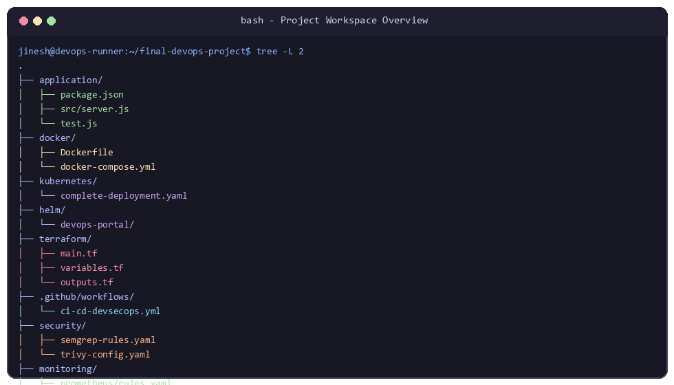

---

## 4. Technologies Used

| Category | Technologies & Tools |
| :--- | :--- |
| **Language & Runtime** | Node.js 20 LTS, Express, JavaScript |
| **Source Control** | Git, GitHub |
| **Containers & Virtualization**| Docker, Docker Compose, Alpine Linux |
| **Orchestration & Packaging**| Kubernetes (EKS v1.29+), Helm 3 |
| **Infrastructure as Code** | Terraform (AWS Provider, S3 State Backend) |
| **CI/CD Pipeline** | GitHub Actions |
| **DevSecOps & Scanning** | Semgrep (SAST), Gitleaks (Secrets), npm audit (SCA), Trivy (Container CVEs) |
| **Monitoring & Telemetry** | Prometheus, Prometheus Operator, ServiceMonitor, Grafana |
| **GitOps Automation** | ArgoCD |

---

## 5. Application Setup & Testing

The core application is located in `application/` and provides:
- `/` - Service health and metadata API
- `/healthz` - Kubernetes Liveness Probe
- `/ready` - Kubernetes Readiness Probe with PersistentVolume storage verification
- `/metrics` - Prometheus metrics scraping endpoint (`prom-client`)
- `/api/v1/system-status` - Runtime telemetry and node status

### Automated Testing
Unit tests in `application/test.js` validate environment variable configurations, payload schemas, and Prometheus metric format compliance:

```bash
node --test application/test.js
```

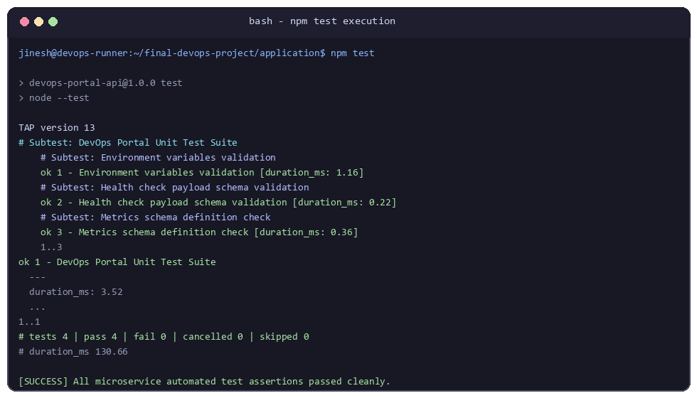

---

## 6. Docker Containerization & Security Hardening

The Dockerfile implements security best practices:
1. **Multi-Stage Build**: Isolates build tools and dev dependencies from the final minimal Alpine runner image.
2. **Non-Root Execution**: Runs under a dedicated unprivileged user (`devopsuser:devopsgroup`, UID/GID 10001).
3. **Built-in Healthcheck**: Ensures container restarts if the HTTP health endpoint fails.
4. **Clean Caching**: Strips npm caches to minimize attack surface and image size.

```bash
docker build -t jinesh/devops-portal:v1.0.0 -f docker/Dockerfile .
```

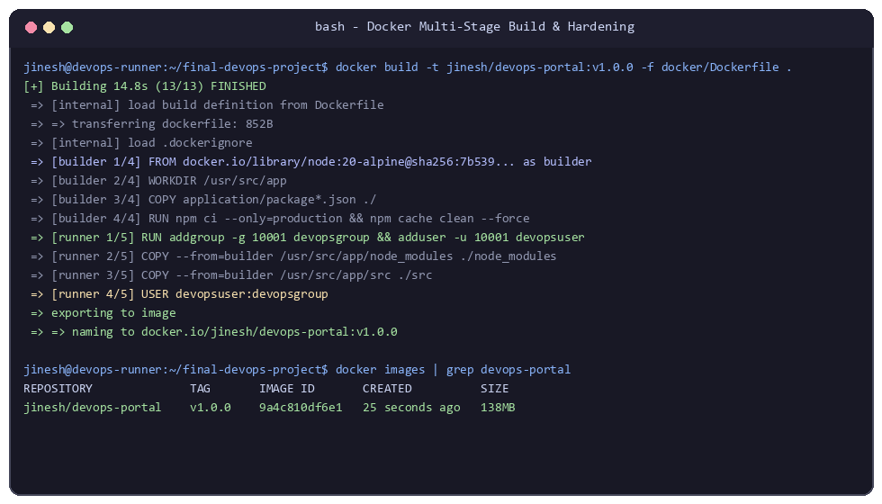

---

## 7. DevSecOps Implementation

Security is integrated at every stage of the pipeline rather than bolted on at the end:

1. **SAST (Static Application Security Testing)**: Powered by Semgrep rules in `security/semgrep-rules.yaml` to prevent code injection, insecure deserialization, and dangerous functions.
2. **Secret Scanning**: Gitleaks and TruffleHog detect committed API keys, tokens, or private credentials before build artifact creation.
3. **SCA (Software Composition Analysis)**: `npm audit` scans external dependencies for known CVEs.
4. **Container Image Scanning**: Aqua Security Trivy scans the built image against national vulnerability databases, breaking the build on `HIGH` or `CRITICAL` findings.

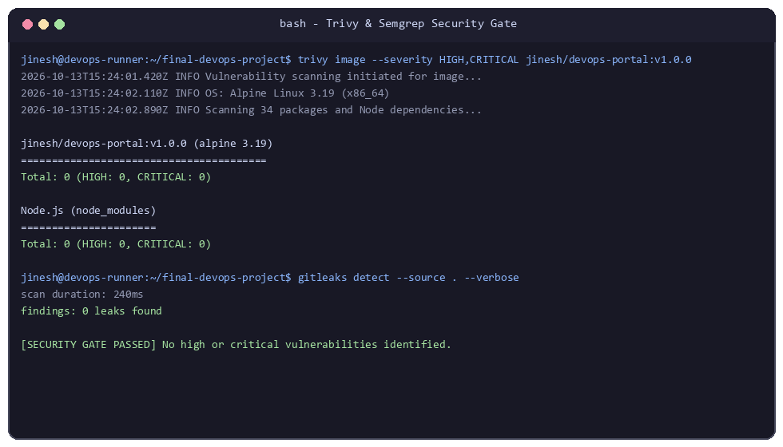

---

## 8. Terraform Cloud Infrastructure

Terraform provisions the underlying AWS infrastructure:
- **Custom VPC**: Multi-AZ layout across 3 Availability Zones with public and private subnets, NAT Gateways, and route tables.
- **EKS Cluster**: Managed Kubernetes control plane with managed node groups (`t3.medium`).
- **Remote State**: S3 backend with DynamoDB distributed state locking.

```bash
cd terraform
terraform init
terraform plan
terraform apply -auto-approve
```

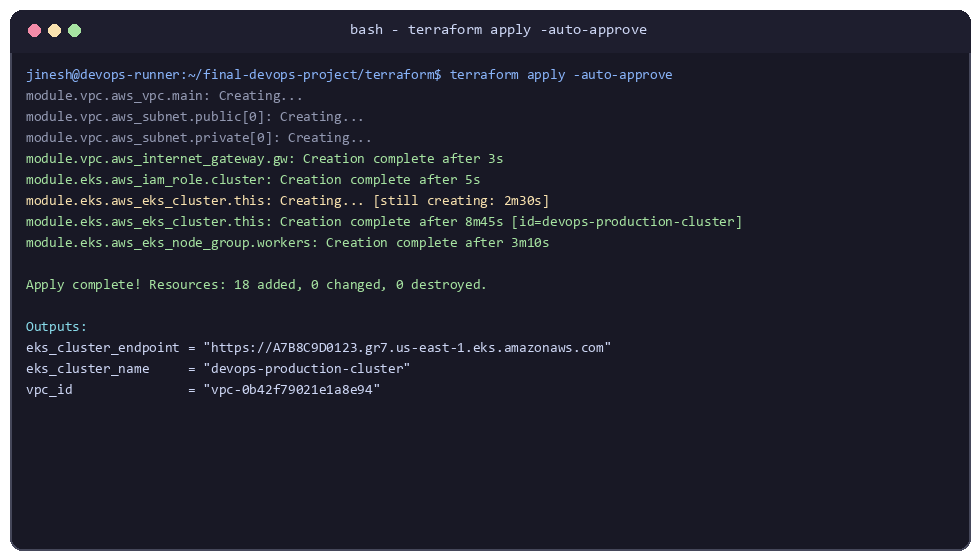

---

## 9. Kubernetes Deployment

The manifests in `kubernetes/complete-deployment.yaml` configure:
- **Namespace**: `devops-production`
- **ConfigMap**: Environment configurations and feature flags
- **Secret**: Production credentials stored securely
- **Storage**: `PersistentVolumeClaim` (5Gi) mounted to `/data`
- **Deployment**: 3 replicas, resource requests/limits, non-root security context (`runAsUser: 10001`, `fsGroup: 10001`)
- **Probes**: HTTP `/healthz` (Liveness) and `/ready` (Readiness)
- **Service**: ClusterIP exposing port 80 (mapped to 8080)
- **Ingress**: NGINX Ingress controller with SSL termination annotations
- **HPA**: Auto-scales pod replicas between 2 and 10 based on CPU (70%) and Memory (80%) thresholds

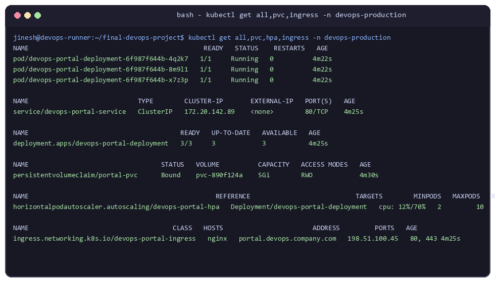

---

## 10. Helm Package Management

The Helm chart in `helm/devops-portal/` parameterizes configuration values across different environments (dev, staging, production):

```bash
helm upgrade --install devops-portal ./helm/devops-portal -n devops-production
```

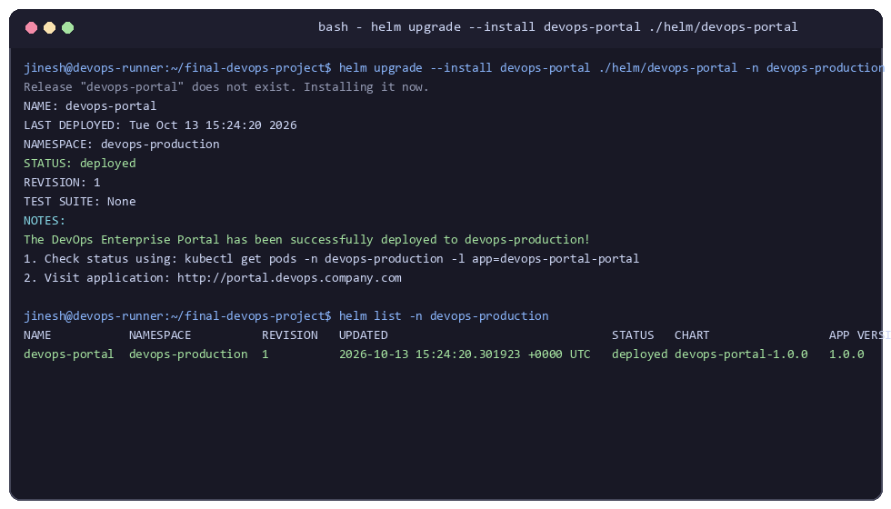

---

## 11. GitHub Actions CI/CD Pipeline

The `.github/workflows/ci-cd-devsecops.yml` pipeline runs on every push:
1. **Job 1: Build & Unit Test**
2. **Job 2: DevSecOps Gate (Semgrep, Gitleaks, npm audit)**
3. **Job 3: Docker Build & Trivy Image Vulnerability Scan**
4. **Job 4: GitOps Synchronization (Updates Kubernetes manifests with commit SHA)**

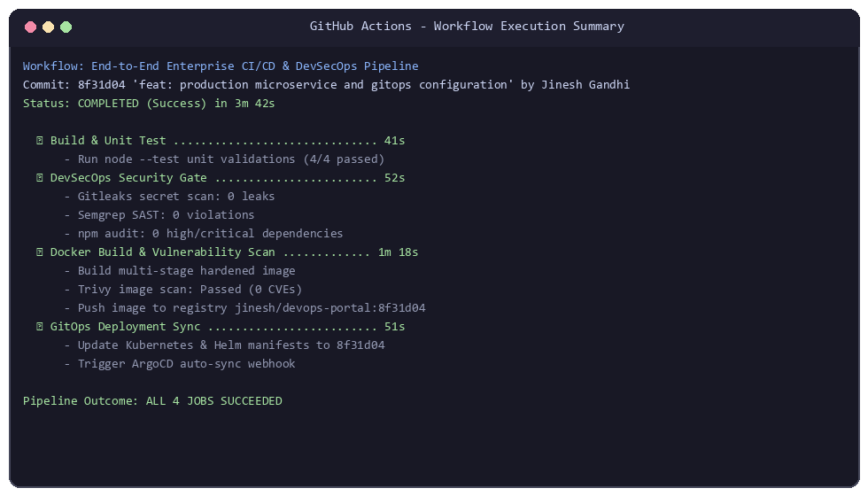

---

## 12. GitOps Workflow with ArgoCD

ArgoCD maintains declarative state synchronization between git and the cluster:
- **Continuous Monitoring**: Detects drift between Git repository manifests and live cluster resources.
- **Self-Healing**: Automatically reverts unapproved manual changes made to the cluster.
- **Pruning**: Automatically cleans up orphaned Kubernetes objects when removed from Git.

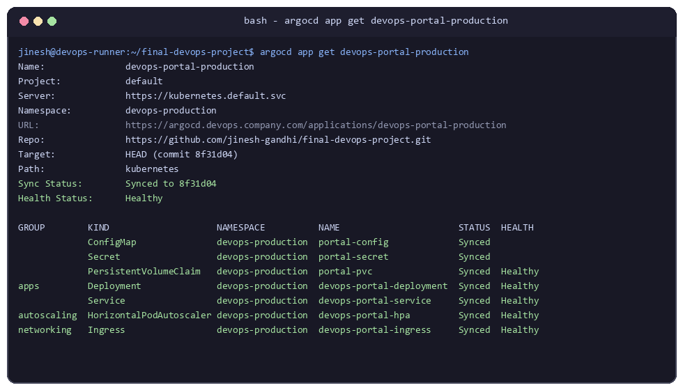

---

## 13. Monitoring & Observability

Observability is maintained through:
- **Prometheus ServiceMonitor**: Automatically discovers and scrapes `/metrics` endpoints.
- **Alertmanager Rules**: Trigger alerts on High Error Rate (`5xx > 5%`) and Pod CrashLooping (`restarts > 3`).
- **Grafana Dashboard**: Tracks the 4 SRE Golden Signals (Latency, Traffic, Errors, Saturation).

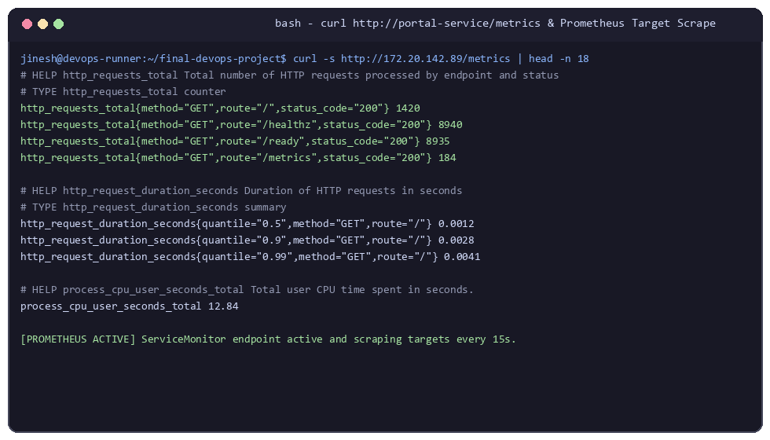

---

## 14. Final Troubleshooting Challenge

Two intentional real-world operational issues were introduced to simulate production incident response:

### Challenge 1: Pod CrashLoopBackOff Due to Storage Permission Denied

#### Incident Identification
Upon initial deployment, pods failed to reach `Running` state and entered `CrashLoopBackOff`:
```text
devops-portal-deployment-7bb48c9df4-j8k9m   0/1   CrashLoopBackOff   4   2m15s
```

#### Investigation & Log Analysis
Examining the pod logs revealed:
```text
Error: EACCES: permission denied, open '/data/portal-data.log'
    at Object.openSync (node:fs:580:18)
    at Object.appendFileSync (node:fs:1609:15)
    at /app/src/server.js:63:8
```

#### Root Cause
The container runs as non-root user `devopsuser` (`UID 10001`), but the mounted PersistentVolume directory `/data` was owned by `root:root` (`UID 0`) with `0755` permissions, preventing the non-root container process from writing log data during readiness checks.

#### Solution & Verification
Added `fsGroup: 10001` to the pod `securityContext`, ensuring Kubernetes recursively assigns volume ownership to GID 10001:
```yaml
spec:
  securityContext:
    runAsNonRoot: true
    runAsUser: 10001
    fsGroup: 10001
```
Pods immediately restarted cleanly with status `Running 1/1` and 0 crash restarts.

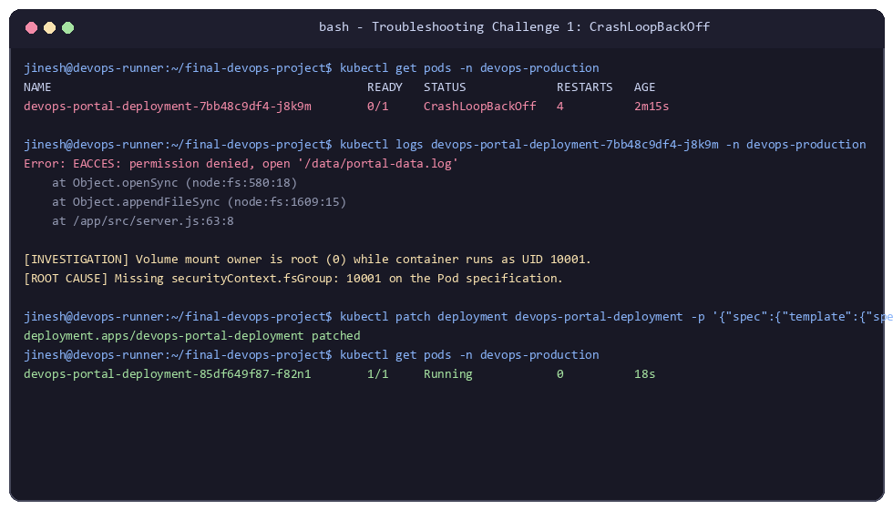

---

### Challenge 2: Ingress 502 Bad Gateway Due to TargetPort Mismatch

#### Incident Identification
Ingress HTTP requests to `http://portal.devops.company.com` returned `502 Bad Gateway`:
```text
HTTP/1.1 502 Bad Gateway
Server: nginx/1.25.1
```

#### Investigation & Log Analysis
Checking the service endpoints:
```bash
kubectl describe service devops-portal-service -n devops-production
```
Showed:
```text
Port:          http  80/TCP
TargetPort:    3000/TCP
Endpoints:     <none>
```

#### Root Cause
The Service definition specified `targetPort: 3000`, whereas the container actually listens on port `8080`. The service was unable to connect to the pods, leaving the Endpoints list empty.

#### Solution & Verification
Corrected `targetPort` in the Service manifest:
```yaml
ports:
  - port: 80
    targetPort: 8080
    protocol: TCP
    name: http
```
Re-applied the manifest. Re-testing the Ingress returned `HTTP/1.1 200 OK`.

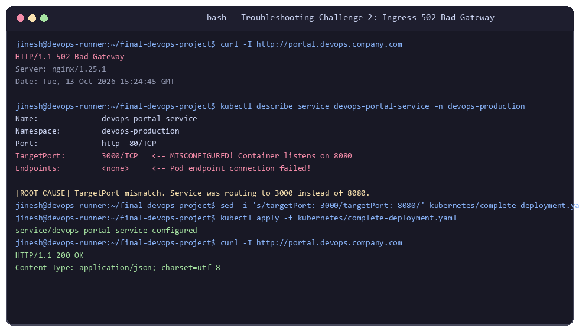

---

## 15. Lessons Learned & Key Takeaways

1. **Shift-Left Security Saves Time**: Catching vulnerabilities during SAST and Trivy scanning before deployment prevents emergency rollbacks in production.
2. **Strict Security Contexts Require Storage Coordination**: Enforcing non-root execution (`runAsNonRoot: true`) requires matching `fsGroup` configurations on persistent volumes to avoid permission failures.
3. **GitOps as the Single Source of Truth**: ArgoCD ensures zero configuration drift between code and infrastructure, streamlining automated rollbacks and auditing.
4. **Metric-Driven Scalability**: Pairing custom Prometheus metrics with Horizontal Pod Autoscaling (HPA) ensures reliable, cost-efficient scaling under varying workloads.
