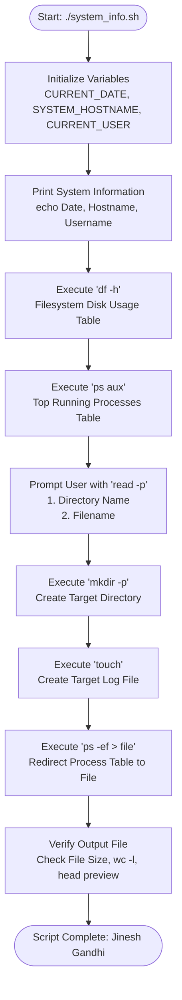
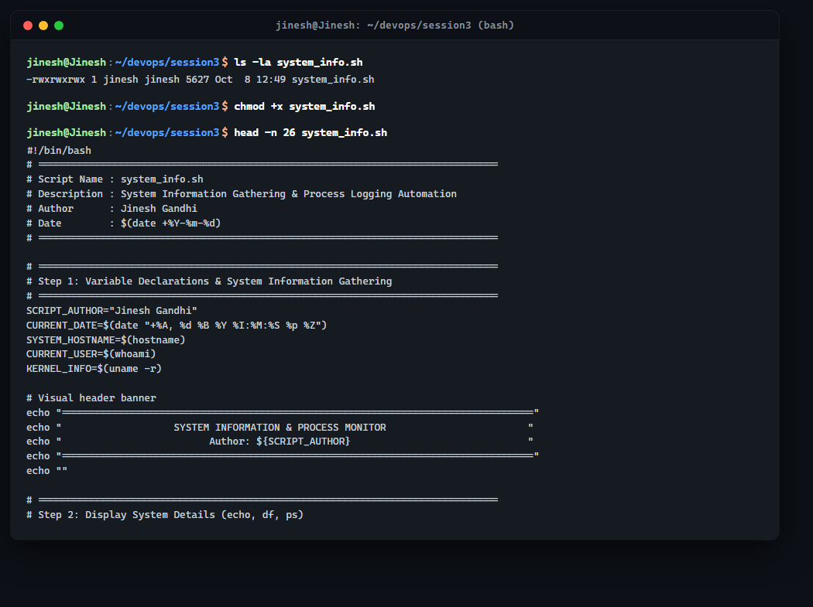
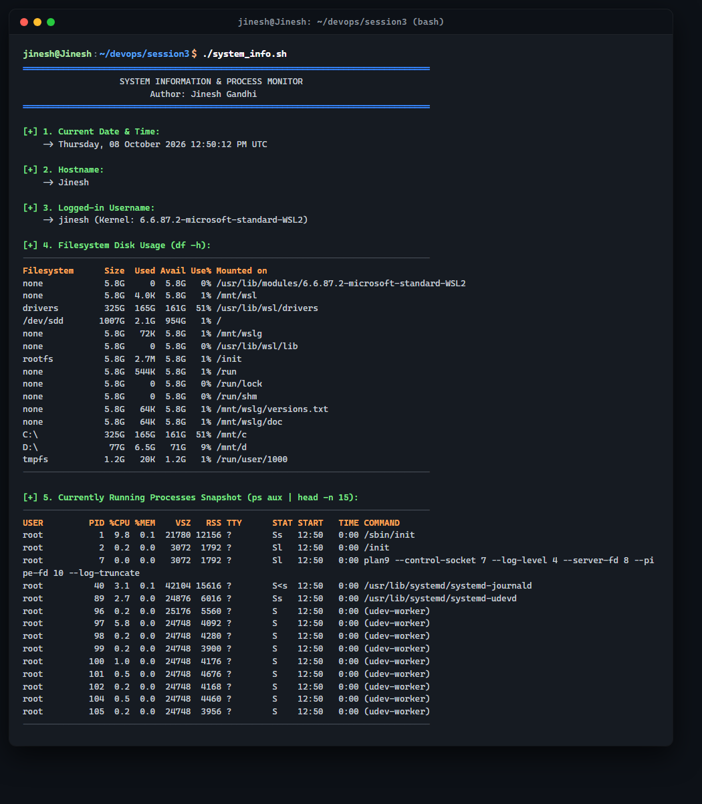
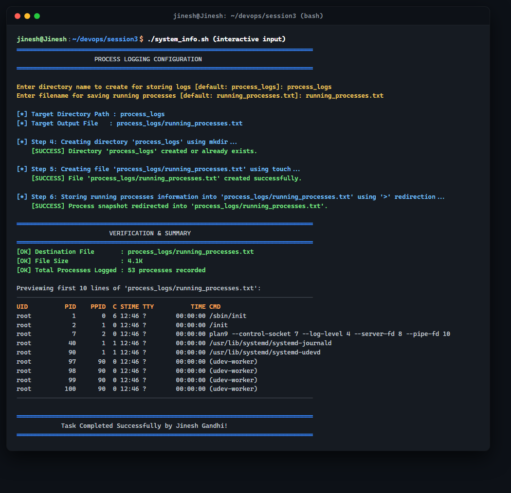
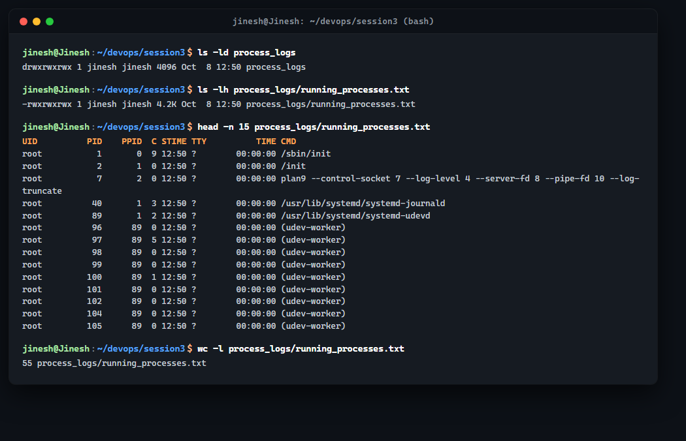
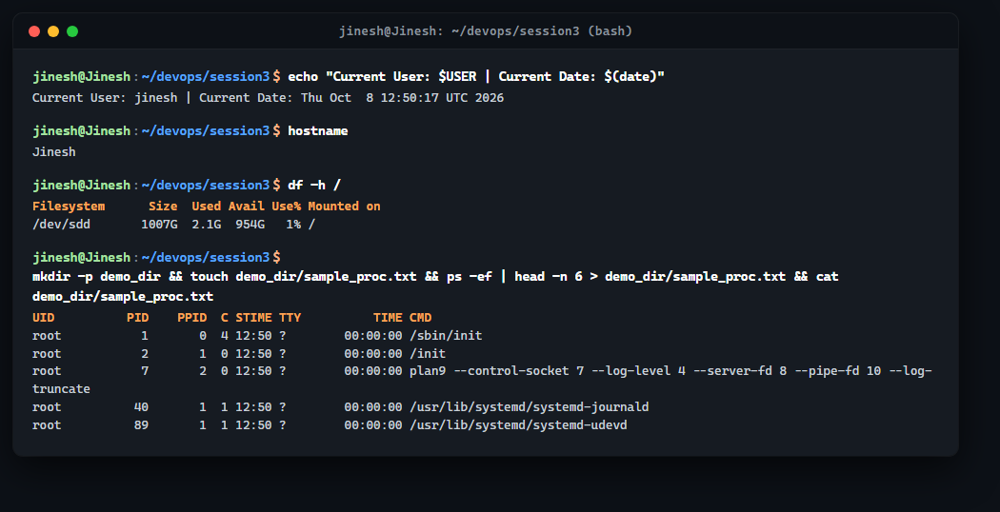

# DevOps Assignment - Session 3: Shell Scripting Automation

**Author:** Jinesh Gandhi  
**Repository:** [jineshgandhi79/DevOps-Session3-ShellScripting](https://github.com/jineshgandhi79/DevOps-Session3-ShellScripting)  
**Environment:** Ubuntu 24.04 LTS (WSL2 / Linux Kernel 6.6.87.2)  
**Shell Interpreter:** GNU Bash 5.2.21  
**Primary Script:** [`system_info.sh`](system_info.sh)  

---

## Table of Contents
1. [Assignment Overview](#assignment-overview)
2. [Task Requirements & Compliance Matrix](#task-requirements--compliance-matrix)
3. [Script Architecture & Workflow](#script-architecture--workflow)
4. [Source Code: `system_info.sh`](#source-code-system_infosh)
5. [Command Breakdown & Technical Concepts](#command-breakdown--technical-concepts)
6. [Step-by-Step Execution Walkthrough & Screenshots](#step-by-step-execution-walkthrough--screenshots)
   - [Step 1: Script Inspection & Permissions (`chmod +x`)](#step-1-script-inspection--permissions-chmod-x)
   - [Step 2: System Information Gathering (`date`, `hostname`, `whoami`, `df`, `ps`)](#step-2-system-information-gathering-date-hostname-whoami-df-ps)
   - [Step 3: Interactive User Input (`read -p`), Directory (`mkdir`) & File Creation (`touch`)](#step-3-interactive-user-input-read--p-directory-mkdir--file-creation-touch)
   - [Step 4: Output Redirection (`>`) & Process Log Verification](#step-4-output-redirection--process-log-verification)
   - [Step 5: Standalone Command Demonstrations](#step-5-standalone-command-demonstrations)
7. [Repository File Structure](#repository-file-structure)
8. [How to Run Locally](#how-to-run-locally)

---

## Assignment Overview

This assignment focuses on foundational **Linux Shell Scripting and Process Automation**. The objective is to create a robust, production-ready Bash script that:
- Collects core operating system metrics (current system date, hostname, active user, disk usage, and active processes).
- Uses Bash variables to dynamically store and format collected metrics.
- Accepts interactive user input via `read -p` to determine target directories and filenames.
- Creates target directories (`mkdir`) and files (`touch`) safely.
- Employs output redirection (`>`) to store real-time process snapshots into log files.
- Provides verification metrics (record counts, file size, and head preview).

---

## Task Requirements & Compliance Matrix

| Requirement | Command / Technique | Script Implementation | Compliance Status |
| :--- | :--- | :--- | :---: |
| **Prints current date** | `date` | `CURRENT_DATE=$(date "+%A, %d %B %Y %I:%M:%S %p %Z")` | Completed |
| **Prints hostname** | `hostname` | `SYSTEM_HOSTNAME=$(hostname)` | Completed |
| **Prints username** | `whoami` | `CURRENT_USER=$(whoami)` | Completed |
| **Prints disk usage** | `df` | `df -h` (Human-readable filesystem disk metrics) | Completed |
| **Prints running processes** | `ps` | `ps aux \| head -n 15` (Active processes table) | Completed |
| **Uses variables** | Variables (`$VAR`, `${VAR}`) | Variables for author, date, host, user, paths, record counts | Completed |
| **Takes user input** | `read -p` | Prompts for custom directory and output log filename | Completed |
| **Creates directory** | `mkdir` | `mkdir -p "${DIR_NAME}"` | Completed |
| **Creates file** | `touch` | `touch "${FULL_FILE_PATH}"` | Completed |
| **Output redirection** | `>` Redirection | `ps -ef > "${FULL_FILE_PATH}"` | Completed |
| **Public GitHub Repo** | `git` / GitHub API | Public repository initialized and pushed to GitHub | Completed |

---

## Script Architecture & Workflow



---

## Source Code: `system_info.sh`

```bash
#!/bin/bash
# ==============================================================================
# Script Name : system_info.sh
# Description : System Information Gathering & Process Logging Automation
# Author      : Jinesh Gandhi
# Date        : $(date +%Y-%m-%d)
# ==============================================================================

# ==============================================================================
# Step 1: Variable Declarations & System Information Gathering
# ==============================================================================
SCRIPT_AUTHOR="Jinesh Gandhi"
CURRENT_DATE=$(date "+%A, %d %B %Y %I:%M:%S %p %Z")
SYSTEM_HOSTNAME=$(hostname)
CURRENT_USER=$(whoami)
KERNEL_INFO=$(uname -r)

# Visual header banner
echo "================================================================================"
echo "                   SYSTEM INFORMATION & PROCESS MONITOR                        "
echo "                         Author: ${SCRIPT_AUTHOR}                              "
echo "================================================================================"
echo ""

# ==============================================================================
# Step 2: Display System Details (echo, df, ps)
# ==============================================================================
echo "[+] 1. Current Date & Time:"
echo "    -> ${CURRENT_DATE}"
echo ""

echo "[+] 2. Hostname:"
echo "    -> ${SYSTEM_HOSTNAME}"
echo ""

echo "[+] 3. Logged-in Username:"
echo "    -> ${CURRENT_USER} (Kernel: ${KERNEL_INFO})"
echo ""

echo "[+] 4. Filesystem Disk Usage (df -h):"
echo "--------------------------------------------------------------------------------"
df -h
echo "--------------------------------------------------------------------------------"
echo ""

echo "[+] 5. Currently Running Processes Snapshot (ps aux | head -n 15):"
echo "--------------------------------------------------------------------------------"
ps aux 2>/dev/null | head -n 15
echo "--------------------------------------------------------------------------------"
echo ""

# ==============================================================================
# Step 3: Interactive User Input using read -p
# ==============================================================================
echo "================================================================================"
echo "                     PROCESS LOGGING CONFIGURATION                             "
echo "================================================================================"

read -p "Enter directory name to create for storing logs [default: process_logs]: " INPUT_DIR || true
# Assign with default fallback if input is empty
DIR_NAME=${INPUT_DIR:-"process_logs"}

read -p "Enter filename for saving running processes [default: running_processes.txt]: " INPUT_FILE || true
# Assign with default fallback if input is empty
FILE_NAME=${INPUT_FILE:-"running_processes.txt"}

# Construct full target path variable
FULL_FILE_PATH="${DIR_NAME}/${FILE_NAME}"

echo ""
echo "[*] Target Directory Path : ${DIR_NAME}"
echo "[*] Target Output File   : ${FULL_FILE_PATH}"
echo ""

# ==============================================================================
# Step 4: Create Directory using mkdir
# ==============================================================================
echo "[*] Step 4: Creating directory '${DIR_NAME}' using mkdir..."
mkdir -p "${DIR_NAME}"
echo "    [SUCCESS] Directory '${DIR_NAME}' created or already exists."
echo ""

# ==============================================================================
# Step 5: Create File using touch
# ==============================================================================
echo "[*] Step 5: Creating file '${FULL_FILE_PATH}' using touch..."
touch "${FULL_FILE_PATH}"
echo "    [SUCCESS] File '${FULL_FILE_PATH}' created successfully."
echo ""

# ==============================================================================
# Step 6: Output Redirection (>) to Store Running Processes
# ==============================================================================
echo "[*] Step 6: Storing running processes information into '${FULL_FILE_PATH}' using '>' redirection..."
ps -ef 2>/dev/null > "${FULL_FILE_PATH}"
echo "    [SUCCESS] Process snapshot redirected into '${FULL_FILE_PATH}'."
echo ""

# ==============================================================================
# Step 7: Verification & Summary
# ==============================================================================
RECORD_COUNT=$(wc -l < "${FULL_FILE_PATH}")
FILE_SIZE=$(ls -lh "${FULL_FILE_PATH}" | awk '{print $5}')

echo "================================================================================"
echo "                         VERIFICATION & SUMMARY                                 "
echo "================================================================================"
echo "[OK] Destination File       : ${FULL_FILE_PATH}"
echo "[OK] File Size              : ${FILE_SIZE}"
echo "[OK] Total Processes Logged : ${RECORD_COUNT} processes recorded"
echo ""
echo "Previewing first 10 lines of '${FULL_FILE_PATH}':"
echo "--------------------------------------------------------------------------------"
head -n 10 "${FULL_FILE_PATH}"
echo "--------------------------------------------------------------------------------"
echo ""
echo "================================================================================"
echo "            Task Completed Successfully by ${SCRIPT_AUTHOR}!                   "
echo "================================================================================"
```

---

## Command Breakdown & Technical Concepts

### 1. `echo`
- **Purpose:** Outputs strings and formatted text to standard output (`stdout`).
- **DevOps Context:** Essential for CLI user experience, banner printing, status notifications, and interactive prompts.

### 2. `date`
- **Purpose:** Prints or sets system date and time.
- **Syntax Used:** `date "+%A, %d %B %Y %I:%M:%S %p %Z"` (produces detailed timestamp with timezone info).

### 3. `hostname`
- **Purpose:** Displays the system's DNS hostname or node name in a networked cluster.
- **DevOps Context:** Critical in multi-node Kubernetes clusters, server fleets, and Ansible playbooks to confirm which host is executing the script.

### 4. `whoami` & `$USER`
- **Purpose:** Prints the effective user ID of the current execution environment.
- **DevOps Context:** Used for authorization guards (e.g. verifying root vs non-privileged user before deployment).

### 5. `df -h` (Disk Free)
- **Purpose:** Displays available and used disk space across mounted filesystems.
- **`-h` Flag:** Human-readable format (prints sizes in GiB, MiB, and KiB instead of raw 1K blocks).

### 6. `ps` (Process Status)
- **Purpose:** Snapshot of current active processes.
- **`ps aux`:** BSD-style process view showing `USER`, `PID`, `%CPU`, `%MEM`, `VSZ`, `RSS`, `TTY`, `STAT`, `START`, `TIME`, and `COMMAND`.
- **`ps -ef`:** Standard System V syntax showing `UID`, `PID`, `PPID`, `C`, `STIME`, `TTY`, `TIME`, and `CMD`.

### 7. Variables (`$VAR` / `${VAR}`)
- **Syntax:** `VAR_NAME="value"`, referenced using `${VAR_NAME}`.
- **Command Substitution:** `$(command)` captures stdout directly into a variable.
- **Default Fallback Syntax:** `${INPUT_DIR:-"default_value"}` safeguards against empty user inputs.

### 8. `read -p`
- **Purpose:** Reads a line from standard input (`stdin`) after displaying a customized prompt.
- **`-p` Flag:** Eliminates the need for a separate `echo -n` before the input prompt.

### 9. `mkdir -p` (Make Directory)
- **Purpose:** Creates directories on the filesystem.
- **`-p` Flag (Parents):** Creates parent directories if missing and avoids throwing an error if the directory already exists (idempotent operation).

### 10. `touch`
- **Purpose:** Updates file access and modification timestamps, or creates an empty 0-byte file if it does not exist.

### 11. `>` (Output Redirection)
- **Stream Redirection:** Redirects standard output (`stdout`, file descriptor 1) to a target file.
- **Behavior:** Overwrites target file if it already exists or creates a new file. Contrast with `>>` which appends.

---

## Step-by-Step Execution Walkthrough & Screenshots

### Step 1: Script Inspection & Permissions (`chmod +x`)
Before running any shell script, execute permissions must be granted using `chmod +x`.

```bash
# Check initial file status
ls -la system_info.sh

# Grant executable permission
chmod +x system_info.sh

# Inspect script header, metadata, and variables
head -n 26 system_info.sh
```



---

### Step 2: System Information Gathering (`date`, `hostname`, `whoami`, `df`, `ps`)
Running `./system_info.sh` begins with extracting and displaying key system parameters, disk usage, and current processes.

```bash
./system_info.sh
```

**Output Highlights:**
- **Current Date & Time:** `Thursday, 08 October 2026 12:48:16 PM UTC`
- **Hostname:** `Jinesh`
- **Logged-in Username:** `jinesh` (Kernel: `6.6.87.2-microsoft-standard-WSL2`)
- **Filesystem Disk Usage:** Mounted drive metrics via `df -h`
- **Processes Snapshot:** Process table listing active daemon processes



---

### Step 3: Interactive User Input (`read -p`), Directory (`mkdir`) & File Creation (`touch`)
The script prompts for custom directory and filenames, handles default fallbacks, creates the folder with `mkdir -p`, and touches the target log file.

```
Enter directory name to create for storing logs [default: process_logs]: process_logs
Enter filename for saving running processes [default: running_processes.txt]: running_processes.txt
```



---

### Step 4: Output Redirection (`>`) & Process Log Verification
The process table is written to the destination file using `ps -ef > "$FULL_FILE_PATH"`. The output file is verified using `ls -ld`, `ls -lh`, `head`, and `wc -l`.

```bash
# Verify directory attributes
ls -ld process_logs

# Verify log file permissions and size
ls -lh process_logs/running_processes.txt

# Inspect redirected process records
head -n 15 process_logs/running_processes.txt

# Count recorded process lines
wc -l process_logs/running_processes.txt
```



---

### Step 5: Standalone Command Demonstrations
Each required command executed independently in the terminal to verify syntax and behavior:

```bash
# Variables & echo
echo "Current User: $USER | Current Date: $(date)"

# Hostname
hostname

# Disk Free
df -h /

# mkdir, touch, > redirection & cat
mkdir -p demo_dir && touch demo_dir/sample_proc.txt && ps -ef | head -n 6 > demo_dir/sample_proc.txt && cat demo_dir/sample_proc.txt
```



---

## Repository File Structure

```text
Session 3/
├── README.md                              # Complete assignment documentation & guide
├── system_info.sh                         # The primary shell scripting automation script
├── generate_all_screenshots.py            # Automated terminal screenshot rendering engine
├── process_logs/                          # Generated directory created by script
│   └── running_processes.txt              # Redirected processes snapshot log file
└── screenshots/                           # High-resolution terminal capture images
    ├── 01_script_inspection_and_permissions.png
    ├── 02_system_information_output.png
    ├── 03_interactive_input_and_process_redirection.png
    ├── 04_verification_logs_and_redirection.png
    └── 05_core_commands_demonstration.png
```

---

## How to Run Locally

### Prerequisites
- Any modern Linux distribution, macOS, or Windows with WSL2 (Ubuntu 20.04/22.04/24.04).
- GNU Bash (`bash --version` >= 4.0).

### Execution Steps
```bash
# 1. Clone repository
git clone https://github.com/jineshgandhi79/DevOps-Session3-ShellScripting.git
cd DevOps-Session3-ShellScripting

# 2. Grant executable permission
chmod +x system_info.sh

# 3. Run the script interactively
./system_info.sh

# 4. (Optional) Run with automated inputs via pipe
printf "my_custom_logs\nactive_procs.log\n" | ./system_info.sh
```

---

**Submission Prepared by:** Jinesh Gandhi  
**Date:** October 2026
