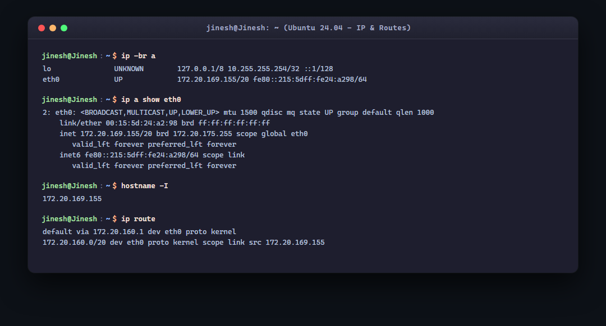
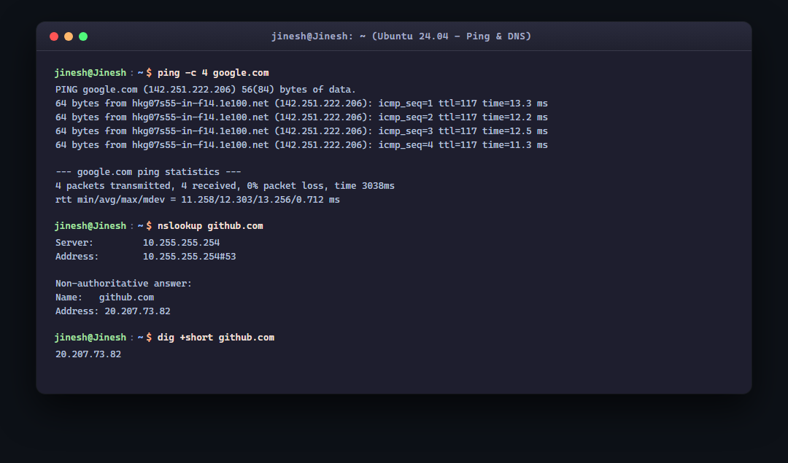
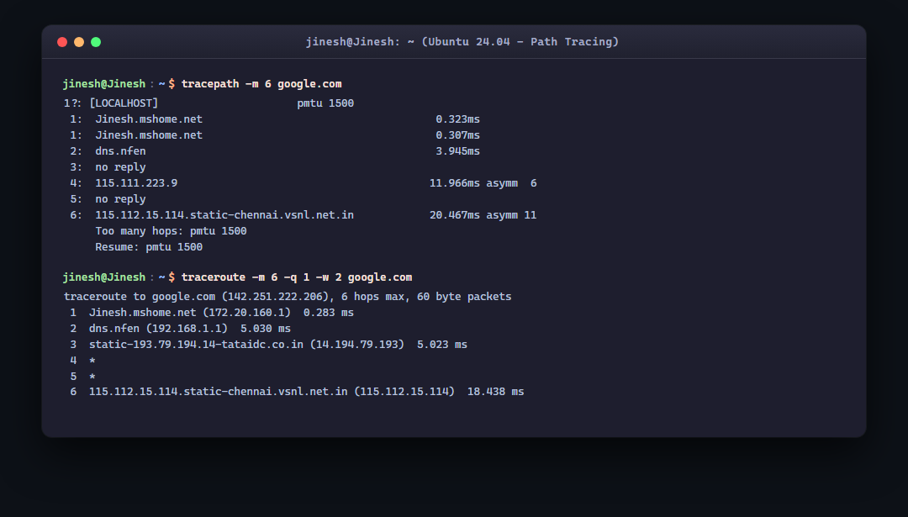
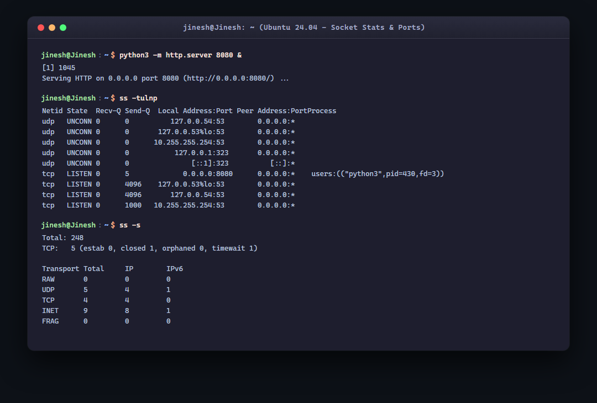
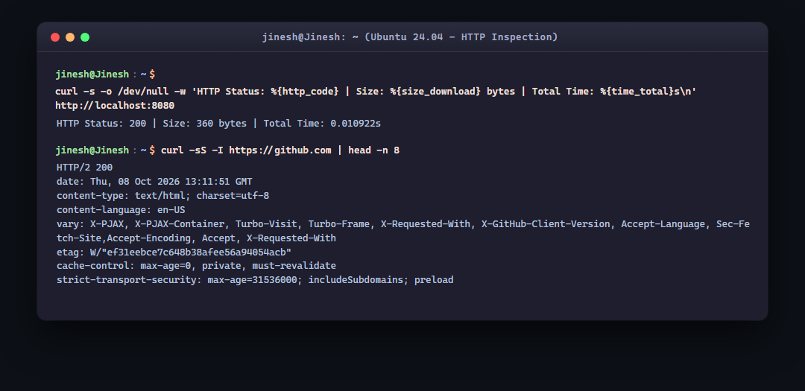
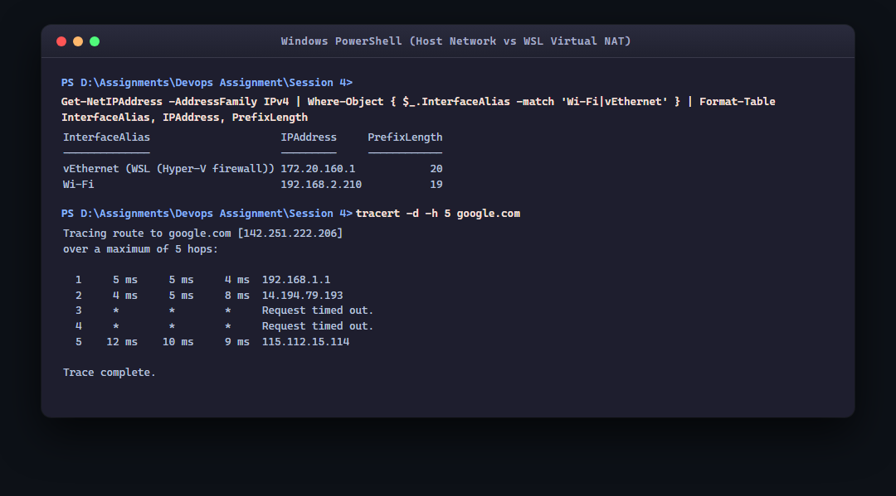

# Session 4: Linux & DevOps Networking Fundamentals

- **Author:** Jinesh Gandhi
- **Operating Environment:** Ubuntu 24.04 LTS (WSL2 Linux Kernel 5.15) & Windows 11 Host
- **Repository Reference:** DevOps Hero (`session4-networking`, `Nency-Ravaliya/Networking`)
- **Status:** Completed

---

## Overview

In DevOps, networking forms the bedrock of application delivery, container communication, microservices orchestration, and infrastructure security. This assignment focuses on hands-on execution and analysis of fundamental networking commands on the local terminal environment. 

The commands were executed within **Ubuntu 24.04 LTS on WSL2** and contrasted against the **Windows 11 host** network stack, uncovering how virtual network interfaces, NAT gateways, subnet masks, DNS resolvers, and sockets function in real-world environments.

---

## Task 1 & 2: Execution, Screenshots & Command Analysis

### 1. `ip a` / `ip -br a` - Network Interfaces and Addresses



#### Terminal Output
```text
jinesh@Jinesh:~$ ip -br a
lo               UNKNOWN        127.0.0.1/8 10.255.255.254/32 ::1/128 
eth0             UP             172.20.169.155/20 fe80::215:5dff:fe24:a298/64 

jinesh@Jinesh:~$ ip a show eth0
2: eth0: <BROADCAST,MULTICAST,UP,LOWER_UP> mtu 1500 qdisc mq state UP group default qlen 1000
    link/ether 00:15:5d:24:a2:98 brd ff:ff:ff:ff:ff:ff
    inet 172.20.169.155/20 brd 172.20.175.255 scope global eth0
       valid_lft forever preferred_lft forever
    inet6 fe80::215:5dff:fe24:a298/64 scope link 
       valid_lft forever preferred_lft forever
```

#### What I Understood About This Command
- `ip a` (from the modern `iproute2` suite, replacing legacy `ifconfig`) enumerates all network interfaces and their Layer 2/3 parameters.
- `-br` provides a clean, brief tabular view showing the interface name, link operational state (`UP`/`DOWN`), and assigned IPv4/IPv6 addresses.
- **`lo` (Loopback):** Assigned `127.0.0.1/8`. Packets sent here never leave the host kernel, bypassing physical network hardware.
- **`eth0`:** Assigned IPv4 `172.20.169.155/20`.
  - **MAC Address:** `00:15:5d:24:a2:98`. Notice the `00:15:5D` IEEE OUI prefix; this identifies a Microsoft Hyper-V virtual network adapter.
  - **MTU (Maximum Transmission Unit):** Set to `1500` bytes, standard for Ethernet frames.
  - **`brd 172.20.175.255`:** The directed broadcast address calculated automatically by the kernel for this `/20` subnet.

---

### 2. `hostname -I` - Rapid Host IP Extraction

#### Terminal Output
```text
jinesh@Jinesh:~$ hostname -I
172.20.169.155
```

#### What I Understood About This Command
- `hostname -I` outputs only the assigned host network IP addresses without headers, interfaces, or metadata.
- **DevOps Use Case:** This is the ideal command inside bash scripts, CI/CD provisioning pipelines, or cloud bootstrap scripts (`cloud-init`) where you need to register the server's private IP dynamically (e.g., `HOST_IP=$(hostname -I | awk '{print $1}')`).
- *Note:* Capital `-I` displays all network interface addresses, whereas lowercase `-i` resolves the system hostname through `/etc/hosts` and might return `127.0.1.1`.

---

### 3. `ip route` - Kernel Routing Table Inspection

#### Terminal Output
```text
jinesh@Jinesh:~$ ip route
default via 172.20.160.1 dev eth0 proto kernel 
172.20.160.0/20 dev eth0 proto kernel scope link src 172.20.169.155
```

#### What I Understood About This Command
The routing table instructs the Linux kernel where to send outgoing network frames using longest-prefix match:
1. **Local Subnet Route (`172.20.160.0/20 dev eth0 scope link`):** Any destination IP within the range `172.20.160.1` – `172.20.175.254` is directly on the same local layer 2 segment (link-local). The kernel delivers packets directly via ARP without an intermediary router.
2. **Default Gateway Route (`default via 172.20.160.1 dev eth0`):** Any destination outside the `/20` subnet is forwarded to `172.20.160.1` (the Hyper-V virtual switch NAT gateway on the Windows host).

---

### 4. `ping -c 4 google.com` - Reachability & Latency



#### Terminal Output
```text
jinesh@Jinesh:~$ ping -c 4 google.com
PING google.com (142.251.222.206) 56(84) bytes of data.
64 bytes from hkg07s55-in-f14.1e100.net (142.251.222.206): icmp_seq=1 ttl=117 time=13.3 ms
64 bytes from hkg07s55-in-f14.1e100.net (142.251.222.206): icmp_seq=2 ttl=117 time=12.2 ms
64 bytes from hkg07s55-in-f14.1e100.net (142.251.222.206): icmp_seq=3 ttl=117 time=12.5 ms
64 bytes from hkg07s55-in-f14.1e100.net (142.251.222.206): icmp_seq=4 ttl=117 time=11.3 ms

--- google.com ping statistics ---
4 packets transmitted, 4 received, 0% packet loss, time 3038ms
rtt min/avg/max/mdev = 11.258/12.303/13.256/0.712 ms
```

#### What I Understood About This Command
- `ping` sends ICMP Echo Request packets and listens for ICMP Echo Reply packets.
- **`0% packet loss`:** Validates full Layer 3 bidirectionality between the local environment and the target.
- **RTT (Round Trip Time):** `avg = 12.3 ms` with very low jitter (`mdev = 0.712 ms`), indicating a stable, healthy network path.
- **TTL (Time to Live) Analysis:** Replies returned with `ttl=117`. Google edge servers typically initiate replies with an initial TTL of 128. Since each intermediate router decrements TTL by 1, `128 - 117 = 11 hops` were traversed to reach our system.
- `1e100.net` is Google's infrastructure PTR domain (named after a googol, 10¹⁰⁰).

---

### 5. `nslookup github.com` & `dig` - DNS Name Resolution

#### Terminal Output
```text
jinesh@Jinesh:~$ nslookup github.com
Server:		10.255.255.254
Address:	10.255.255.254#53

Non-authoritative answer:
Name:	github.com
Address: 20.207.73.82

jinesh@Jinesh:~$ dig +short github.com
20.207.73.82
```

#### What I Understood About This Command
- `nslookup` and `dig` query DNS servers over UDP/TCP port 53 to map human-readable domain names to IP addresses.
- **`Server: 10.255.255.254#53`:** Identifies the local recursive DNS resolver provided by WSL's automated DNS proxy forwarding queries to Windows.
- **Non-authoritative answer:** The resolver fetched the record from cache or recursed upstream to top-level domains rather than owning the `github.com` DNS zone directly.
- **`20.207.73.82`:** Resolves to Microsoft Azure India South datacenter IP space. Because GitHub uses GeoDNS / Anycast, traffic resolves to the closest regional edge proxy.

---

### 6. `tracepath` & `traceroute` - Path Discovery & Hop Analysis



#### Terminal Output
```text
jinesh@Jinesh:~$ tracepath -m 6 google.com
 1?: [LOCALHOST]                      pmtu 1500
 1:  Jinesh.mshome.net                                     0.323ms 
 1:  Jinesh.mshome.net                                     0.307ms 
 2:  dns.nfen                                              3.945ms 
 3:  no reply
 4:  115.111.223.9                                        11.966ms asymm  6 
 5:  no reply
 6:  115.112.15.114.static-chennai.vsnl.net.in            20.467ms asymm 11 
     Too many hops: pmtu 1500
     Resume: pmtu 1500 

jinesh@Jinesh:~$ traceroute -m 6 -q 1 -w 2 google.com
traceroute to google.com (142.251.222.206), 6 hops max, 60 byte packets
 1  Jinesh.mshome.net (172.20.160.1)  0.283 ms
 2  dns.nfen (192.168.1.1)  5.030 ms
 3  static-193.79.194.14-tataidc.co.in (14.194.79.193)  5.023 ms
 4  *
 5  *
 6  115.112.15.114.static-chennai.vsnl.net.in (115.112.15.114)  18.438 ms
```

#### What I Understood About This Command
- `traceroute` and `tracepath` identify the intermediate routers along the packet path by sending packets with incremental TTL values (TTL=1, TTL=2, etc.) and capturing the returned `ICMP Time-to-Live Exceeded` messages.
- **Hop Breakdown:**
  - **Hop 1 (`172.20.160.1` / `Jinesh.mshome.net` in 0.28 ms):** The virtual NAT gateway on Windows host.
  - **Hop 2 (`192.168.1.1` in 5.0 ms):** The local physical Wi-Fi router.
  - **Hop 3 (`14.194.79.193` in 5.0 ms):** The ISP's edge gateway (Tata Communications / broadband provider).
  - **Hops 4-5 (`*` / `no reply`):** Normal behavior where backbone routers drop or rate-limit ICMP TTL-exceeded messages for security and CPU protection.
  - **Hop 6 (`115.112.15.114` in 18.4 ms):** VSNL / Tata Communications transit core POP in Chennai routing directly towards Google's network edge.

---

### 7. `ss -tulnp` & `ss -s` - Socket Statistics & Port Monitoring



#### Terminal Output
```text
jinesh@Jinesh:~$ python3 -m http.server 8080 &
[1] 1045
Serving HTTP on 0.0.0.0 port 8080 (http://0.0.0.0:8080/) ...

jinesh@Jinesh:~$ ss -tulnp
Netid State  Recv-Q Send-Q  Local Address:Port Peer Address:PortProcess
udp   UNCONN 0      0          127.0.0.54:53        0.0.0.0:*          
udp   UNCONN 0      0       127.0.0.53%lo:53        0.0.0.0:*          
udp   UNCONN 0      0      10.255.255.254:53        0.0.0.0:*          
udp   UNCONN 0      0           127.0.0.1:323       0.0.0.0:*          
udp   UNCONN 0      0               [::1]:323          [::]:*          
tcp   LISTEN 0      5             0.0.0.0:8080      0.0.0.0:*    users:(("python3",pid=430,fd=3))
tcp   LISTEN 0      4096    127.0.0.53%lo:53        0.0.0.0:*          
tcp   LISTEN 0      4096       127.0.0.54:53        0.0.0.0:*          
tcp   LISTEN 0      1000   10.255.255.254:53        0.0.0.0:*          

jinesh@Jinesh:~$ ss -s
Total: 248
TCP:   5 (estab 0, closed 1, orphaned 0, timewait 1)

Transport Total     IP      IPv6
RAW       0         0       0
UDP       5         4       1
TCP       4         4       0
INET      9         8       1
FRAG      0         0       0
```

#### What I Understood About This Command
- `ss` (Socket Statistics) is the high-performance modern replacement for `netstat`, querying kernel socket data structures directly.
- **Flags Breakdown:**
  - `-t`: Filter for TCP sockets.
  - `-u`: Filter for UDP sockets.
  - `-l`: Show only listening sockets.
  - `-n`: Numeric ports (display `8080` instead of resolving protocol service names).
  - `-p`: Show process ID (`pid=430`) and process name (`python3`).
- **`0.0.0.0:8080` vs `127.0.0.1:8080`:**
  - `0.0.0.0` binds to **all local network interfaces**, allowing external connections from the host or network.
  - If bound to `127.0.0.1`, the service only accepts loopback traffic on that same host—a frequent cause of container connection failures.
- **`Send-Q` on LISTEN Sockets:** Represents the maximum listen backlog queue size (number of pending unaccepted TCP handshakes).

---

### 8. `curl` - HTTP Protocol Inspection & Response Benchmarking



#### Terminal Output
```text
jinesh@Jinesh:~$ curl -s -o /dev/null -w 'HTTP Status: %{http_code} | Size: %{size_download} bytes | Total Time: %{time_total}s\n' http://localhost:8080
HTTP Status: 200 | Size: 360 bytes | Total Time: 0.010922s

jinesh@Jinesh:~$ curl -sS -I https://github.com | head -n 8
HTTP/2 200 
date: Thu, 08 Oct 2026 13:11:51 GMT
content-type: text/html; charset=utf-8
content-language: en-US
vary: X-PJAX, X-PJAX-Container, Turbo-Visit, Turbo-Frame, X-Requested-With, X-GitHub-Client-Version, Accept-Language, Sec-Fetch-Site,Accept-Encoding, Accept, X-Requested-With
etag: W/"ef31eebce7c648b38afee56a94054acb"
cache-control: max-age=0, private, must-revalidate
strict-transport-security: max-age=31536000; includeSubdomains; preload
```

#### What I Understood About This Command
- `curl` transfers data across protocols (HTTP, HTTPS, FTP, etc.) and is essential for health checks, API debugging, and performance profiling.
- **`-I` (HEAD Request):** Retrieves only HTTP response headers without downloading the payload body, saving bandwidth during availability checks.
- **`HTTP/2 200`:** Confirms HTTP/2 multiplexing negotiated over TLS via ALPN (Application-Layer Protocol Negotiation).
- **Format String (`-w`):** Measures total transaction time (`time_total = 0.01s`), confirming microsecond response latency for local loopback requests.

---

### 9. Host vs Virtual Network Stack Comparison



#### Terminal Output
```text
PS D:\Assignments\Devops Assignment\Session 4> Get-NetIPAddress -AddressFamily IPv4 | Where-Object { $_.InterfaceAlias -match 'Wi-Fi|vEthernet' } | Format-Table InterfaceAlias, IPAddress, PrefixLength

InterfaceAlias                         IPAddress      PrefixLength
--------------                         ---------      ------------
vEthernet (WSL (Hyper-V firewall))     172.20.160.1             20
Wi-Fi                                  192.168.2.210            19

PS D:\Assignments\Devops Assignment\Session 4> tracert -d -h 5 google.com
Tracing route to google.com [142.251.222.206]
over a maximum of 5 hops:

  1     5 ms     5 ms     4 ms  192.168.1.1
  2     4 ms     5 ms     8 ms  14.194.79.193
  3     *        *        *     Request timed out.
  4     *        *        *     Request timed out.
  5    12 ms    10 ms     9 ms  115.112.15.114

Trace complete.
```

#### What I Understood About This Architecture
Comparing the Windows host and WSL Linux outputs demonstrates how hypervisor-based virtualization constructs private networks:

| Parameter | WSL2 Linux Guest (`eth0`) | Windows 11 Host (`Wi-Fi`) | Windows Virtual Switch (`vEthernet`) |
| :--- | :--- | :--- | :--- |
| **IP Address** | `172.20.169.155` | `192.168.2.210` | `172.20.160.1` |
| **Subnet Prefix** | `/20` (255.255.240.0) | `/19` (255.255.224.0) | `/20` (255.255.240.0) |
| **Gateway** | `172.20.160.1` (Virtual Switch) | `192.168.1.1` (Physical Wi-Fi Router) | N/A (acts as the Gateway) |
| **Interface Role** | Virtual Container/VM NIC | Physical Wireless NIC | Internal Virtual NAT Bridge |
| **Traceroute Hop 1** | `172.20.160.1` (Windows NAT) | `192.168.1.1` (Wi-Fi Router) | Local translation layer |

---

## Subnetting & IP Addressing Concepts (DevOps Hero Reference)

### 1. IPv4 Address Classes & RFC 1918 Private Ranges

| Class | First Octet Range | Default Subnet Mask | RFC 1918 Private Range | Purpose / Use Case |
| :---: | :---: | :---: | :---: | :--- |
| **A** | `1` – `127` | `255.0.0.0` (`/8`) | `10.0.0.0/8` (`10.0.0.0` - `10.255.255.255`) | Huge enterprise & cloud VPC networks |
| **B** | `128` – `191` | `255.255.0.0` (`/16`) | `172.16.0.0/12` (`172.16.0.0` - `172.31.255.255`) | Medium networks, Docker bridge, WSL NAT |
| **C** | `192` – `223` | `255.255.255.0` (`/24`) | `192.168.0.0/16` (`192.168.0.0` - `192.168.255.255`) | Home Wi-Fi, small office networks |
| **D** | `224` – `239` | N/A | Multicast addresses | Routing protocols, multicast streaming |

### 2. Practical Subnet Arithmetic: Local WSL Interface (`172.20.169.155/20`)

Using the formulas covered in the course notes:
- **Prefix:** `/20`
- **Subnet Mask:** `255.255.240.0` (`11111111.11111111.11110000.00000000`)
- **Network Bits:** $20$
- **Host Bits:** $32 - 20 = 12$
- **Total Addresses:** $2^{12} = 4,096$
- **Usable Hosts:** $2^{12} - 2 = 4,094$ (subtracting network and broadcast addresses)
- **Network Address:** `172.20.160.0`
- **Broadcast Address:** `172.20.175.255` (matches the `brd 172.20.175.255` output in `ip a show eth0`)
- **Usable Host Range:** `172.20.160.1` to `172.20.175.254`

---

## Command Quick-Reference Cheat Sheet

| Command | Question It Answers | Key Flags & Options |
| :--- | :--- | :--- |
| `ip a` / `ip -br a` | What network interfaces exist and what IPs do they hold? | `-br` (brief single-line output) |
| `hostname -I` | What are the IP addresses of this machine (script-ready)? | `-I` (all addresses) |
| `ip route` | Which path and gateway will packets take to reach destination $X$? | `ip route show`, `ip route get <IP>` |
| `ping <host>` | Is the remote host reachable, what is the latency and packet loss? | `-c <count>` (limit count), `-i <interval>` |
| `nslookup <host>` | What IP address does this domain resolve to? | `nslookup <domain> <custom_dns_ip>` |
| `dig <host>` | Detailed DNS records (A, CNAME, MX, NS) with timing? | `+short` (minimal answer) |
| `tracepath <host>` | What hops are along the path and what is the path MTU? | `-m <max_hops>` |
| `traceroute <host>` | What is the hop-by-hop router path and latency per hop? | `-n` (numeric IPs), `-q 1` (queries per hop) |
| `ss -tulnp` | What TCP/UDP ports are listening and which process owns them? | `-t` (TCP), `-u` (UDP), `-l` (listen), `-n` (numeric), `-p` (process) |
| `curl -I <url>` | Does the web service speak HTTP and what headers are returned? | `-I` (HEAD headers), `-s` (silent), `-w` (custom timing format) |

---

## Key Learnings & Practical Troubleshooting Rules

1. **TTL is an Instant Hop Counter:** Examining `ttl` in `ping` output reveals how many Layer 3 routing devices decremented the packet, flagging NAT and firewalls before running a traceroute.
2. **`0.0.0.0` vs `127.0.0.1` Binding:** If an application service is running but cannot be reached remotely or from the host, checking `ss -tulnp` is the first diagnostic step. If bound to `127.0.0.1`, it refuses all non-loopback connections.
3. **DNS is Context-Sensitive:** A domain like `github.com` resolves differently based on geography and DNS servers due to GeoDNS Anycast routing.
4. **Intermediate Traceroute Timeouts (`*`) are Normal:** Intermediate routers frequently drop ICMP time-exceeded messages by policy; as long as subsequent hops or the target responds, the path is healthy.
5. **Virtual Network Isolation:** Container engines (Docker) and VM environments (WSL2) generate private subnets via virtual switches (Hyper-V/veth), routing to physical internet adapters through host Network Address Translation (NAT).
