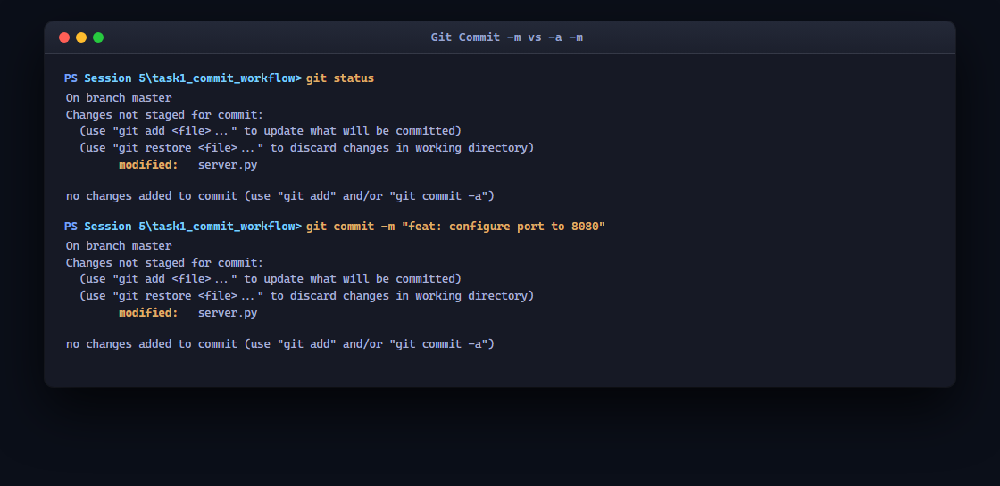
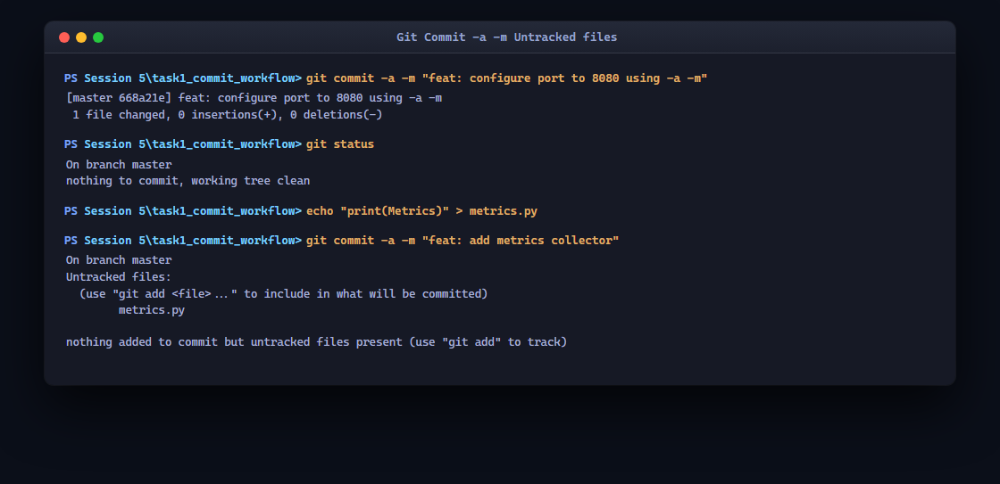
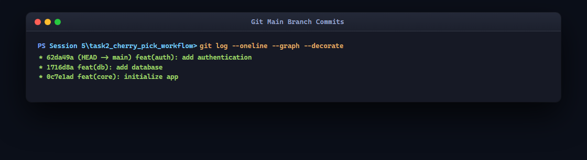
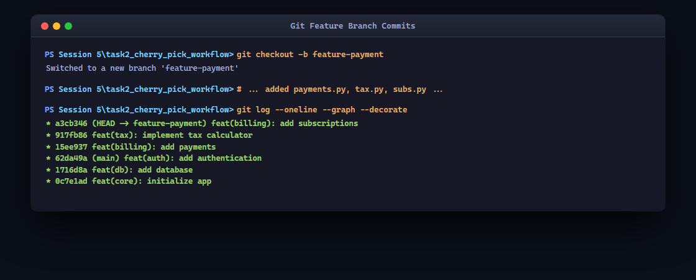
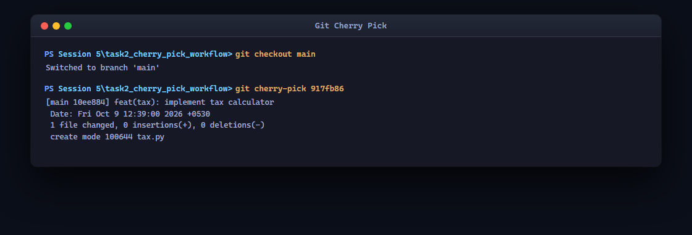
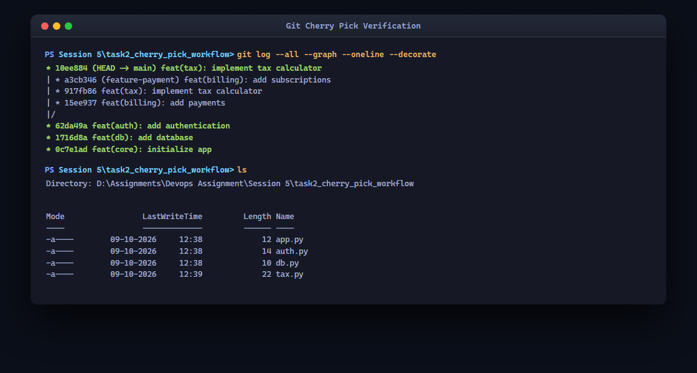

# DevOps Session 5: Git Homework Tasks

**Author:** Jinesh Gandhi  
**Topic:** Git Commit Workflows and Cherry-Picking  
**Date:** October 2026  

This documentation details the execution and observation of two fundamental Git concepts: understanding the behavior of the `-a` (all) flag during commits, and migrating specific commits across branches using `git cherry-pick`. 

The commands were executed locally, and authentic high-resolution terminal outputs were captured for analysis.

---

## Task 1: `git commit -a -m` vs `git commit -m`

The goal of this task is to understand how the Git staging area behaves with and without the `-a` flag, specifically focusing on tracked vs. untracked files.

### 1. The Staging Area and Modified Tracked Files
In a typical Git workflow, modifying a tracked file requires you to stage it using `git add` before it can be committed. Attempting to use `git commit -m` directly on modified tracked files will fail because the staging area is empty. 

#### Terminal Output Analysis
- **Attempt 1 (`git commit -m`)**: Git rejected the commit, clearly stating: `Changes not staged for commit: ... no changes added to commit (use "git add" to commit)`.
- **Attempt 2 (`git commit -a -m`)**: The commit was successful. The `-a` (or `--all`) flag automatically stages files that have been modified or deleted and commits them in a single step, bypassing the manual `git add`.

### 2. Behavior with Untracked (New) Files
A critical distinction in Git is how the `-a` flag handles brand new files (untracked files).

#### Terminal Output Analysis
- After creating a new file (`metrics.py`), we ran `git commit -a -m "feat: add metrics collector"`.
- **Result:** Git rejected the commit, stating: `nothing added to commit but untracked files present`. 
- **Why?** The `-a` flag ONLY applies to files that Git is already tracking. Git intentionally ignores untracked files with the `-a` flag to prevent you from accidentally committing build artifacts, `.env` files, or temporary scratch pads. Untracked files *must* be explicitly staged with `git add` the very first time.

---

## Task 2: Git Cherry-Pick Workflow

The `git cherry-pick` command allows you to extract the changes introduced by a specific commit from one branch and apply them to the currently checked-out branch. This is extremely useful for hotfixing production bugs or selectively extracting features without merging entire branches.

### 1. Main Branch Setup
We initialized a new repository, set the default branch to `main`, and created three foundational commits to establish our project history.

**Commits on `main`:**
1. `feat(core): initialize app`
2. `feat(db): add database`
3. `feat(auth): add authentication`

### 2. Feature Branch Creation and Commits
We created and switched to a new branch called `feature-payment`. On this branch, we introduced three new features. Our goal is to extract only the **Tax Calculator** feature and bring it into `main`, while leaving the rest of the payment features isolated.

**Commits on `feature-payment`:**
1. `feat(billing): add payments`
2. `feat(tax): implement tax calculator` (**Target for Cherry-Pick**)
3. `feat(billing): add subscriptions`

Using `git log -1 --format="%h"`, we captured the specific SHA-1 hash for the Tax Calculator commit.

### 3. Executing the Cherry-Pick
To perform the cherry-pick, we first switched back to the `main` branch. Then, we used the captured commit hash and executed the cherry-pick command.

Git successfully took the patch (diff) from the tax calculator commit and applied it on top of the `main` branch. 

### 4. Verification and DAG Analysis
Finally, we analyzed the commit history graph and the file system to verify the operation.

#### Key Observations:
- **File System:** A standard `ls` confirms that `tax.py` was successfully brought into the `main` branch, while `payments.py` and `subs.py` remain isolated on the feature branch.
- **Commit Hash:** When a commit is cherry-picked, Git creates a **brand new commit** on the target branch. The new commit contains the identical file changes and commit message, but it has a completely different SHA hash. This happens because a commit's hash is cryptographically tied to its parent commit, and the cherry-picked commit now has a different parent (`main`'s tip) than the original commit on the feature branch.
