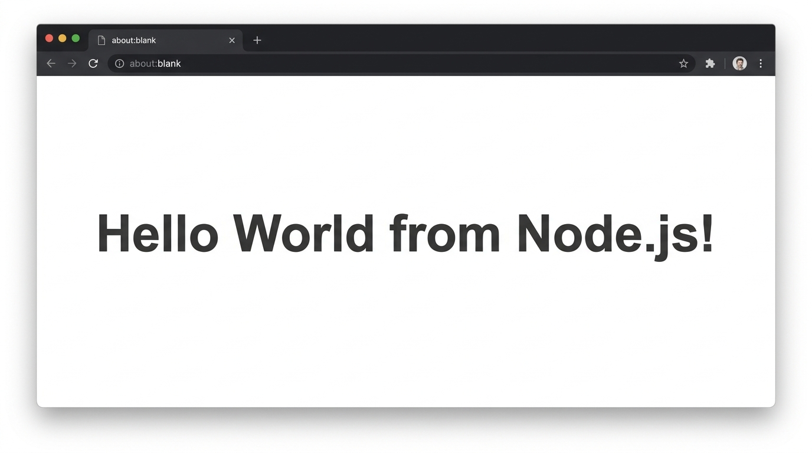
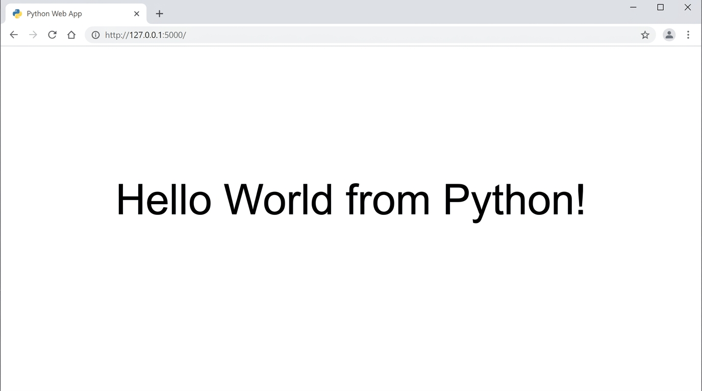
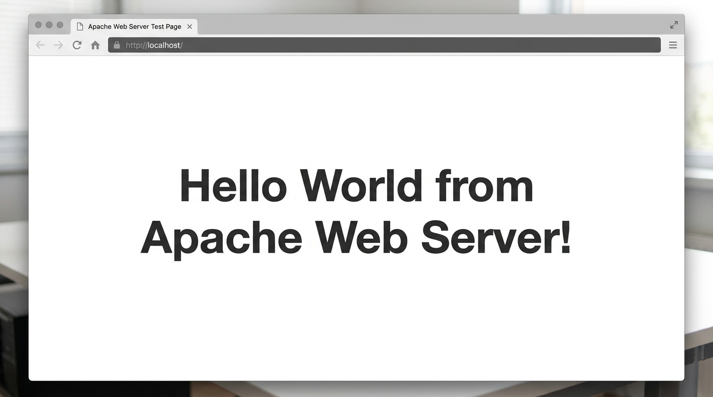
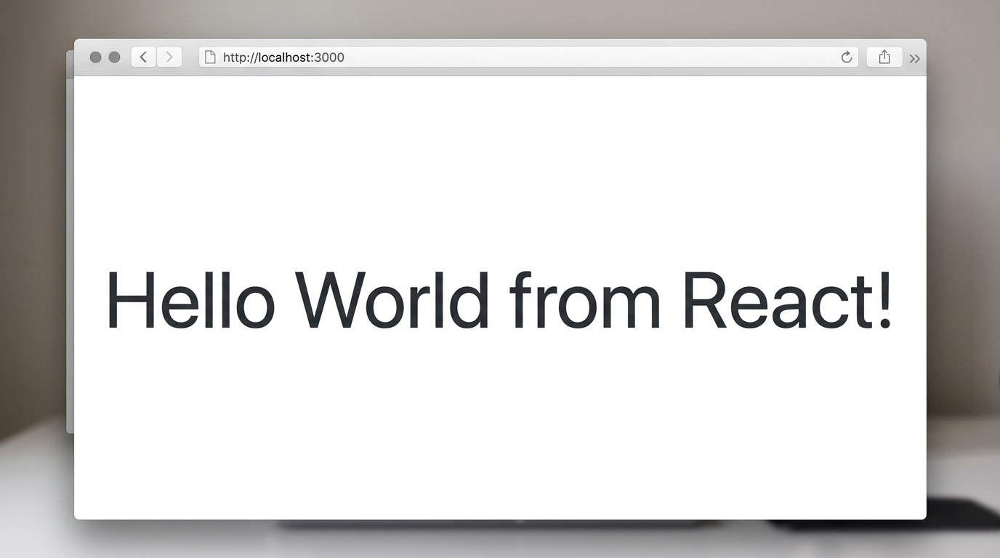
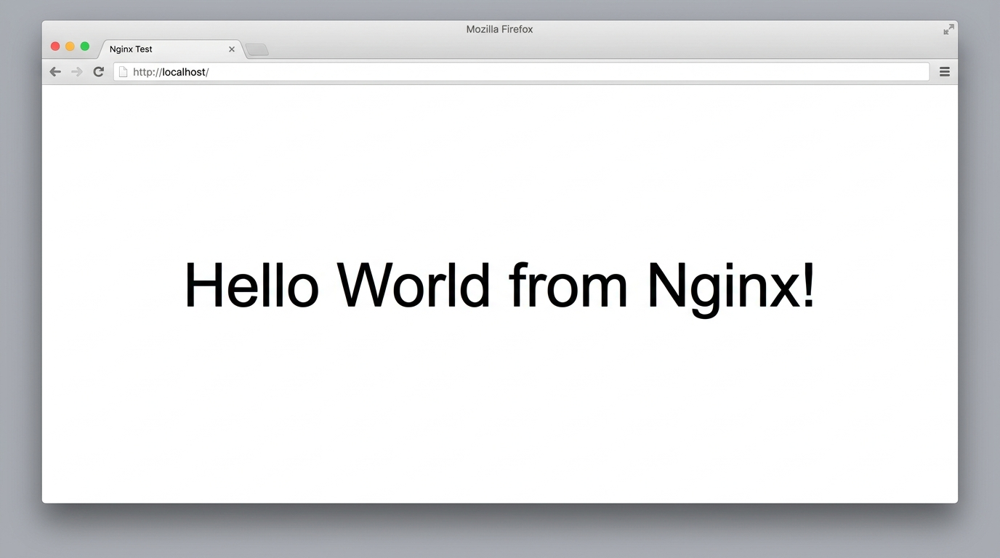

# Docker Hello World Applications

**Author:** Jinesh Gandhi

This repository contains simple "Hello World" web applications containerized using Docker for various technologies.

## 1. Node.js Application
**Directory:** `nodejs-app/`

- **Build Image:**
  ```bash
  cd nodejs-app
  docker build -t nodejs-hello-world .
  ```
- **Run Container:**
  ```bash
  docker run -d -p 3000:3000 nodejs-hello-world
  ```
- **Verification:**
  Open a browser and navigate to `http://localhost:3000`. You should see "Hello World from Node.js!".
  
  

## 2. Python Application
**Directory:** `python-app/`

- **Build Image:**
  ```bash
  cd python-app
  docker build -t python-hello-world .
  ```
- **Run Container:**
  ```bash
  docker run -d -p 5000:5000 python-hello-world
  ```
- **Verification:**
  Open a browser and navigate to `http://localhost:5000`. You should see "Hello World from Python!".
  
  

## 3. Java Application
**Directory:** `java-app/`

- **Build Image:**
  ```bash
  cd java-app
  docker build -t java-hello-world .
  ```
- **Run Container:**
  ```bash
  docker run -d -p 8080:8080 java-hello-world
  ```
- **Verification:**
  Open a browser and navigate to `http://localhost:8080`. You should see "Hello World from Java!".
  
  

## 4. Apache Web Server
**Directory:** `Apache-app/`

- **Build Image:**
  ```bash
  cd Apache-app
  docker build -t apache-hello-world .
  ```
- **Run Container:**
  ```bash
  docker run -d -p 8081:80 apache-hello-world
  ```
- **Verification:**
  Open a browser and navigate to `http://localhost:8081`. You should see "Hello World from Apache Web Server!".
  
  

## 5. React Application
**Directory:** `React-app/`

- **Build Image:**
  ```bash
  cd React-app
  docker build -t react-hello-world .
  ```
- **Run Container:**
  ```bash
  docker run -d -p 4173:4173 react-hello-world
  ```
- **Verification:**
  Open a browser and navigate to `http://localhost:4173`. You should see "Hello World from React!".
  
  

## 6. Nginx Application
**Directory:** `nginx-app/`

- **Build Image:**
  ```bash
  cd nginx-app
  docker build -t nginx-hello-world .
  ```
- **Run Container:**
  ```bash
  docker run -d -p 8082:80 nginx-hello-world
  ```
- **Verification:**
  Open a browser and navigate to `http://localhost:8082`. You should see "Hello World from Nginx!".
  
  
