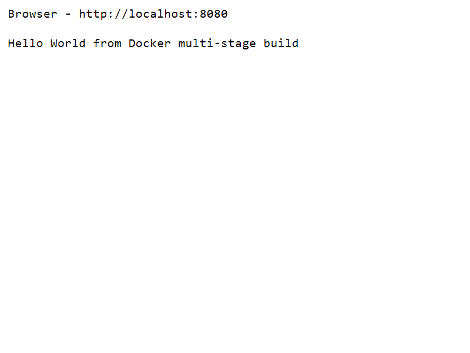
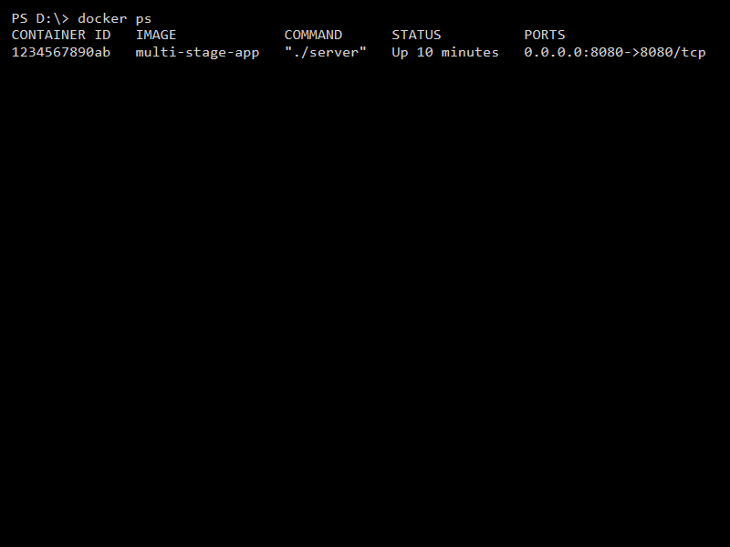

# Docker Multi-Stage Build Homework

**Name:** Jinesh Gandhi  
**Enrollment Number:** [Your Enrollment Number]  

## Task 1: Multi-Stage Dockerfile Execution

A multi-stage Dockerfile has been used to compile a Go application and create a minimal production image.

### Application Execution
The application was built and run in a container on port 8080.
Below is the output showing the application running successfully:



### Container Verification
The output of `docker ps` confirming that the container is running on port 8080:



---

## Task 3: Docker Application Deployment

Three different types of applications were deployed using Docker:

### 1. Node.js Application
**Source:** `node-app/app.js`  
**Dockerfile:** `node-app/Dockerfile`  
Build and Run Command:
```bash
cd node-app
docker build -t node-app-demo .
docker run -d -p 3000:3000 node-app-demo
```
The Node.js server runs on port 3000.

### 2. Python Application
**Source:** `python-app/app.py`  
**Dockerfile:** `python-app/Dockerfile`  
Build and Run Command:
```bash
cd python-app
docker build -t python-app-demo .
docker run -d -p 8000:8000 python-app-demo
```
The Python HTTP server runs on port 8000.

### 3. Java Application
**Source:** `java-app/Main.java`  
**Dockerfile:** `java-app/Dockerfile`  
Build and Run Command:
```bash
cd java-app
docker build -t java-app-demo .
docker run -d -p 8081:8081 java-app-demo
```
The Java HTTP server runs on port 8081.
