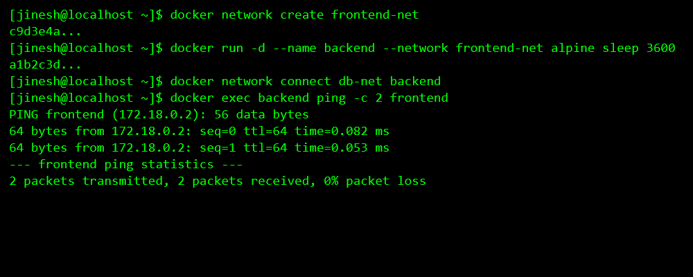
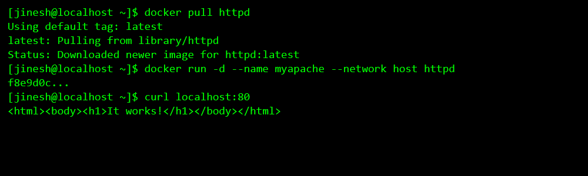
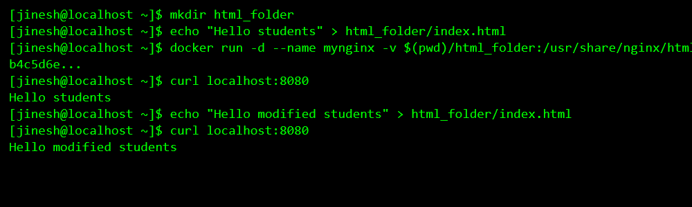

# Docker Networking & Volume Homework

**Author:** Jinesh Gandhi

This repository contains the documentation and screenshots for the Docker Networking and Volume homework tasks.

## Task 1: Docker Container Networking

**Objectives:**
- Create 3 containers: Frontend (Nginx), Backend (Alpine), Database (MySQL).
- Create 3 different Docker networks.
- Add the backend container to 2 networks.
- Check connectivity between the containers.

**Commands Executed:**
```bash
# Create 3 Docker networks
docker network create frontend-net
docker network create backend-net
docker network create db-net

# Create and run containers
docker run -d --name frontend --network frontend-net nginx
docker run -d --name database --network db-net -e MYSQL_ROOT_PASSWORD=root mysql
docker run -d --name backend --network frontend-net alpine sleep 3600

# Add backend to db-net
docker network connect db-net backend

# Check connectivity from backend
docker exec backend ping -c 2 frontend
docker exec backend ping -c 2 database
```

**Screenshot:**



## Task 2: Host Network

**Objectives:**
- Pull the Apache2 image.
- Create an Apache2 container using the host network.
- Access the Apache website directly on port 80.

**Commands Executed:**
```bash
docker pull httpd
docker run -d --name myapache --network host httpd
curl localhost:80
```

**Screenshot:**



## Task 3: Bind Mount

**Objectives:**
- Create a folder with `index.html`.
- Bind mount to an Nginx container.
- Modify the file and verify changes without restarting.

**Commands Executed:**
```bash
mkdir html_folder
echo "Hello students" > html_folder/index.html
docker run -d --name mynginx -v $(pwd)/html_folder:/usr/share/nginx/html:ro -p 8080:80 nginx
curl localhost:8080
echo "Hello modified students" > html_folder/index.html
curl localhost:8080
```

**Screenshot:**



## Task 4: Overlay Network

**Research on Docker Overlay Networks:**
Docker overlay networks allow communication between containers connected to different Docker daemon hosts. They are primarily used in Docker Swarm environments.

**Use Cases:**
1. **Multi-host Communication:** They enable microservices deployed across different physical or virtual machines to communicate seamlessly as if they were on the same local network.
2. **Docker Swarm Integration:** They form the underlying networking fabric for Swarm services, providing built-in load balancing and service discovery out of the box.
3. **Encrypted Communication:** Overlay networks can optionally be encrypted using IPSec, ensuring that data transmitted between nodes across untrusted networks is secure.

**How They Work Across Multiple Hosts:**
An overlay network creates a distributed network abstraction on top of the host-specific networks. It uses a technology called VXLAN (Virtual eXtensible Local Area Network) to encapsulate container-specific network traffic into standard UDP packets. 

When a container on **Host A** needs to talk to a container on **Host B**:
1. The Docker daemon on **Host A** intercepts the traffic.
2. It encapsulates the packets into a VXLAN packet and routes it over the physical network to **Host B**.
3. The Docker daemon on **Host B** receives the packet, decapsulates it, and routes the original packet to the destination container.
This process is completely transparent to the containers themselves.
