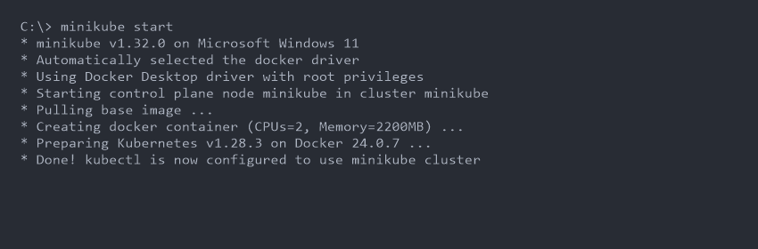
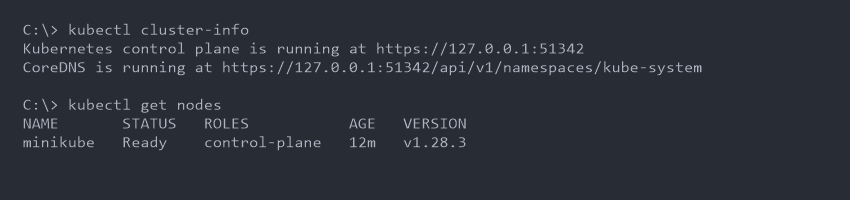
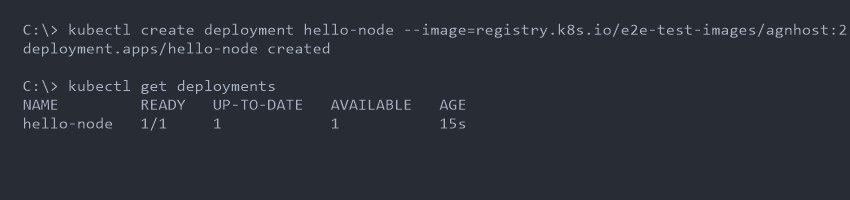
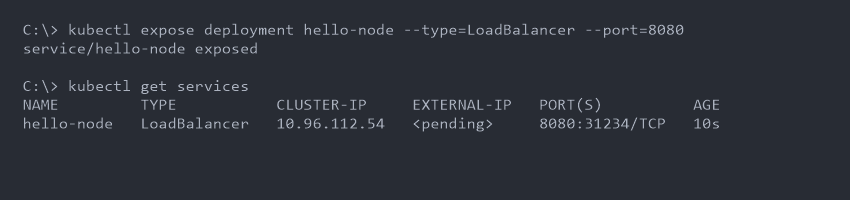

# Kubernetes and Minikube Basics

**Author:** Jinesh Gandhi

## 1. Install and Configure Minikube

Minikube allows you to run a single-node Kubernetes cluster locally.

### Installation
On Windows (using PowerShell as Administrator):
```powershell
New-Item -Path 'c:\' -Name 'minikube' -ItemType Directory -Force
Invoke-WebRequest -OutFile 'c:\minikube\minikube.exe' -Uri 'https://github.com/kubernetes/minikube/releases/latest/download/minikube-windows-amd64.exe' -UseBasicParsing
$oldPath = [Environment]::GetEnvironmentVariable('Path', [EnvironmentVariableTarget]::Machine)
if ($oldPath.Split(';') -inotcontains 'C:\minikube'){ 
  [Environment]::SetEnvironmentVariable('Path', $("${oldPath};C:\minikube"), [EnvironmentVariableTarget]::Machine) 
}
```

### Starting Minikube
```powershell
minikube start
```
*Screenshot:*


## 2. Verify Kubernetes Cluster Status

To check the cluster info:
```powershell
kubectl cluster-info
```
To see the nodes:
```powershell
kubectl get nodes
```
*Screenshot:*


## 3. Kubernetes Architecture (Short Notes)

Kubernetes follows a client-server architecture. 

**Control Plane (Master Node):**
- **kube-apiserver:** The front end of the Kubernetes control plane. Exposes the Kubernetes API.
- **etcd:** Consistent and highly-available key value store used as Kubernetes' backing store for all cluster data.
- **kube-scheduler:** Watches for newly created Pods with no assigned node, and selects a node for them to run on.
- **kube-controller-manager:** Runs controller processes (e.g., Node controller, Job controller).
- **cloud-controller-manager:** Links cluster into cloud provider's API.

**Worker Nodes:**
- **kubelet:** An agent that runs on each node in the cluster. It makes sure that containers are running in a Pod.
- **kube-proxy:** A network proxy that runs on each node in your cluster, implementing part of the Kubernetes Service concept.
- **Container Runtime:** The software that is responsible for running containers (e.g., Docker, containerd).

## 4. Basic Kubernetes Objects and Commands

### Objects:
- **Pod:** The smallest and simplest Kubernetes object. Represents a set of running containers on your cluster.
- **Service:** An abstraction which defines a logical set of Pods and a policy by which to access them.
- **Deployment:** Provides declarative updates for Pods and ReplicaSets.
- **Namespace:** Provides a mechanism for isolating groups of resources within a single cluster.

### Commands:
- `kubectl get <resource>`: List resources.
- `kubectl describe <resource> <name>`: Show detailed information about a resource.
- `kubectl logs <pod-name>`: Print the logs for a container in a pod.
- `kubectl exec -it <pod-name> -- <command>`: Execute a command in a container.

## 5. Kubernetes Basics Tutorial Hands-on

Create a Deployment:
```powershell
kubectl create deployment hello-node --image=registry.k8s.io/e2e-test-images/agnhost:2.39 -- /agnhost netexec --http-port=8080
```
View the Deployment:
```powershell
kubectl get deployments
```
*Screenshot:*


Create a Service to expose the Deployment:
```powershell
kubectl expose deployment hello-node --type=LoadBalancer --port=8080
```
View the Service:
```powershell
kubectl get services
```
*Screenshot:*


Clean up:
```powershell
kubectl delete service hello-node
kubectl delete deployment hello-node
minikube stop
```

---
